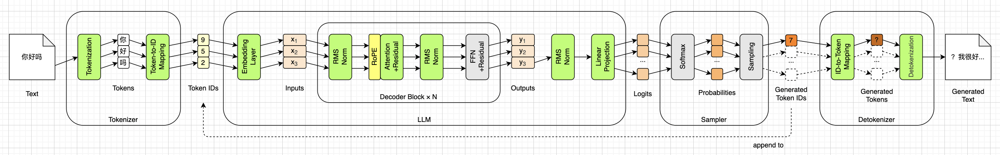
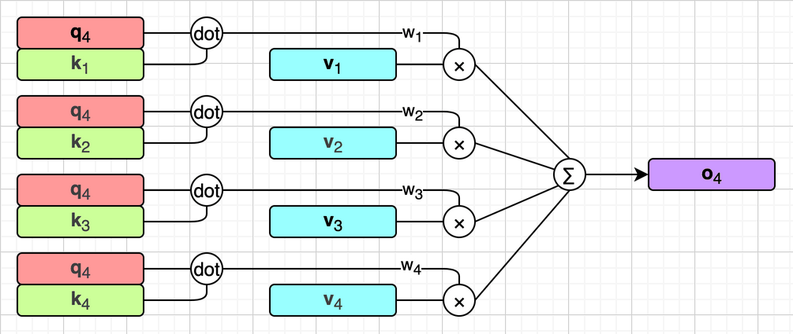
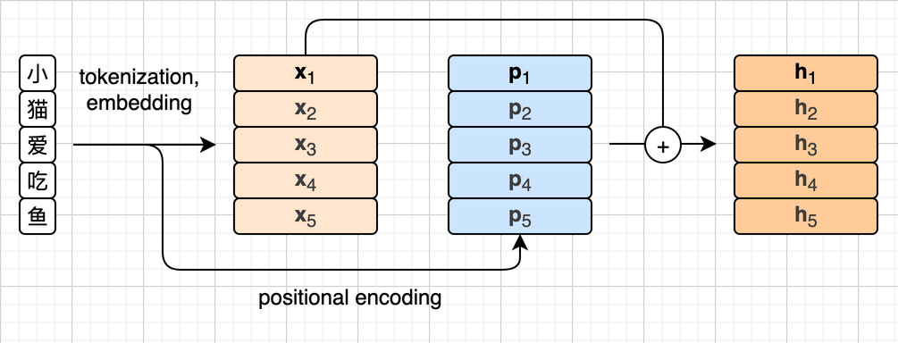
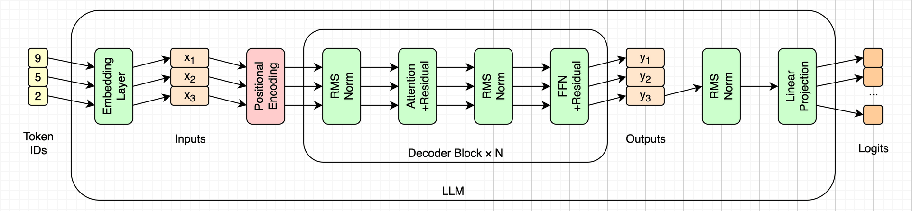
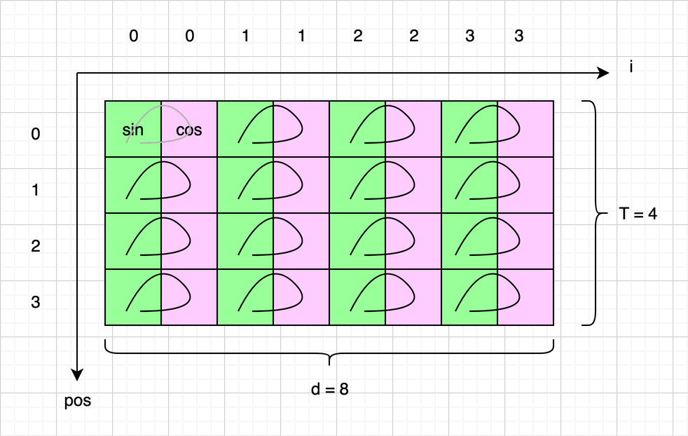
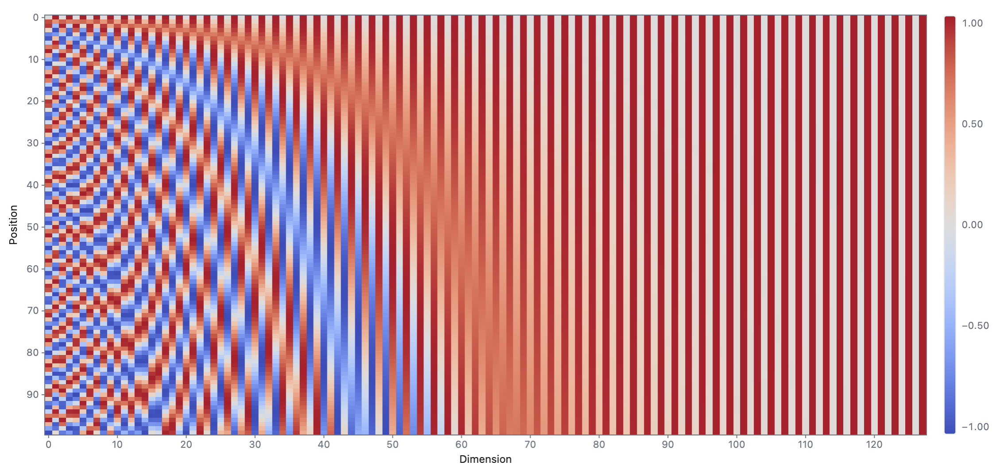
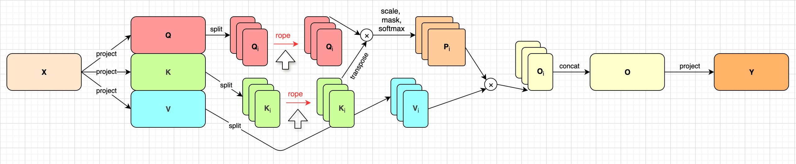
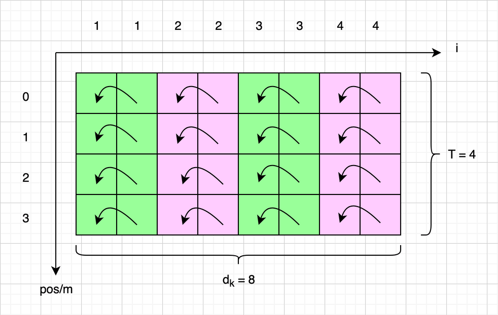
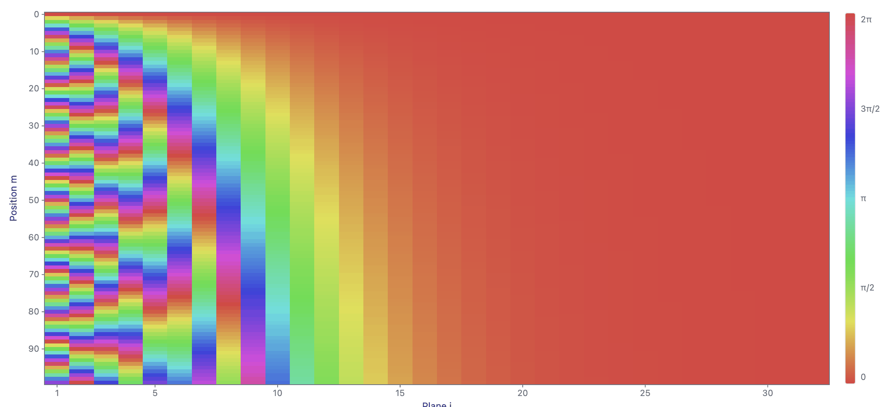

# 位置编码（Positional Encoding）


在第六章，我们实现了注意力机制，它是整个LLM里唯一让词元之间互相看的模块。从那一章起，前面的词元才第一次真正参与了计算。到目前为止，我们已经实现了14个小模块中的10个（不算残差连接），如下图所示：



这一章我们来补上和注意力机制密不可分的位置编码，也就是上图的黄色小模块。第一章说过，RoPE其实并不是一个独立的模块，我们把它单独画在注意力机制的前面，只是为了方便制定路线。这一章我们会看到，它真正的位置在注意力机制的内部。

我会先说说为什么需要位置编码，然后简要介绍2017年论文里的正弦位置编码，重点是它的思路。接着介绍目前主流的旋转位置编码，也就是RoPE，以及SmolLM2在RoPE上的几个具体选择。最后写代码，把RoPE加进注意力机制里，看看效果。这一章会出现一些三角函数和矩阵乘法，用到的公式都是中学学过的，我会在用到的地方再写出来。


## 为什么需要位置编码

上一章末尾说过，注意力机制有一个先天的缺陷：**它分不清词序**。如果说“小猫喜欢吃鱼”和“鱼喜欢吃小猫”在LLM看来一样，那推理结果就要闹笑话了。这一小节我们把这个问题，以及解决办法，都说清楚。先把第六章最后展开的那个式子抄过来：

$$
\mathbf{o}_a = \sum_{b=1}^{a}
\frac{\exp(\mathbf{q}_a \cdot \mathbf{k}_b / \sqrt{d_k})}{\sum_{c=1}^{a} \exp(\mathbf{q}_a \cdot \mathbf{k}_c / \sqrt{d_k})}
\mathbf{v}_b
$$

上一章讲完这个式子，留了一句话：第 $b$ 个词元贡献多少，只看它的 $\mathbf{k}_b$ 和 $\mathbf{v}_b$ ，和它排在第几位没有关系。这一节就从这句话说起。

对于我们要讨论的问题，其实缩放和Softmax并不重要。缩放是每个点积都除以同一个 $\sqrt{d_k}$ ，Softmax分母里的求和也不分先后，它们都不会带进任何和位置有关的东西。去掉这两样也不影响讨论，于是我们可以把前面这个公式简化为下面这样：

$$
\mathbf{o}_a = \sum_{b=1}^{a} (\mathbf{q}_a \cdot \mathbf{k}_b) \mathbf{v}_b
$$

现在式子里只剩下点积和加权求和，看得更清楚了。从头到尾，第 $b$ 个词元只以 $\mathbf{k}_b$ 和 $\mathbf{v}_b$ 的身份出现，下标 $b$ 只是用来区分它们，并不参与计算。而加法又是不分先后的，把这几项换个顺序，加出来还是同一个结果。如果这个公式还不够直观，我们把 $a$ 和 $b$ 换成具体的数，把它画出来：



这里我们取 $a=4$ ，看第4个词元的输出 $\mathbf{o}_4$ 是怎么算出来的。为了画得清楚，我们把 $\mathbf{q}_4$ 复制了四份，每一行配一个 $\mathbf{k}_b$ 。图里的`dot`表示向量点积，算出来的 $w_b$ 就是 $\mathbf{q}_4 \cdot \mathbf{k}_b$ ，也就是第 $b$ 个词元的权重；乘号表示用这个权重去乘 $\mathbf{v}_b$ ；最后 $\sum$ 把四行的结果加起来，就得到了 $\mathbf{o}_4$ 。

注意每一行都是自给自足的：第 $b$ 行只用到 $\mathbf{q}_4$ 、 $\mathbf{k}_b$ 和 $\mathbf{v}_b$ ，算出一个向量交给最后的 $\sum$ 。把这四行上下调换顺序，每一行算出来的东西都不变，加起来也就不变。也就是说， $\mathbf{k}$ 和 $\mathbf{v}$ 只要成对地挪动，不管排在第几行，都不影响最终加权求和的结果。

用前面那个例子，“小猫喜欢吃鱼”这6个字，假设一个字对应一个词元。站在“鱼”的角度看，“小猫喜欢吃”和“喜欢吃小猫”并没有什么区别：同样的5个字，各自的K和V也都一样，只是排列不同，加权求和的结果完全相同。

严格地说，有了因果掩码，情况会稍微复杂一点。前面那些词元各自能看见的范围不一样，打乱之后，它们自己的输出会跟着变，再经过一层层传下去，最后的结果也会变。但这只是“能看见几个”的差别，并不是“谁在第几位”的信息。注意力本身仍然看不到位置，后面“代码效果”一节，我们会用实验把这一点看清楚。

一句话：缩放点积注意力本身**看不到**词元的位置。所以，要让模型分清“小猫喜欢吃鱼”和“鱼喜欢吃小猫”，就必须额外把位置信息告诉它，这就是**位置编码**（Positional Encoding，简称**PE**）要解决的问题。

最早的位置编码，思路很简单：给每个位置准备一个只和位置有关的向量，维度和词嵌入一样，然后把它加到这个位置的词嵌入上。这样一来，同一个词元出现在不同的位置，送进模型的向量就不一样了。这个过程如下图所示：



我们用 $\mathrm{pos}$ 表示位置，用 $\mathrm{PE}$ 表示位置编码函数，图里的 $\mathbf{p}_i$ 就是 $\mathrm{PE}(i)$ 。那么第 $\mathrm{pos}$ 个位置送进模型的向量，就可以用下面这个公式计算：

$$
\mathbf{h}_\mathrm{pos} = \mathbf{x}_\mathrm{pos} + \mathrm{PE}(\mathrm{pos})
$$

那么位置编码函数怎么定呢？《Attention Is All You Need》论文里试过两种方案。一种是让模型自己学出一张表，有多少个位置就有多少行，用的时候按位置查表，和第四章的词嵌入矩阵是一个路子，后来的BERT和GPT-2用的都是这种。这种方案的问题在于，表的行数是训练时定死的。GPT-2的表有1024行，推理时要是来了第1025个词元，表里就没有它那一行了。另一种方案是不学，直接用一个公式根据位置算出来，任意位置都能算，这就是论文最终采用的正弦位置编码。论文里说，两种方案的效果差不多，选择后者，是因为它也许能处理比训练时更长的序列。

最后还有一个问题：位置编码到底应该编码什么？最直接的想法是**绝对位置**，告诉模型“这是第5个词元”。但仔细想想，语言里更重要的其实是**相对位置**。还是以“小猫喜欢吃鱼”为例，对于“鱼”来说，它并不需要知道自己是第几个字，只要知道它的前面是“吃”，再往前是“欢”，再往前是“喜”，就够了。同样一句话，放在文章开头还是放在文章中间，它内部的关系都不该变。位置编码这条技术路线，基本上就是从绝对位置慢慢走向相对位置的过程。带着这个问题，我们来看正弦位置编码。


## 正弦位置编码

在介绍公式之前，先看看位置编码放在哪里。在原始的Transformer架构里，位置编码放在所有Decoder块的外面，只在入口处加一次就够了，这和SmolLM2用的RoPE很不一样。为了方便对比，我把第一章那张图里的LLM部分单独拿了出来，去掉了RoPE，在词嵌入后面加上了一个位置编码模块（粉色），如下图所示：



可以看到， $\mathbf{x}_1$ 到 $\mathbf{x}_3$ 在进入第一个Decoder块之前，先各自加上自己位置的编码，也就是上一节那张图做的事。之后的N个Decoder块就再也不碰位置了。注意这张图只是为了对比，并不是原始Transformer的真实样子，它用的是SmolLM2的结构。

《Attention Is All You Need》论文在3.5小节提出，用不同频率的 $\sin$ 和 $\cos$ 函数来算位置编码。论文没有专门给它起名字，后来大家一般叫它**正弦位置编码**（Sinusoidal PE），下面是它的公式：

$$
\begin{aligned}
\mathrm{PE}(\mathrm{pos}, 2i) &= \sin\left(\frac{\mathrm{pos}}{10000^{2i/d}}\right) \\
\mathrm{PE}(\mathrm{pos}, 2i+1) &= \cos\left(\frac{\mathrm{pos}}{10000^{2i/d}}\right)
\end{aligned}
$$

如果你没有一眼看懂这组公式，也没关系，我刚开始看论文的时候，也没看懂。这组公式算的是第 $\mathrm{pos}$ 个位置的位置编码里，每一维的值。其中 $d$ 是词嵌入的维度， $2i$ 和 $2i+1$ 是维度的编号，两两一组：偶数维用 $\sin$ 函数，奇数维用 $\cos$ 函数。注意，这里的位置和维度编号都沿用论文的写法，从0开始，而上一节的图是从1数起的。

我们假设有一个很小的模型，词嵌入维度 $d=8$ ，输入只有4个词元，那么完整的位置编码表可以画成下面这样。绿色的格子用 $\sin$ 去算，粉色的格子用 $\cos$ 去算，把 $\mathrm{pos}$ 和 $2i$ 代进去，就能算出每个格子里的值。



表头的数字是 $i$ ，同一组的两列共用一个 $i$ ；每一行是一个位置，一共 $T=4$ 行。我把这张表实际算了一下，结果如下，行是位置，列是维度。这一章的随书源代码里有一个`sinpe.py`脚本，可以打印出这张表，你也可以自己跑一下。

```
   pos=0   0.000   1.000   0.000   1.000   0.000   1.000   0.000   1.000
   pos=1   0.841   0.540   0.100   0.995   0.010   1.000   0.001   1.000
   pos=2   0.909  -0.416   0.199   0.980   0.020   1.000   0.002   1.000
   pos=3   0.141  -0.990   0.296   0.955   0.030   1.000   0.003   1.000
```

可以看到，越靠左的维度变化越快：第0维从0变到0.841、0.909，又掉回0.141，短短4个位置，已经转过了将近半圈。越靠右的维度变化越慢：第6维只是从0.000变到0.003。这是因为分母 $10000^{2i/d}$ 会随着 $i$ 变大而变大，每一组维度转动的速度都不一样。这有点像钟表，秒针转得快，负责分辨近处；时针转得慢，负责分辨远处。合在一起，每个位置就都有了一个独一无二的编码。

如果觉得这张4行8列的小表还不够直观，我还写了一个HTML小工具，把整张位置编码表画成一张热力图：行是位置，列是维度，颜色是这一格的值，越红越接近1，越蓝越接近-1。这种热力图并不是我的发明，网上介绍Transformer的文章里经常能看到，这个工具就是参考这类图做的，只是让它可以调参数、可以逐格查看。

它在随书源代码的`tools/sinpe-heatmap/`目录下，用浏览器直接打开`index.html`就能用，不需要安装任何东西。维度、位置数和底数都可以随时调整；把鼠标放到任意一格上，它会显示这一格的位置、组号、用的是 $\sin$ 还是 $\cos$ ，以及完整的计算过程。下面是 $T=100$ 、 $d=128$ 时的截图：



可以看到，左边的条纹又细又密，越往右越宽、越平缓，这就是前面说的越靠左的维度变化越快。到了最右边，100个位置还远远不够转出一个明显的角度， $\sin$ 那一列一直在0附近（灰色）， $\cos$ 那一列一直在1附近（红色），于是排成了一红一灰的竖条纹。

那为什么要这么设计呢？论文给出的理由是：对于任意固定的偏移 $k$ ， $\mathrm{PE}(\mathrm{pos}+k)$ 都可以表示成 $\mathrm{PE}(\mathrm{pos})$ 的一个线性变换。也就是说，从位置 $\mathrm{pos}$ 往后挪 $k$ 个位置，可以用一个只和 $k$ 有关的矩阵来描述，这正是前面说的相对位置。我们来验证一下。为了简化公式，令：

$$
\begin{aligned}
\theta &= \frac{\mathrm{pos}}{10000^{2i/d}} \\
\Delta &= \frac{k}{10000^{2i/d}}
\end{aligned}
$$

注意 $\theta$ 和位置 $\mathrm{pos}$ 有关，而 $\Delta$ 只和偏移 $k$ 有关。这样，第 $\mathrm{pos}$ 个位置的第 $i$ 组维度，就可以写成一个二维的列向量：

$$
\begin{bmatrix}
\mathrm{PE}(\mathrm{pos}, 2i) \\
\mathrm{PE}(\mathrm{pos}, 2i+1)
\end{bmatrix} =
\begin{bmatrix}
\sin \theta \\
\cos \theta
\end{bmatrix}
$$

同样，第 $\mathrm{pos}+k$ 个位置的这组维度，就是 $\sin(\theta + \Delta)$ 和 $\cos(\theta + \Delta)$ 。这里要用到中学学过的两角和公式：

$$
\begin{aligned}
\sin(\alpha + \beta) &= \sin\alpha \cos\beta + \cos\alpha \sin\beta \\
\cos(\alpha + \beta) &= \cos\alpha \cos\beta - \sin\alpha \sin\beta
\end{aligned}
$$

把 $\sin(\theta + \Delta)$ 和 $\cos(\theta + \Delta)$ 按这组公式展开，再写成矩阵乘法的形式，就是下面这样：

$$
\begin{bmatrix}
\sin(\theta + \Delta) \\
\cos(\theta + \Delta)
\end{bmatrix} =
\begin{bmatrix}
\sin\theta \cos\Delta + \cos\theta \sin\Delta \\
\cos\theta \cos\Delta - \sin\theta \sin\Delta
\end{bmatrix} =
\begin{bmatrix}
\cos\Delta & \sin\Delta \\
-\sin\Delta & \cos\Delta
\end{bmatrix}
\begin{bmatrix}
\sin\theta \\
\cos\theta
\end{bmatrix}
$$

最后一个等号右边那个 $2 \times 2$ 的矩阵，正好是一个旋转矩阵，转的角度是 $\Delta$ 。它只和 $k$ 有关，和 $\mathrm{pos}$ 无关。也就是说，不管从哪个位置出发，往后挪 $k$ 个位置，这组维度都是转同一个角度。把全部 $d/2$ 组维度放在一起，就可以写成：

$$
\mathrm{PE}(\mathrm{pos}+k) = \mathbf{M}_k \, \mathrm{PE}(\mathrm{pos})
$$

其中 $\mathbf{M}_k$ 是一个 $d \times d$ 的矩阵，沿着对角线排着 $d/2$ 个上面那样的 $2 \times 2$ 旋转矩阵，其余位置都是0。每一组的转速不同，所以每一块转的角度也各不相同。`sinpe.py`也验证了这一点：取 $d=64$ ，对同一个 $k$ ，分别从位置0、7、100出发，用同一个 $\mathbf{M}_k$ 去转，得到的都正好是 $\mathrm{PE}(\mathrm{pos}+k)$ 。

所以，正弦位置编码确实把相对位置藏在了里面。但问题在于，这只是位置编码**之间**的关系。位置编码是加到词嵌入上的，加完之后，还要分别乘上 $\mathbf{W}_Q$ 和 $\mathbf{W}_K$ ，才去算Q和K的点积。到了点积那一步，语义和位置早就搅在了一起，绝对位置也没有被消掉。论文的说法是，作者推测这样能让模型比较容易地学会按相对位置分配注意力。这只是一个推测，没人能保证模型一定学得会。

另外，从本节开头那张图可以看出，位置编码是在入口处一次性加上去的，加完就进了主干，和语义信息混在一起，后面每一层都得自己想办法把它们分开。

有没有办法，让Q和K的点积直接只依赖相对位置，而不用指望模型自己去学呢？这就是RoPE要解决的问题。


## 旋转位置编码

**旋转位置编码**（Rotary Position Embedding，简称**RoPE**）出自2021年苏剑林等人的论文《RoFormer: Enhanced Transformer with Rotary Position Embedding》（arXiv:2104.09864）。如今Llama、Qwen、Mistral等主流模型用的都是RoPE，或者它的变种，SmolLM2也不例外。

如果你已经理解了正弦位置编码，那RoPE就不难懂了。正弦位置编码是先根据位置算出一个向量，再加到词嵌入上；RoPE不加任何东西，而是直接把Q和K转一个角度，转多少由位置决定。RoPE放在注意力机制的内部，我们把第六章那张把整个注意力过程画在一起的图拿过来，在上面补上RoPE，用红字和箭头标了出来，如下图所示：



可以看到，RoPE发生在拆完头之后、Q和K相乘之前：每个头的 $\mathbf{Q}_i$ 和 $\mathbf{K}_i$ 先各自转一下，再去算注意力分数。每个头转的角度都一样，只由词元的位置决定，和是第几个头没有关系。而 $\mathbf{V}_i$ 原样不动。只转Q和K、不转V，是因为位置要影响的是“谁和谁匹配”，也就是注意力分数；而V是匹配上之后要取出的内容，不该被位置扭曲。

这带来一个直接的后果：RoPE作用在Q和K上，而每一层都有自己的Q和K，所以每一层都要转一次，30层就要转30次。这也就是为什么第一章那张图里，RoPE画在Decoder块的里面，而不是像前面那张正弦位置编码的图那样，只在入口处加一次。


### 怎么旋转

前面我们已经知道了RoPE在哪里转：拆完头之后、Q和K相乘之前。下面来看具体怎么转。

RoPE旋转Q和K的方式，和正弦位置编码的计算方式很像，也是把维度两两分成一组。还记得正弦位置编码的那张表吗？第 $2i$ 维和第 $2i+1$ 维共用同一个角度，一个取 $\sin$ ，一个取 $\cos$ 。RoPE也是两维一组，每组对应一个角度，只是不再用这个角度算出新的数，而是把这两维上原有的两个数看成平面上的一个点，把它转过这个角度。以Q为例，如下图所示：



图里每一行是某个位置上一个头的Q向量，这里假设只有8维；相邻两格组成一个平面，表头的数字就是平面的编号 $i$ ，箭头表示在这个平面里转一个角度。注意，前面的 $\mathbf{Q}_i$ 里， $i$ 还表示第几个头，从这里开始， $i$ 改成表示平面的编号。转多少由位置和平面一起决定：位置越靠后转得越多，越靠右的平面转得越慢。为了画得整齐，图里每一格都画了同样的箭头，其实第0行是不转的，下面会说到。

具体来说，每个头的向量有 $d$ 维（也就是第六章的 $d_k$ ），我们把相邻的两维看成一个平面上的点，一共有 $d/2$ 个平面。我们把第 $m$ 个位置的Q向量记作 $\mathbf{q}_m$ ，旋转之后的记作 $\mathbf{q}'_m$ ，那么在第 $m$ 个位置上，第 $i$ 个平面要转 $m\theta_i$ 这么大的角度：

$$
\begin{bmatrix}
q'_{m, 2i-1} \\
q'_{m, 2i}
\end{bmatrix} =
\begin{bmatrix}
\cos m\theta_i & -\sin m\theta_i \\
\sin m\theta_i & \cos m\theta_i
\end{bmatrix}
\begin{bmatrix}
q_{m, 2i-1} \\
q_{m, 2i}
\end{bmatrix}
$$

这里沿用RoPE论文的写法，平面和维度都从1开始编号，所以第 $i$ 个平面由第 $2i-1$ 和第 $2i$ 两维组成。中间那个矩阵，就是二维平面上标准的旋转矩阵，它把一个向量逆时针旋转 $m\theta_i$ 。这就是RoPE叫做旋转位置编码的缘故。而位置 $m$ 和代码一样，从0开始数：第一个词元转0度，等于不转。每个平面转多快，由 $\theta_i$ 决定：

$$
\theta_i = 10000^{-2(i-1)/d}, \quad i = 1, 2, \ldots, d/2
$$

可以看到，它正好是正弦位置编码里那个分母的倒数：第1个平面 $\theta_1 = 1$ ，转得最快，越往后转得越慢，还是钟表那个思路。把所有平面写在一起，就是RoPE论文里的公式（15）：

$$
\mathbf{R}_m =
\begin{bmatrix}
\cos m\theta_1 & -\sin m\theta_1 & 0 & 0 & \cdots & 0 & 0 \\
\sin m\theta_1 & \cos m\theta_1 & 0 & 0 & \cdots & 0 & 0 \\
0 & 0 & \cos m\theta_2 & -\sin m\theta_2 & \cdots & 0 & 0 \\
0 & 0 & \sin m\theta_2 & \cos m\theta_2 & \cdots & 0 & 0 \\
\vdots & \vdots & \vdots & \vdots & \ddots & \vdots & \vdots \\
0 & 0 & 0 & 0 & \cdots & \cos m\theta_{d/2} & -\sin m\theta_{d/2} \\
0 & 0 & 0 & 0 & \cdots & \sin m\theta_{d/2} & \cos m\theta_{d/2}
\end{bmatrix}
$$

于是，第 $m$ 个位置的Q和第 $n$ 个位置的K，旋转之后就是：

$$
\begin{aligned}
\mathbf{q}'_m &= \mathbf{R}_m \mathbf{q}_m \\
\mathbf{k}'_n &= \mathbf{R}_n \mathbf{k}_n
\end{aligned}
$$

注意，为了和论文保持一致，这里把单个向量写成了列向量，旋转矩阵从左边乘上去。第六章的 $\mathbf{Q}$ 是一行一个词元，这里的 $\mathbf{q}_m$ 就是它的一行，只是竖过来写而已。可以看到，旋转矩阵 $\mathbf{R}_m$ 只和位置 $m$ 有关，和向量里的内容无关。

为了把这个旋转看得更直观，我仿照前面正弦位置编码的那个工具，也给RoPE写了一个。它在`tools/rope-angles/`目录下，用法和前面那个一样。它的上半部分画的是每个位置、每个平面一共转了多少：行是位置 $m$ ，列是平面 $i$ ，颜色表示转角 $m\theta_i$ 去掉整圈之后剩下的部分。颜色用的是一个色环，从红色出发，经过黄、绿、青、蓝、紫，再回到红色，正好对应转一整圈。

把鼠标放到任意一格上，它会显示这个平面用的是哪两维、转了多少度、转了几圈，旁边还有一个表盘，画出向量转之前和转之后的样子。下面是 $d=64$ 、 $T=100$ 时的截图。注意截图用的是SmolLM2的参数，底数是100000，而不是上面公式里的10000，原因后面会讲到：



可以看到，规律和正弦位置编码那张热力图一样：左边的平面转得快，第1个平面大约每6.3个位置就转一圈，100个位置转了将近16圈，颜色几乎每一行都在变；越往右转得越慢，从第20个平面左右开始，100个位置加起来也没转出多大角度，颜色一直停在红色附近。工具的下半部分还有一个演示，可以拖动Q和K的位置，看旋转之后的点积怎么变。读完下一节，你可以回来试一试。


### 为什么只依赖相对位置

正弦位置编码一节的结尾留了一个问题：能不能让Q和K的点积直接只依赖相对位置？现在Q和K都按各自的位置转过了，我们就来看看，转完之后它们的点积到底和什么有关。

先在一个平面里，凭直觉想一想。第四章介绍余弦相似度的时候说过，两个向量的点积同时受模长和夹角影响，可以写成 $\mathbf{a}\cdot\mathbf{b} = \|\mathbf{a}\| \|\mathbf{b}\| \cos\varphi$ 。这里把夹角记作 $\varphi$ ，免得和RoPE的 $\theta_i$ 混在一起。旋转不改变模长，所以点积只取决于夹角。在第 $i$ 个平面里，第 $m$ 个位置的 $\mathbf{q}$ 转了 $m\theta_i$ ，第 $n$ 个位置的 $\mathbf{k}$ 转了 $n\theta_i$ ，两者的夹角就比原来多了 $(n-m)\theta_i$ 。转多转少都没关系，要紧的只是两个转角的差，而这个差只和 $n-m$ 有关。把一句话整体往后挪，两个向量一起多转同样的角度，夹角不变，点积也就不变。前面那个工具的下半部分，演示的就是这件事。

直觉有了，下面我们用矩阵把它写严格。旋转矩阵有两个很直观的性质：

$$
\begin{aligned}
\mathbf{R}_m^\top &= \mathbf{R}_{-m} \\
\mathbf{R}_m \mathbf{R}_n &= \mathbf{R}_{m+n}
\end{aligned}
$$

第一个是说，转置相当于反着转；第二个是说，先转 $n$ 再转 $m$ ，等于直接转 $m+n$ 。这里把 $m$ 和 $n$ 当成转角的系数来理解就好，它们可以是负数，表示反着转。两条合起来，就得到 $\mathbf{R}_m^\top \mathbf{R}_n = \mathbf{R}_{n-m}$ 。

现在我们来算旋转之后Q和K的点积，也就是注意力分数。写成列向量的形式，就是 $(\mathbf{q}'_m)^\top \mathbf{k}'_n$ 。这里还要用到矩阵转置的一个公式 $(\mathbf{A}\mathbf{B})^\top = \mathbf{B}^\top \mathbf{A}^\top$ ，于是有：

$$
\begin{aligned}
(\mathbf{q}'_m)^\top \mathbf{k}'_n
&= (\mathbf{R}_m \mathbf{q}_m)^\top (\mathbf{R}_n \mathbf{k}_n) \\
&= \mathbf{q}_m^\top \mathbf{R}_m^\top \mathbf{R}_n \mathbf{k}_n \\
&= \mathbf{q}_m^\top \mathbf{R}_{n-m} \mathbf{k}_n
\end{aligned}
$$

看最后一行，中间那个旋转矩阵只和 $n-m$ 有关。也就是说，第 $m$ 个位置的Q和第 $n$ 个位置的K算出来的注意力分数，只取决于它们原本的内容，以及它们之间隔了多远，和它们各自排在第几位无关。把一句话整体往后挪10个位置，每一对词元之间的注意力分数一个都不会变。

到这里，正弦位置编码一节结尾的那个问题就有了答案。旋转的时候，Q和K用的都是各自的绝对位置；到了点积这一步，绝对位置抵消掉了，只剩下两者的差。这是和正弦位置编码最大的不同：相对位置由公式直接保证，不需要模型自己去学。另外，RoPE只转Q和K，不往词嵌入上加任何东西，位置信息不进主干，也就不会和语义混在一起。

回头再看正弦位置编码，两者其实都用到了旋转，只是用法不同。正弦位置编码里的旋转，只是两个位置编码之间的一种数学关系，推理时并没有哪行代码去做这次旋转。RoPE则把旋转变成了一步真正的运算，直接作用在Q和K上，每一层都要做。

除此之外，RoPE还有两点值得一提。一是前面说过的，旋转不改变模长，Q和K转完之后，数值尺度和原来一样。二是RoPE一个参数都没有，全靠公式算出来的三角函数。第二章说过，RoPE不用存在模型文件里，原因就在这里。


### 怎么算得快

$\mathbf{R}_m$ 是一个 $d \times d$ 的矩阵，但绝大部分元素都是0，真拿它去做矩阵乘法，太浪费了。RoPE论文的公式（34）给出了一个省事的算法，把矩阵乘法换成两次逐元素相乘，再加一次：

$$
\mathbf{R}_m \mathbf{q} =
\begin{bmatrix}
q_1 \\
q_2 \\
q_3 \\
q_4 \\
\vdots \\
q_{d-1} \\
q_d
\end{bmatrix} \odot
\begin{bmatrix}
\cos m\theta_1 \\
\cos m\theta_1 \\
\cos m\theta_2 \\
\cos m\theta_2 \\
\vdots \\
\cos m\theta_{d/2} \\
\cos m\theta_{d/2}
\end{bmatrix} +
\begin{bmatrix}
-q_2 \\
q_1 \\
-q_4 \\
q_3 \\
\vdots \\
-q_d \\
q_{d-1}
\end{bmatrix} \odot
\begin{bmatrix}
\sin m\theta_1 \\
\sin m\theta_1 \\
\sin m\theta_2 \\
\sin m\theta_2 \\
\vdots \\
\sin m\theta_{d/2} \\
\sin m\theta_{d/2}
\end{bmatrix}
$$

这里的 $\odot$ 是第五章介绍过的哈达玛积，也就是逐元素相乘。第一项是原向量乘上cos；第二项先把每个平面里的两个数对调，前一个取负，再乘上sin。把它逐行展开，正好就是前面那个 $2 \times 2$ 的旋转矩阵。这样，只要提前算好每个位置的cos和sin，旋转就只剩几次逐元素的乘法和加法。我们的代码就是这么写的。


### SmolLM2的三个选择

到这里，RoPE的原理就讲完了。但要和SmolLM2的权重对上，还有三个细节必须和训练时保持一致。选错任何一个，程序都不会报错，只是算出来的数全都不对。

**第一，公式里的 $d$ 是每个头的维度。** RoPE作用在每个头的Q和K上，所以 $d$ 不是词嵌入的576，而是每个头的64，一共32个平面。9个Q头和3个K头，用的都是同一套旋转：位置是词元的属性，和它在哪个头里没有关系。

**第二，底数是100000。** 公式里的10000，叫做**底数**（Base），在`config.json`里对应`rope_theta`字段。SmolLM2的值是100000，比论文里的大了十倍。顺便把后面要用到的另外两个字段也贴出来：

```json
{
  /* 其他字段 */
  "max_position_embeddings": 8192,
  "rope_interleaved": false,
  "rope_theta": 100000,
  /* 其他字段 */
}
```

底数越大，每个平面转得越慢。最快的第1个平面不受影响，大约每6.3个词元转一圈。最慢的第32个平面，底数是10000时，大约47,117个词元转一圈；换成100000，要438,460个词元才转一圈。转得越慢，离得很远的两个位置就越不容易转回同一个角度，也就越能区分开。

这里要纠正一个常见的说法：RoPE只依赖相对位置，所以推理时能处理任意长的序列。其实不然。模型训练时见过的距离是有限的，碰到更远的距离，那些转得慢的平面会转到训练时从没见过的角度，效果照样会变差。所以才有了各种扩展上下文的方法，加大底数就是其中最简单的一种。SmolLM2的上下文长度是8192，也就是上面的`max_position_embeddings`，一般来说，底数调大正是为了支持更长的上下文。这个数必须从`config.json`读，写死成10000，程序照样能跑，只是位置全算错了。

**第三，配对方式是half-split。** 前面一直说“相邻的两维”组成一个平面，这是RoPE论文的写法，叫做interleaved：第1、2维一组，第3、4维一组，以此类推。但HF的实现，以及GPT-NeoX等不少模型，用的是另一种配对：把64维劈成前后两半，第1维和第33维一组，第2维和第34维一组，叫做half-split。SmolLM2的`rope_interleaved`是`false`，选的就是后者。

两种配对的差别，用一个8维的小例子就能看清楚。下面是对向量`[0, 1, 2, 3, 4, 5, 6, 7]`做论文公式（34）里“对调、取负”那一步的结果，注意代码里的编号从0开始：

```
输入          [0, 1, 2, 3, 4, 5, 6, 7]
interleaved   [-1, 0, -3, 2, -5, 4, -7, 6]     配对 (0,1) (2,3) (4,5) (6,7)
half-split    [-4, -5, -6, -7, 0, 1, 2, 3]     配对 (0,4) (1,5) (2,6) (3,7)
```

两种都是货真价实的旋转，都保持模长，前面推导出的相对位置性质也都成立，模型用哪一种都能训练好。但SmolLM2的权重是在half-split下训练出来的，推理时选错了，Q和K就转错了维度，算出来的东西和训练时完全对不上，而程序既不报错，也不崩溃。这种错误，只有拿`transformers`的输出逐个数字核对，才能发现。


## 代码实现

理论讲完了，下面我们把RoPE加进推理引擎。和前两章一样，`Engine`类一行都不用动，要改的只有`Config`和`Model`两个类。先看`Config`类，我们给RoPE要用的三个字段起了名字：

```python
        # 第七章新要的三个，都是RoPE用的，值分别是100000、false和8192。
        # RoPE一个可训练参数都没有，全靠这几个数算出一张三角函数表。
        self.rope_theta = self.raw["rope_theta"]
        self.rope_interleaved = self.raw["rope_interleaved"]
        self.max_position_embeddings = self.raw["max_position_embeddings"]
```

然后是`Model`类。前面说过，旋转只和位置有关，和输入的内容无关，所以每个位置的cos和sin可以提前算好，存成一张表，30层、每生成一个词元都查同一张。我们在构造函数里加了一行：

```python
        self.cos, self.sin = self.rope_table()  # 各(8192, 64)，算一次，30层共用
```

这两张表就是`rope_table()`方法算出来的：

```python
    def rope_table(self):
        cfg = self.config
        head_dim = cfg.hidden_size // cfg.num_attention_heads # 64
        theta = cfg.rope_theta # 100000，不是常见的10000
        # 下面的rotate_half按隔半个头配对。config要是说相邻配对，这里就算错了，
        # 而且不报错，所以先拦一下。
        assert not cfg.rope_interleaved

        # 照抄transformers的算法：先用整数排好0, 2, ..., 62，再转成浮点数。
        # 写法不同，inv_freq的最后一位就可能不同。
        exponent = torch.arange(0, head_dim, 2).float() / head_dim # (32,)
        inv_freq = 1.0 / theta ** exponent # (32,)

        positions = torch.arange(cfg.max_position_embeddings).float() # (8192,)
        angles = torch.outer(positions, inv_freq) # (8192, 32)
        # 第i维和第i+32维是一对，转同一个角度，所以32个角度抄两遍，拼成64个。
        angles = torch.cat((angles, angles), dim=-1) # (8192, 64)
        return angles.cos(), angles.sin()
```

其中`inv_freq`就是公式里的 $\theta_1$ 到 $\theta_{32}$ ，32个平面各自的转速。注意代码里的`theta`是底数，沿用的是`config.json`里`rope_theta`这个名字，和公式里的 $\theta_i$ 不是一回事。另外，代码从0开始编号，公式从1开始编号，所以`inv_freq[0]`是 $\theta_1$ 。`torch.outer()`把8192个位置和32个转速两两相乘，得到一张`(8192, 32)`的表，第 $m$ 行第 $i$ 列就是 $m\theta_{i+1}$ ，也就是第 $m$ 个位置上第 $i+1$ 个平面要转的角度。注意下一行把这32列抄了两遍：因为是half-split，第 $i$ 维和第 $i+32$ 维同属一个平面，要转同一个角度。最后对整张表取cos和sin，两张表各是`(8192, 64)`，加起来大约4MB。

开头那个`assert`是个保险：下面的代码只实现了half-split，要是换一个`rope_interleaved`为`true`的模型，宁可当场报错，也不要悄悄算错。

接下来是论文公式（34）里“对调、取负”那一步，按half-split的配对来写：

```python
    def rotate_half(self, x):
        a, b = x.chunk(2, dim=-1) # 各(..., 32)
        return torch.cat((-b, a), dim=-1) # (..., 64)
```

这里`chunk()`把最后一维劈成前后两半，`a`是前32维，`b`是后32维，然后拼成`(-b, a)`。对照前面那个8维的例子，这正是half-split那一行。有了它，旋转本身就只有一行：

```python
    def rope(self, x):
        T = x.shape[-2]
        cos, sin = self.cos[:T], self.sin[:T] # 各(T, 64)，位置从0数起
        return x * cos + self.rotate_half(x) * sin # 广播到每个头
```

这里的`x`是拆完头的Q或者K，形状是`(头数, T, 64)`。先从表里取出前T行，也就是位置0到T-1的cos和sin，形状是`(T, 64)`。最后一行就是公式（34）：原向量乘cos，加上对调取负之后的向量乘sin。cos和sin没有头那一维，PyTorch会自动把它们广播到每个头上，所以9个头转的都是同样的角度。注意这里的位置总是从0开始数，这一点到第十一章加KV Cache的时候还要改。

最后，在`attn()`方法里调用它。拆完头之后、算注意力分数之前，加两行就行：

```python
        # RoPE：q和k按位置转一下，v不动。k在复制之前转，只用转3个头。
        q = self.rope(q) # (9, T, 64)
        k = self.rope(k) # (3, T, 64)
```

K只有3个头，我们在复制成9个头之前就转，转3个头就够了，复制出来的那些自然也都是转好的。`attn()`的其他部分，和第六章一字不差。


## 代码效果

代码改完了，我们来看看效果。和上一章相比，这一章的改动很小：启动时多算了两张cos和sin表，`attn()`里多了两行旋转，`Engine`类一行没动。不过要先说一句，第二个空位里的FFN还是返回0，所以别指望这一章就能生成通顺的句子。我们先跑一下引擎，还是输入“Once upon a time”：

```
输出   'Once upon a timeppoppoppoppoppoppoppoppoppoppo'
```

还是复读`ppo`，和上一章一字不差。别急，这在意料之中，原因我们放到后面说。先来看看RoPE到底有没有起作用。

**第一，注意力分得清词序了。** 这一章的随书源代码里有一个`shuffle.py`脚本，专门用来重做打乱实验。前面说过，因为有因果掩码，打乱输入之后整条流水线的结果本来就会变，所以要把“分不清词序”看清楚，只能看第0层注意力在最后一个位置的输出，并且最后一个词元不动。这个脚本保持`Ġtime`不动，只打乱前面三个词元，然后对比打乱前后，第0层最后一行的输出最多差了多少。把`rope()`换成什么都不做，就是上一章的注意力：

```
词元顺序                          没有RoPE      有RoPE
Once upon a time                   0.0e+00     0.0e+00
upon Once a time                   1.5e-08     2.2e-02
a upon Once time                   1.2e-07     4.6e-02
Once a upon time                   1.2e-07     4.1e-02
a Once upon time                   2.4e-07     5.4e-02
```

没有RoPE的那一列，差别都在1e-7上下，这只是浮点数的舍入误差：加法换了顺序，最后一位可能会变。也就是说，上一章的注意力确实分不清这几种顺序。有RoPE的那一列，差别到了小数点后第二位，词序进来了。

**第二，第0层和真模型对上了。** 第六章我们用`inspect_attn.py`看过第0层第1个头的权重矩阵，`Ġa`那一行是`0.211 0.099 0.690 0.000`，当时说“由于现在还没有位置编码，这几个数本身没什么可解读的”。补上RoPE之后，同一行变成了：

```
    0.184  0.102  0.714  0.000
```

更有意思的是另一组数。`inspect_attn.py`还会打印最后一个位置看向各个位置的权重（9个头取平均），并且借`transformers`跑一遍真模型做对比。第0层，我们的引擎和真模型一模一样，都是`0.166 0.192 0.346 0.296`；而换成上一章没有RoPE的代码，同一个脚本跑出来是`0.235 0.221 0.302 0.242`。第0层的输入就是词嵌入过一次归一化，前面还没有其他东西掺进来，所以这一层对上，说明RoPE写对了。

**第三，为什么还是`ppo`。** 从第1层开始，我们的引擎和真模型就对不上了。第15层，真模型把93.5%的注意力都给了第一个词元，而我们的四个权重分别是`0.226 0.353 0.202 0.220`，还是几乎均匀的；30层走完，各个位置两两之间的余弦在0.992以上，仍然被抹成了差不多的样子。原因很简单：真模型每一层都有FFN往主干上加东西，而我们的FFN还返回0。第1层往后，每一层看到的输入都和真模型不一样了，注意力自然也算不到一块去。所以，注意力退化成平均，主要不是因为缺RoPE，而是因为缺FFN。下一章补上FFN，再来看它。

最后，我们再和`transformers`核对一下。上一章的注意力没有位置编码，只能和PyTorch自带的函数比；这一章终于可以和`transformers`里真正的`LlamaAttention`比了。随书源代码里的`check_attn.py`就是干这个的。对短一些的输入，两边逐位相同；输入长到一百多个词元以后，偶尔会在最后一位上差一点。这是因为我们的cos表是启动时一次算好8192行，而`transformers`是每次现算T行，同样的角度，`torch.cos()`算大表和算小表时走的计算路径不完全一样，最后一位偶尔不同。而故意把配对方式换成interleaved，或者把底数换成10000，差别都在百分之几到百分之几十，一眼就能分辨出来。


## 本章小结

这一章做了四件事。

第一，弄清了为什么需要位置编码。注意力本质上是加权求和，而加法不分先后，所以它分不清词序。要让模型知道每个词元在哪，就必须额外注入位置信息。而对语言来说，更重要的是相对位置：两个词元隔了多远，而不是各自排在第几位。

第二，认识了正弦位置编码。它用不同转速的sin和cos，给每个位置算出一个编码，加到词嵌入上。从位置 $\mathrm{pos}$ 挪到 $\mathrm{pos}+k$ ，相当于把位置编码转一个只和 $k$ 有关的角度，相对位置就藏在里面。但它加进了主干，和语义混在一起，模型能不能用上相对位置，只能指望它自己学。

第三，认识了RoPE。它不往向量上加任何东西，而是按位置把Q和K转一个角度。旋转之后Q和K的点积，只和两者的位置差有关，相对位置由公式直接保证，不需要模型自己去学。正弦位置编码里的旋转只是两个位置编码之间的一种数学关系，RoPE则把旋转变成了一步真正的运算。RoPE在注意力内部，30层每层都要转一次，但一个参数都没有。实现时还有三个细节必须和SmolLM2训练时保持一致：转的是每个头的64维，底数是100000，配对方式是half-split。

第四，把这些写成了代码。我们给`Config`补了三个字段，给`Model`加了`rope_table()`、`rotate_half()`和`rope()`三个方法，`attn()`里只多了两行。我们用`shuffle.py`看到注意力分得清词序了，用`inspect_attn.py`看到第0层的注意力权重和真模型一模一样，又用`check_attn.py`和`LlamaAttention`核对了一下，短输入两边逐位相同。另外，正弦位置编码和RoPE各有一个HTML小工具，可以对着正文看。引擎现在是：

```
ids → embed → [norm → attn(含RoPE) → norm → □] × 30 → norm → lm_head → logits
```

Decoder块的第一个子层至此就完整了。不过输出还是一直重复`ppo`，问题并不在RoPE：第0层和真模型已经一模一样，但从第1层开始，每一层的输入都少了FFN往主干上加的那一份，注意力也就还是在给整句话求平均。第二个空位里的FFN还返回0，下一章我们就来填上它。
