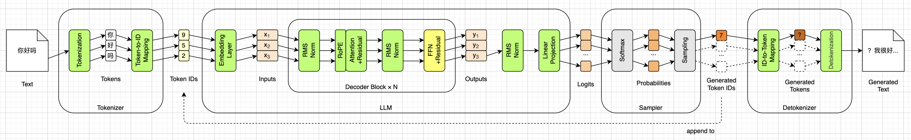
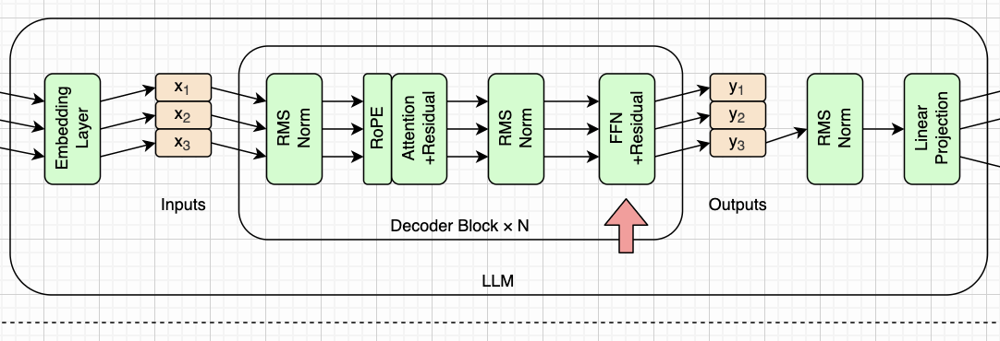
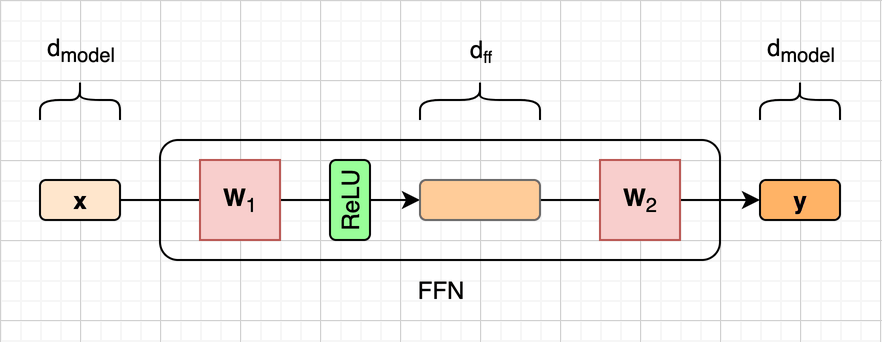
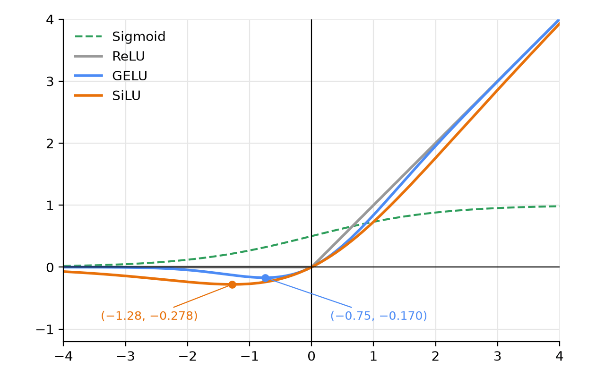
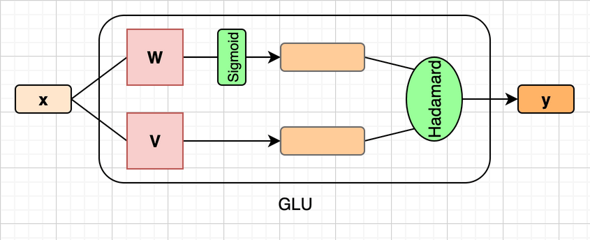
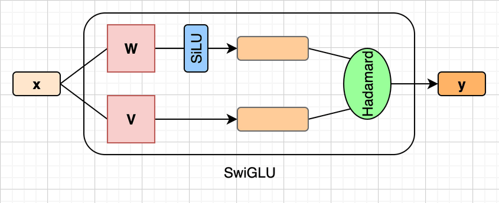
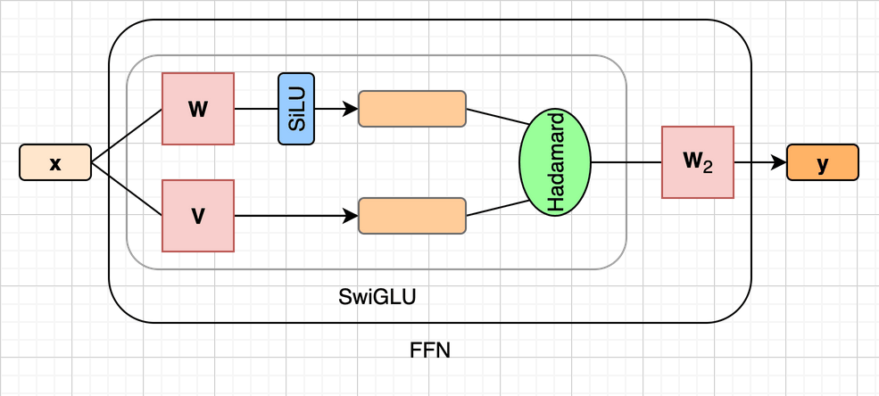
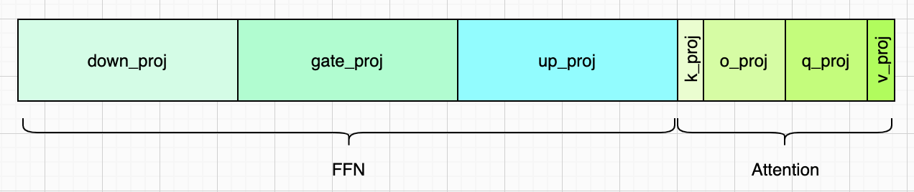
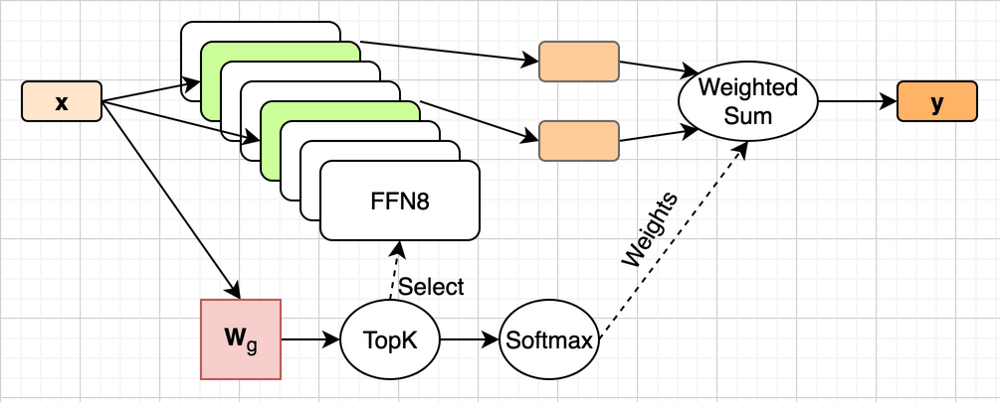

# 前馈网络（FFN）


在第七章，我们给注意力机制补上了位置编码。RoPE按位置把Q和K各转一个角度，转完之后，两者的点积只和它们之间隔了多远有关。注意力从此分得清词序，第0层的注意力权重也和真模型一模一样了。不过引擎还是一直重复`ppo`，原因我们也知道了：Decoder块里的第二个空位，也就是FFN，还在返回全0。到目前为止，我们已经实现了14个小模块中的11个（不算残差连接），如下图所示：



这一章我们就来填上这个空位，也就是上图的黄色小模块：前馈网络（FFN）。第一章说过，FFN是这些模块里相对比较容易理解的一个，但它占了整个模型将近六成的参数。填上它之后，Decoder块里就再也没有空位了，第二章读进来的272个张量也全都用上了。到这一章结束时，我们的引擎会第一次说出像样的人话，而且和第一章用`transformers`库跑出来的那句话一字不差。

我会先说说为什么有了注意力还需要FFN，再看2017年论文里最朴素的FFN，以及激活函数在里面起什么作用。接着仔细介绍SmolLM2用的SwiGLU，顺便解释第二章那个1536是怎么来的。然后写代码，把FFN填进引擎，看看效果。最后简单看一眼目前不少大模型都在用的混合专家（MoE）。


## 为什么需要FFN

相比Transformer架构和LLM，**前馈网络**（Feed-Forward Network，简称**FFN**）可是一项古老的技术了。它的源头可以追溯到1958年Rosenblatt提出的感知机：一个“神经元”把输入加权求和，再和一个阈值比一比，输出0或1。把很多个这样的神经元排成一层，再把几层串起来，就得到了**多层感知机**（Multi-Layer Perceptron，简称**MLP**）。

上世纪80年代，人们找到了训练多层网络的办法，MLP从此成了神经网络的标准部件。所谓“前馈”，说的是数据只往前走，从输入一路流到输出，中间没有回路。这是相对于循环神经网络（RNN）而言的，RNN会把上一步的输出再喂回来。所以FFN和MLP说的是同一个东西，资料和代码里两个名字你都会见到。第二章那9个张量里，`mlp.gate_proj`、`mlp.up_proj`、`mlp.down_proj`这三个名字里的`mlp`，就是这么来的。2017年Transformer问世时，几乎原样把这个老部件搬进了每一个块里。

第六章说过，注意力是整个LLM里唯一让词元之间互相看的模块。FFN正好相反，它是**严格逐词元**的：每个位置各算各的，第3个词元的FFN，完全不知道第1、2个词元的存在。我们把第一章那张图再贴一次，红色箭头指的就是FFN，它在Decoder块的出口处：



既然注意力已经能看上下文了，为什么还要在后面再挂一个FFN呢？我们先回头看看，注意力到底做了哪些计算。

把第六章的那组公式过一遍，你会发现，除了Softmax，注意力里剩下的全是线性运算：Q、K、V是输入乘上一个矩阵，输出是V的加权求和，最后再乘一个 $\mathbf{W}_O$ 。Softmax虽然不是线性的，但它只管算权重，被加起来的V并不经过它。所以，注意力干的事情，说到底是把各个位置的V按权重**混合**起来，它擅长的是“从上下文里收集信息”。至于每个位置收集到信息之后，要在自己内部做什么样的加工，注意力就无能为力了。这个活交给FFN。一个常见的说法是：注意力负责收集，FFN负责消化。一个Decoder块就是先收集、再消化，重复30次。

这件事我们在前两章其实已经亲眼看到了。第七章的引擎有注意力、有RoPE，就是没有FFN，30层走完之后，“Once upon a time”这4个位置两两之间的余弦全都在0.992以上，几乎被抹成了同一个向量。只有注意力，一层层加权平均下去，各个位置就会越来越像。这个现象有人专门研究过，2021年有一篇论文，标题就叫《Attention is Not All You Need: Pure Attention Loses Rank Doubly Exponentially with Depth》（arXiv:2103.03404），显然是冲着2017年那篇论文去的。我们在第七章看到的，正是这件事的一个小样本。

最后提一句机理方面的说法，免得你在别处看到时不知道是怎么回事。2021年Geva等人的论文《Transformer Feed-Forward Layers Are Key-Value Memories》（arXiv:2012.14913），把FFN看成一种**键值记忆**：第一个矩阵的每一列，像是一个要匹配的模式，输入和它越像，激活值就越大；第二个矩阵对应的那一行，则是匹配上之后要取出的内容。按这个说法，模型学到的事实性知识，有相当一部分存在FFN里。这和第六章的Q、K、V有几分神似，不过它只是一种解释，并不是定论。本书按约定不深究，知道有这么个说法就行。


## 2017年的FFN

我们先来看最朴素的FFN，也就是《Attention Is All You Need》论文3.3小节给出的那个。它只有两个矩阵，中间夹一个ReLU激活函数。论文里的公式（2）是这样写的：

$$
\mathrm{FFN}(\mathbf{x}) = \max(0, \mathbf{x} \times \mathbf{W}_1 + \mathbf{b}_1) \times \mathbf{W}_2 + \mathbf{b}_2
$$

注意这里的 $\mathbf{x}$ 是行向量，矩阵从右边乘上去，和本书第四章、第六章的写法一致。 $\mathbf{b}_1$ 和 $\mathbf{b}_2$ 是两个偏置向量，但SmolLM2一个偏置都没有，第五章说过，它所有张量的名字都以`weight`结尾。所以后面我们直接忽略偏置。

整个计算可以分成三步。第一步，乘上 $\mathbf{W}_1$ ，把向量的维度升上去；第二步，过一遍ReLU，也就是公式里那个 $\max(0, \cdot)$ ，把所有负数都换成0；第三步，乘上 $\mathbf{W}_2$ ，把维度降回来。论文里，词嵌入的维度 $d_\mathrm{model}$ 是512，中间那一层的维度 $d_\mathrm{ff}$ 是2048，正好是4倍。这个过程如下图所示（没有画偏置）：



第六章画投影的时候，我们把“输入 × 矩阵 = 输出”三样东西并排摆出来。FFN要连乘两个矩阵，再这么画就太啰嗦了，所以这一章换一种画法：箭头从左往右走，穿过一个权重矩阵，就表示乘上这个矩阵。其余的约定不变：直角矩形是矩阵，圆角矩形是向量，绿色圆角矩形是激活函数。上方的花括号标出了各个向量的维度。输入和输出都是 $d_\mathrm{model}$ 维，所以FFN的输出能直接加回主干上，这和注意力是一样的。另外，这幅图没有按比例画，中间那个向量实际上是输入的4倍长。

这三步里，每一步都只动最后一维。换成矩阵视角，T个词元的输入是一个 $[T \times 512]$ 的矩阵，乘上 $\mathbf{W}_1$ 变成 $[T \times 2048]$ ，过ReLU还是 $[T \times 2048]$ ，再乘上 $\mathbf{W}_2$ 回到 $[T \times 512]$ 。矩阵乘法是一行一行独立算的，ReLU是一个数一个数独立算的，所以第 $i$ 行的输出，只取决于第 $i$ 行的输入。这就是前面说的“严格逐词元”。

那为什么要先升维、再降维呢？一个直观的说法是，中间那一层更宽，给了非线性变换更大的施展空间，就像在一张纸上缠在一起的两根线，拎到三维空间里就容易分开了。不过这只是帮助理解的说法，真正的答案还是在训练里，我们不深究。

另一个问题倒是可以说得很清楚：**为什么中间那个激活函数一定要有？** 我们假设没有它，FFN就变成了 $\mathbf{x} \times \mathbf{W}_1 \times \mathbf{W}_2$ 。矩阵乘法满足结合律，这和 $\mathbf{x} \times (\mathbf{W}_1 \times \mathbf{W}_2)$ 是一回事，而 $\mathbf{W}_1 \times \mathbf{W}_2$ 只是一个 $[512 \times 512]$ 的矩阵。也就是说，两个矩阵、中间升到2048维，绕了一大圈，等价于直接乘一个矩阵，那个2048维白升了。不光一个FFN是这样，只要中间没有非线性，再多的线性运算叠在一起，也只等于一次线性运算。激活函数就是为了打破这一点，它是整个FFN里唯一的非线性。


## 激活函数

**激活函数**（Activation Function）其实就是一个逐元素的非线性函数：向量里的每一个数，各自过一遍这个函数，形状不变。激活函数有很多种，这一小节我们按出现的先后，看四个：Sigmoid、ReLU、GELU和SiLU。最后一个是SmolLM2用的，前面三个可以说是它的来历。我们先把它们的公式写在一起：

$$
\begin{aligned}
\sigma(x) &= \frac{1}{1 + e^{-x}} \\
\mathrm{ReLU}(x) &= \max(0, x) \\
\mathrm{GELU}(x) &= x \cdot \Phi(x) \\
\mathrm{SiLU}(x) &= x \cdot \sigma(x) = \frac{x}{1 + e^{-x}}
\end{aligned}
$$

**Sigmoid**最古老，公式里习惯用 $\sigma$ 表示它。这个名字的意思是“S形”，因为它的曲线就像一个被拉长的字母S： $x$ 很大时， $e^{-x}$ 趋近于0，结果趋近于1； $x$ 很小时，分母变得很大，结果趋近于0；正好在0处，结果是0.5。还记得第一节的感知机吗？它把加权和跟阈值比一比，输出0或1，是一级硬生生的台阶。Sigmoid就是这级台阶的光滑版本。在ReLU流行之前，神经网络里最常用的激活函数就是它。另外注意，这里的 $\sigma$ 和第五章表示标准差的 $\sigma$ 不是一回事，只是碰巧用了同一个字母。

**ReLU**（Rectified Linear Unit）最简单，正数原样放过，负数一律换成0。它在2010年前后流行起来，取代了Sigmoid。原因主要在训练里：网络一深，用Sigmoid就很难训练，换成ReLU就好得多。按本书的约定，这里只说结论。另外，ReLU算起来也便宜，只是一次比较，Sigmoid却要算一次指数。2012年那个让深度学习一炮而红的AlexNet用的就是ReLU，2017年的Transformer也沿用了它。

**GELU**（Gaussian Error Linear Unit）出自2016年Hendrycks和Gimpel的论文《Gaussian Error Linear Units (GELUs)》（arXiv:1606.08415）。公式里的 $\Phi(x)$ 是标准正态分布的累积分布函数，取值在0到1之间， $x$ 越大越接近1，越小越接近0。BERT和GPT-2用的都是GELU。

**SiLU**（Sigmoid Linear Unit）的形式和GELU很像，只是把 $\Phi(x)$ 换成了Sigmoid，名字里的Sigmoid就是这么来的。2017年Google的Ramachandran等人在论文《Searching for Activation Functions》（arXiv:1710.05941）里，用自动搜索的办法，从一大堆候选函数里找到了它，起名叫Swish。所以SiLU和Swish说的是同一个函数，PyTorch里叫`F.silu`。

被ReLU取代以后，Sigmoid并没有消失，只是换了个用法：它很少再直接当激活函数，更多是用来把任意一个数压到0到1之间，当成一个比例。SiLU里的 $\sigma(x)$ 就是这么用的，下一小节的门控，用的也是它。

我把四个函数在几个点上的取值算了一下，列成了下面这张表：

| $x$ | -3 | -1 | 0 | 1 | 3 |
| --- | --: | --: | --: | --: | --: |
| Sigmoid | 0.0474 | 0.2689 | 0.5000 | 0.7311 | 0.9526 |
| ReLU | 0 | 0 | 0 | 1 | 3 |
| GELU | -0.0040 | -0.1587 | 0 | 0.8413 | 2.9960 |
| SiLU | -0.1423 | -0.2689 | 0 | 0.7311 | 2.8577 |

把这四个函数画在同一个坐标系里，就是下面这幅图，图上标出了GELU和SiLU的最低点。Sigmoid画成了虚线，因为它和另外三个不是一类：不管 $x$ 多大，它的输出都封顶在1，而另外三个在正数那一侧，都是差不多原样放过。



可以看到，ReLU、GELU和SiLU三者在两头差不多：正数越大，越接近原样放过；负数越小，越接近0。区别都在0附近。ReLU在0处有一个折角，左边是一条水平线；GELU和SiLU的曲线处处光滑，而且负数那一侧并不是硬性归零，而是先往下凹一点，再慢慢回到0。GELU的最低点在 $x \approx -0.75$ 附近，大约是-0.170；SiLU的最低点在 $x \approx -1.28$ 附近，大约是-0.278。换句话说，小的负数还能透过去一点。对照那条虚线，还能看出SiLU是怎么来的：它就是 $x$ 乘上Sigmoid。 $x=1$ 时乘的是1，所以两条线正好在这里相交； $x$ 为负时，一个负数乘上0到1之间的比例，结果还是负数，这就是那一小段下凹。

那么，为什么新的激活函数会比ReLU好呢？老实说，这个问题的答案在训练里，和梯度有关。按我们的约定，这里只说结论：在大量实验里，光滑的GELU和SiLU通常比ReLU训练得稍好一点。至于为什么好，没有一个让所有人都信服的解释，SiLU本身就是机器搜出来的，而不是谁推导出来的。对我们写推理引擎来说，只要知道一件事就够了：SmolLM2用的是SiLU，`config.json`里`hidden_act`字段的值就是`silu`。

不过，SmolLM2的FFN并不是把ReLU换成SiLU这么简单，它还多了一个矩阵，用的是一种叫做门控的结构。我们先看门控，再看SmolLM2用的SwiGLU。


## 门控线性单元（GLU）

**门控线性单元**（Gated Linear Unit，简称**GLU**）出自2016年Dauphin等人的论文《Language Modeling with Gated Convolutional Networks》（arXiv:1612.08083）。它的想法是，不是“先投影然后过一个激活函数”，而是**并行**做两次投影，一路当“门”，一路当“内容”，然后两路逐元素相乘：

$$
\mathrm{GLU}(\mathbf{x}) = \sigma(\mathbf{x} \times \mathbf{W}) \odot (\mathbf{x} \times \mathbf{V})
$$

这里的 $\odot$ 是第五章介绍过的哈达玛积，也就是逐元素相乘。门那一路过了Sigmoid，每个数都在0到1之间，乘到内容那一路上，就相当于给内容的每一维都配了一个阀门：接近1就放过去，接近0就挡回来。和ReLU比一比，区别就清楚了：ReLU放不放，看的是这个数自己是正是负；GLU放多少，看的是另外一次投影算出来的门。门开多大，是由输入自己决定的。至于名字里的“线性”，指的是内容那一路：它只乘了一个矩阵，没有过任何激活函数。

上面这个公式可以画成下面这样：



输入 $\mathbf{x}$ 分成两路：上面一路乘 $\mathbf{W}$ 再过Sigmoid，就是门；下面一路只乘 $\mathbf{V}$ ，就是内容。两路在右边的椭圆里逐元素相乘。注意，为了好看，图上没有画 $\sigma$ 和 $\odot$ 这两个符号，而是直接写了名字：绿色方框里的Sigmoid就是公式里的 $\sigma$ ，椭圆里的Hadamard就是哈达玛积 $\odot$ 。既然要逐元素相乘，两路的输出就必须一样长，所以 $\mathbf{W}$ 和 $\mathbf{V}$ 的形状总是相同的。后面我们会在SmolLM2的权重里看到这一点。


## SwiGLU

2020年，Google的Shazeer写了一篇很短的论文《GLU Variants Improve Transformer》（arXiv:2002.05202），把GLU用进了Transformer的FFN，并且试了好几种门：用ReLU的叫ReGLU，用GELU的叫GEGLU，用Swish（也就是SiLU）的叫**SwiGLU**。SwiGLU的公式如下：

$$
\mathrm{SwiGLU}(\mathbf{x}) = \mathrm{SiLU}(\mathbf{x} \times \mathbf{W}) \odot (\mathbf{x} \times \mathbf{V})
$$

可以看到，SwiGLU和GLU很像，只是把Sigmoid换成了SiLU。下面是SwiGLU的示意图，为了显示区别，我把SiLU画成了蓝色。



把SwiGLU放进FFN，替换掉原来的“乘 $\mathbf{W}_1$ 再过ReLU”，最后照样乘一个 $\mathbf{W}_2$ 把维度降回来，就得到了论文里的 $\mathrm{FFN}_\mathrm{SwiGLU}$ 公式：

$$
\mathrm{FFN}_\mathrm{SwiGLU}(\mathbf{x}) = \big(\mathrm{SiLU}(\mathbf{x} \times \mathbf{W}) \odot (\mathbf{x} \times \mathbf{V})\big) \times \mathbf{W}_2
$$

我们拿它和2017年的FFN逐项对一下。原来的 $\mathbf{W}_1$ ，现在变成了 $\mathbf{W}$ 和 $\mathbf{V}$ 两个矩阵，一个算门，一个算内容，两者都是把 $d_\mathrm{model}$ 维升到 $d_\mathrm{ff}$ 维；原来的ReLU，换成了SiLU加上一次逐元素相乘；最后的 $\mathbf{W}_2$ 原封不动，还是把 $d_\mathrm{ff}$ 维降回 $d_\mathrm{model}$ 维。所以从外面看，输入输出的形状和原来一模一样，FFN在Decoder块里的位置也不用动，变的只是里面的结构：矩阵从两个变成了三个。多出来的这个 $\mathbf{V}$ 也带来了一个问题，参数要多出一半，后面讲1536的来历时再细说。

我们把这个公式画出来，大概是下面这样：



这里有一个细节值得留意。SwiGLU名字里还带着“门”，但它的门已经不是一个只会开关的阀门了。看看激活函数那一节的表就知道，SiLU没有上限，输入是3，输出是2.8577；它还能是负数，最低能到-0.278。所以门那一路乘过去，不只是决定放多少，还可能把内容放大，甚至把符号翻过来。与其说它是阀门，不如说它是一组按输入当场算出来的系数。

那么SwiGLU为什么比原来的FFN好呢？Shazeer在论文里做了一组对比实验，GLU这一族的效果确实更好，SwiGLU和GEGLU排在前面。至于为什么好，论文的结论部分说得很坦白：作者不打算解释。前言里说本书只解释how、不解释why，举的正是这个例子：连提出它的论文作者都说不清楚。所以这里我们也只如实转述，不硬编一个理由。

不管机理如何，SwiGLU后来成了主流。2022年的PaLM、2023年的Llama都用了它，之后的Qwen、DeepSeek等系列也基本沿用，SmolLM2也不例外。


## SmolLM2的FFN

前面几节讲的都是论文里的通用写法，矩阵叫 $\mathbf{W}$ 、 $\mathbf{V}$ 和 $\mathbf{W}_2$ ，维度叫 $d_\mathrm{model}$ 和 $d_\mathrm{ff}$ 。这一节我们把SwiGLU落到SmolLM2身上，换成具体的名字和数字：三个矩阵在权重文件里叫什么、形状是多少，第二章那个一直没解释的1536是怎么来的，以及FFN在整个模型里到底占了多少参数。


### 三个矩阵

和第六章一样，我们先从权重文件看起。我把第0层FFN的JSON元数据贴出来：

```json
  // ... 其他数据 ...
  "model.layers.0.mlp.down_proj.weight": {
    "dtype": "BF16", "shape": [576, 1536], "data_offsets": [56624256, 58393728]
  },
  "model.layers.0.mlp.gate_proj.weight": {
    "dtype": "BF16", "shape": [1536, 576], "data_offsets": [58393728, 60163200]
  },
  "model.layers.0.mlp.up_proj.weight": {
    "dtype": "BF16", "shape": [1536, 576], "data_offsets": [60163200, 61932672]
  },
  // ... 其他数据 ...
```

元数据里的名字是按字母排序的，所以顺序是down、gate、up，和计算的先后无关。三个名字各有来历：`gate_proj`是门那一路，对应公式里的 $\mathbf{W}$ ；`up_proj`是内容那一路，对应 $\mathbf{V}$ ，它把576维升到1536维，所以叫up；`down_proj`对应 $\mathbf{W}_2$ ，把维度降回来，所以叫down。为了和权重文件对上，我们把公式也换成这三个名字：

$$
\mathrm{FFN}(\mathbf{x}) = \big(\mathrm{SiLU}(\mathbf{x} \times \mathbf{W}_\mathrm{gate}) \odot (\mathbf{x} \times \mathbf{W}_\mathrm{up})\big) \times \mathbf{W}_\mathrm{down}
$$

和第六章一样，我把公式里的权重矩阵、JSON元数据里的名字和形状列了一个表。文件里的矩阵是按“输出×输入”存的，公式里要的是“输入×输出”，所以最后两列的形状正好反过来：

| 权重矩阵 | 元数据名称 | 元数据中的形状 | 公式中的形状 |
| --- | --- | --- | --- |
| $\mathbf{W}_\mathrm{gate}$ | `gate_proj` | `[1536, 576]` | `[576, 1536]` |
| $\mathbf{W}_\mathrm{up}$ | `up_proj` | `[1536, 576]` | `[576, 1536]` |
| $\mathbf{W}_\mathrm{down}$ | `down_proj` | `[576, 1536]` | `[1536, 576]` |

可以看到，`gate_proj`和`up_proj`的形状完全一样，这正是门控线性单元那一节说的：两路要逐元素相乘，输出就必须一样长。

整个计算可以分成四步，我们把每一步的形状都写出来。第一步，输入分两路，分别乘上 $\mathbf{W}_\mathrm{gate}$ 和 $\mathbf{W}_\mathrm{up}$ ，都从`(T, 576)`升到`(T, 1536)`。第二步，只有门那一路过SiLU，形状不变。第三步，两路逐元素相乘，还是`(T, 1536)`。第四步，乘上 $\mathbf{W}_\mathrm{down}$ ，从`(T, 1536)`降回`(T, 576)`。对照SwiGLU一节最后那张图，把 $\mathbf{W}$ 、 $\mathbf{V}$ 、 $\mathbf{W}_2$ 换成gate、up、down，把 $d_\mathrm{model}$ 和 $d_\mathrm{ff}$ 换成576和1536，就是SmolLM2的FFN。

注意，SiLU只套在门那一路上，内容那一路不过。这一点要是写错了，比如把SiLU套在了`up`那一路上，或者两路都套，程序照样能跑，算出来的数也都像模像样，只是模型就坏了。


### 1536是怎么来的

上面的元数据里，`gate_proj`和`up_proj`的形状都是`[1536, 576]`。这个1536，第二章就见过，当时没有解释它是怎么来的。现在可以回答了。

2017年那个FFN，中间层是4倍宽。放到SmolLM2的576维上，就是2304维，两个矩阵。SwiGLU多了一个矩阵，如果中间层还是4倍宽，参数就要多出一半。所以Shazeer在论文里做了一个调整：把中间层的宽度乘上2/3，让三个矩阵的参数加起来，和原来两个矩阵一样多。我们来算一下：

```
普通FFN：2个矩阵 × 576 × 2304 = 2,654,208
SwiGLU ：3个矩阵 × 576 × h    = 2,654,208
                  →  h = 2304 × 2/3 = 576 × 8/3 = 1536
```

一个参数都不差。这个1536，在`config.json`里对应`intermediate_size`字段。

不过，8/3只是一个出发点，并不是各家都要遵守的规矩。比如Llama-2-7B的词嵌入维度是4096，乘上8/3是10922.7，它取的是11008，凑成了256的整数倍，大约2.69倍；到了Llama-3-8B，中间层变成了14336，正好是3.5倍。SmolLM2恰好就是8/3，一点没改。


### 参数大头

一个Decoder块里，FFN一共有2,654,208个参数。我们顺便算一下注意力的：`q_proj`和`o_proj`各是 $576 \times 576$ ，`k_proj`和`v_proj`各是 $192 \times 576$ ，加起来是 $576 \times (576 + 576 + 192 + 192) = 576 \times 1536$ ，一共884,736个。

这里有个巧合：注意力的四个矩阵加起来，正好也是一个 $576 \times 1536$ ，而FFN是三个。所以在一个Decoder块里，FFN正好是注意力的3倍，前者占75%，后者占25%。我们把第二章那张每层权重分布图再贴一次，每个张量按参数量画成一段长条：



左边FFN的三块一样宽，加起来正好是右边注意力四块的三倍，原因就在这里。第二章看这张图时，我们还不知道这些名字是什么意思，现在七个名字都认识了。30层加起来，FFN一共有79,626,240个参数，占全模型的59.2%，也就是第一章说的“大约六成”。


## 代码实现

理论讲完了，下面我们把FFN填进推理引擎。和前三章一样，`Engine`类的写法一行都不用动，要改的主要是`Config`和`Model`两个类，外加`engine.py`里的一个常量。先来看`Config`类，这一章只多了一个字段：

```python
        # 第八章新要的一个。FFN先升到这么宽，再降回576。
        self.intermediate_size = self.raw["intermediate_size"] # 1536
```

老实说，后面的`ffn()`并不读这个字段，1536这个数已经藏在三个矩阵的形状里了，就像第五章说的576和49152藏在词嵌入矩阵的形状里一样。我们给它起个名字，主要是为了让`Config`把用到的规格都列全。

然后是这一章的重点，`Model`类的`ffn()`方法。前两章它一直返回全0，现在换成真的SwiGLU。它也多了一个参数`layer`，因为要用到这一层自己的三个权重矩阵：

```python
    def ffn(self, x, layer):
        gate = x @ layer["gate_proj"].T # (T, 576) → (T, 1536)
        up = x @ layer["up_proj"].T     # (T, 576) → (T, 1536)
        # 用F.silu而不是手写z * sigmoid(z)：两种写法数学上相同，但最后一位
        # 会差，`check_ffn.py`里能看到。用F.silu才和transformers逐位相同。
        h = F.silu(gate) * up # (T, 1536)
        return h @ layer["down_proj"].T # (T, 1536) → (T, 576)
```

这个方法只有四行，和前面公式里的四步一一对应。前两行是两路升维，`.T`还是那个转置，和第六章`attn()`里的写法一样。第三行先给门那一路过SiLU，再和内容那一路逐元素相乘，PyTorch里的`*`对张量就是逐元素相乘，也就是哈达玛积。最后一行降维，输出的形状和输入一样，还是`(T, 576)`，所以能直接加回主干上。

这里的`F`是`torch.nn.functional`，需要在文件开头导入一下。注释里说的那件事值得多看一眼：SiLU的公式就是 $z \cdot \sigma(z)$ ，手写成`z * torch.sigmoid(z)`当然也可以，数学上一模一样。但`F.silu()`在PyTorch内部是一次算完的，手写是先算Sigmoid、再做乘法，舍入的次数不一样，最后一位就可能不同。为了和`transformers`逐位对上，我们用`F.silu()`。

还有`block()`方法也需要改一个地方，就是把`layer`也传给`ffn()`：

```python
    def block(self, x, layer):
        x = x + self.attn(self.rms_norm(x, layer["input_norm"]), layer)
        x = x + self.ffn(self.rms_norm(x, layer["post_attn_norm"]), layer)
        return x
```

到这里，`block()`里的两行终于都有了真东西。第一行，归一化之后送进注意力，加回主干；第二行，再归一化一次，送进FFN，再加回主干。从第五章搭好骨架起，这两行的结构就没变过，变的只是两个空位里填的东西，外加一路传下去的`layer`参数。

在`engine.py`里，`Engine`类也是一行没动，只改了一个常量：转的圈数从10改成了20。这是为了和第一章那五行代码里的`max_new_tokens=20`对齐，两边都生成20个词元，才好逐字对照。

那么，怎么知道`ffn()`写对了呢？和第五章一样，这一章的随书源代码里有一个`check_ffn.py`脚本，拿它和`transformers`里的`LlamaMLP`比了一下。输入是`ffn()`真正收到的东西：词嵌入走到第 $i$ 层，过完注意力子层，再过`post_attn_norm`。为了看看做错了会怎样，脚本还故意做错了几种，下面是输出：

```
    T   层      逐位相同      手写silu    silu放错一路      换成ReLU
    4   0        True       1.1e-07       3.5e-01       2.6e-01
    4  15        True       8.9e-08       1.2e+00       1.0e+00
    4  29        True       5.7e-09       2.4e-01       4.1e-02
   26   0        True       8.2e-08       5.9e-01       3.3e-01
   26  15        True       7.8e-08       6.3e-01       6.0e-01
   26  29        True       9.5e-09       2.6e-01       4.0e-02
 1000   0        True       1.1e-07       3.2e-01       3.5e-01
 1000  15        True       1.3e-07       4.4e-01       5.5e-01
 1000  29        True       5.2e-08       2.4e-01       4.5e-02

第3行单独算 vs 整段算再取第3行   相对误差4.5e-07
```

第三列说明，不管输入长短、在哪一层，我们的`ffn()`和`LlamaMLP`都逐位相同，一个比特都不差。第七章说过，RoPE进来以后，长一些的输入会在最后一位上差一点，而FFN不碰RoPE，所以长短输入都能严格对上。

后三列是相对误差。手写SiLU只在1e-7上下，只是舍入不同，不算错。SiLU套错一路、或者换成ReLU，相对误差都在1e-2到1e0之间，和前面差了五六个数量级，一眼就能分辨出来。但要注意，这两种做错的写法，程序都不会报错。

最后一行验证的是“严格逐词元”：把第3行单独喂进去，和整段喂进去再取第3行，结果只差舍入。之所以不是逐位相同，是因为矩阵乘法在内部会按块切分，输入的行数不一样，切法就可能不一样，最后一位也就跟着变。


## 代码效果

代码写完了，我们来跑一下引擎。还是输入“Once upon a time”，下面是`engine.py`的输出（中间省略了几行）：

```
输入   'Once upon a time'
词元   ['Once', 'Ġupon', 'Ġa', 'Ġtime']
ID     [6403, 1980, 253, 655]
...
  第 5个词元   ID    28   ','
  第 6个词元   ID   665   'Ġthere'
  第 7个词元   ID   436   'Ġwas'
  第 8个词元   ID   253   'Ġa'
  第 9个词元   ID  1838   'Ġlittle'
  第10个词元   ID  8180   'Ġgirl'
...
  第24个词元   ID   564   'Ġbut'
...
输出   'Once upon a time, there was a little girl named Lily. She lived in a big house with her family, but'

20个新词元里有18个互不相同。
```

终于说人话了！而且你可以翻回第一章对一下，用`transformers`跑出来的就是这句话，一字不差。从第三章那个随机吐词的假引擎开始，我们复读过`Ġtime`，胡言乱语过，又复读了两章`ppo`，到这里，中间那30层终于全是真的计算了。


### ppo去哪了

第六章和第七章留了一个问题：注意力几乎是在给整句话求平均，这到底是缺RoPE还是缺FFN？第七章已经看到，补上RoPE并没有改变这一点。现在FFN也填上了，我们用`inspect_attn.py`再打印一次最后一个位置看向各个位置的权重（9个头取平均）：

| | 第0层 | 第15层 | 第29层 |
|---|---|---|---|
| 第七章（没有FFN） | 0.166, 0.192, 0.346, 0.296 | 0.226, 0.353, 0.202, 0.220 | 0.307, 0.251, 0.220, 0.222 |
| 这一章 | 0.166, 0.192, 0.346, 0.296 | **0.935**, 0.023, 0.020, 0.022 | **0.697**, 0.043, 0.035, 0.225 |
| 真模型 | 0.166, 0.192, 0.346, 0.296 | **0.935**, 0.023, 0.020, 0.022 | **0.697**, 0.043, 0.035, 0.225 |

第七章只有第0层和真模型对得上，这一章三层全对上了。FFN虽然不直接参与注意力的计算，但从第1层起，每一层注意力的输入里，都有前面各层FFN加到主干上的东西。FFN一缺，后面就全跟着错。

30层走完之后，4个位置两两之间的余弦，也从第七章的0.992以上降到了0.493到0.787，各个位置不再被抹成一个样。出口处排第一的是逗号，按余弦它也排第一；而第六章那个`ppo`，是靠模长大才挤到第一的。这就是`ppo`消失的原因。

第15层那个0.935也值得一提：最后一个词元把93.5%的注意力给了第一个词元`Once`，这并不是因为这个词有多重要。很多模型里，大量注意力都会落在序列开头，不管那里写的是什么。2023年的论文《Efficient Streaming Language Models with Attention Sinks》（arXiv:2309.17453）管它叫**注意力汇聚点**（Attention Sink）。一种常见的解释是，Softmax要求权重加起来等于1，一个头没什么可看的时候，也得把权重分出去，而第一个词元谁都看得见，就成了堆放权重的地方。

另外，`model.py`打印的模长，第10层后144.387，第30层后635.043，出口处40.688，也和第五章量出来的真模型一致。要是把FFN拿掉，换回第七章的引擎，第30层后会涨到1271.2，大了一倍。


### 四级验收

输出那一句话对上了，当然是最好的证明。但如果哪天对不上，光看一句话是看不出错在哪儿的。所以这一章的随书源代码里还有一个`check_forward.py`脚本，把整条流水线和第一章的结果从粗到细比了一遍，一共四级：

```
一  参数量    我们134,515,008   第一章134,515,008   相同

二  逐层比     下标        绝对误差        相对误差
               0       0.0e+00       0.0e+00
               5       1.3e-05       2.2e-08
              10       1.7e-05       2.2e-07
              15       3.1e-05       1.5e-09
              20       3.3e-05       1.6e-09
              25       9.2e-05       4.6e-09
              29       2.4e-04       6.0e-08
              30       2.4e-05       9.4e-07
            31层里最大的相对误差   9.4e-07

三  argmax   我们[346, 253, 655, 28]   第一章[346, 253, 655, 28]   相同

四  贪婪解码
    我们     'Once upon a time, there was a little girl named Lily. She lived in a big house with her family, but'
    第一章   'Once upon a time, there was a little girl named Lily. She lived in a big house with her family, but'
    ID相同，文字相同
```

**第一级，参数量。** 134,515,008个，和第二章数出来的一个不差。漏接一个张量，或者多建一组偏置，在这里立刻就能发现。

**第二级，逐层比。** 把词嵌入和30层各自的输出逐份比较，一共31份，误差从哪一层开始变大，问题就出在哪一层。绝对误差随数值的量级变大，最大到2.4e-4，但相对误差最大只有9.4e-7。这点差别来自计算路径：第一章的`transformers`默认走PyTorch自带的注意力函数，我们是一步一步手算的，加法的顺序不同，最后一位就会变，并不是算错了。另外，`transformers`给的最后一份已经过了出口处的归一化，我们这边也要先归一化再比。

**第三级，argmax。** 4个位置各自预测的下一个词元，两边都一样。第1、2个位置预测的`Ġa`和`Ġtime`，正好是原文的下一个词；第3个位置预测的是逗号（28）；第0个位置只看到`Once`，猜的是`Ġyou`（346），“Once you”也是一个通顺的开头。

**第四级，贪婪解码。** 20个ID和文字都和第一章一样。这是最严格的一级：每一圈的输出都会追加到下一圈的输入里，只要挑错一个词，后面就整段跑偏。


## 混合专家（MoE）

最后，我们简单看一眼不少大模型都在用的**混合专家**（Mixture of Experts，简称**MoE**）。这是给真正的大模型用的技术。SmolLM2太小了，没有用它，所以这一小节不写代码，你了解一下思路即可。

前面算过，SmolLM2的FFN占了全模型的59.2%。模型越大，这个比例往往越高。比如Llama-3-70B，一共80层，词嵌入维度8192，中间层28672，FFN的参数是 $8192 \times 28672 \times 3 \times 80$ ，大约是56.4B，占了整个模型的八成左右。而且这些参数，每个词元都要从头到尾全部算一遍。那能不能每次只用其中的一小部分呢？这就是MoE的出发点。

MoE的想法其实很简单：把原来那个大FFN，拆成许多个小FFN，每一个小FFN叫做一个**专家**（Expert）。再加一个**路由器**（Router），给每个词元挑出少数几个专家来算，其余的专家这一次就闲着。被挑中的几个专家各算出一个结果，再按权重加起来，就是这一层的输出。下面是Mixtral 8x7B的MoE示意图，8个专家，每个词元只挑2个（绿色）：



我们用 $E_i(\mathbf{x})$ 表示第 $i$ 个专家的计算，它就是一个前面讲的SwiGLU版FFN；用 $G(\mathbf{x})_i$ 表示它分到的权重，没被挑中的权重就是0。于是，整个MoE可以写成下面这两个式子，它们出自2024年Mistral AI的论文《Mixtral of Experts》（arXiv:2401.04088）：

$$
\begin{aligned}
\mathbf{y} &= \sum_{i=1}^{n} G(\mathbf{x})_i \, E_i(\mathbf{x}) \\
G(\mathbf{x}) &= \mathrm{softmax}(\mathrm{TopK}(\mathbf{x} \times \mathbf{W}_g))
\end{aligned}
$$

其中 $n$ 是专家的数量，第二个式子就是路由器。输入先乘上一个很小的矩阵 $\mathbf{W}_g$ ，得到 $n$ 个分数，每个专家一个；然后TopK只保留最高的 $K$ 个，其余的都换成负无穷；最后过一遍Softmax，被换成负无穷的那些，权重正好是0。这一步你应该很眼熟，第六章的因果掩码就是这么干的。而“只保留最高的 $K$ 个”这个思路，到第十章讲top-k采样时还会再见到。

这样一来，模型的总参数可以很大，但每个词元真正用到的只有一小部分。下面是两个比较有代表性的MoE模型：

| 模型 | 专家数 | 每个词元激活 | 总参数 | 激活参数 |
| --- | --- | --- | --: | --: |
| Mixtral 8x7B | 8 | 2 | 47B | 13B |
| DeepSeek-V3 | 1个共享 + 256个路由 | 1个共享 + 8个路由 | 671B | 37B |

注意Mixtral 8x7B的总参数不是8乘7等于56B，而是47B，因为复制成8份的只有FFN，注意力和词嵌入都是各个专家共用的。DeepSeek-V3则多了一种**共享专家**（Shared Expert），它不经过路由器，每个词元都要算，用来承担各个专家都需要的那部分通用能力；其余的256个路由专家，每个词元挑8个。

站在推理的角度，MoE有一点要特别注意：计算量看的是激活参数，但内存看的是总参数。路由器每一圈挑中哪几个专家，事先是不知道的，所以全部专家都得装在内存里。DeepSeek-V3每个词元只算370亿个参数，可那6710亿个参数一个都不能少。这也是为什么，大型MoE模型的推理往往要把专家分散到很多张显卡上，那是另一个话题了。SmolLM2只有135M，FFN本来就不大，用不着这么折腾。

当然，不写MoE的代码，还有一个更实在的原因：我这台电脑跑不动像样的MoE模型。等这本书出第二版的时候（如果真有那么一天），我大概已经换了一台更好的电脑，到时候再把MoE的代码补上。


## 本章小结

这一章填上了Decoder块里的最后一个空位，引擎第一次说出了人话。

我们先弄清了为什么需要FFN。注意力除了算权重的Softmax，做的全是线性运算，它只负责把各个位置的信息混合起来；FFN则在每个位置内部做非线性的加工，严格逐词元，词元之间互不相干。第七章的引擎只有注意力，30层走完，各个位置几乎被抹成了同一个向量。

接着我们从2017年的FFN出发，一路走到SmolLM2的FFN。最朴素的FFN是两个矩阵夹一个ReLU，先升维再降维，中间的激活函数是唯一的非线性，没有它，两个矩阵就等于一个。激活函数这条线，从Sigmoid到ReLU，再到光滑的GELU和SiLU；另一条线是门控的GLU，用一路投影去调节另一路。两条线合在一起，就是SwiGLU：门那一路过SiLU，和内容那一路逐元素相乘，再降维回来。

SmolLM2的FFN就是SwiGLU，三个矩阵`gate_proj`、`up_proj`、`down_proj`，形状是`(T, 576) → (T, 1536) → (T, 576)`。1536是576的8/3倍，为的是让三个矩阵的参数和原来两个一样多。算下来，每个Decoder块里FFN的参数正好是注意力的3倍，占了全模型的近六成。至于SwiGLU为什么好，连提出它的论文都不解释。

然后我们写了代码。`Config`补了一个字段，`ffn()`从返回全0换成了四行SwiGLU，`block()`里多传了一个参数。单看FFN，它和`transformers`里的`LlamaMLP`逐位相同；整条流水线也通过了四级验收：参数量、逐层输出、argmax、贪婪解码。前两章留下的`ppo`之谜也有了答案：缺的是FFN。补上之后，三层的注意力权重全部和真模型对上，第15层还冒出了一个注意力汇聚点。引擎现在是：

```
ids → embed → [norm → attn → norm → ffn] × 30 → norm → lm_head → logits
```

最后我们简单看了一眼MoE：把一个大FFN拆成许多专家，每个词元只挑几个来算。计算量看的是激活参数，内存却要装下全部参数。

到这里，第一章总览图上LLM那个大方框里的每一个小模块，都是我们自己写的代码了。不过还有一样东西，我们从第五章起就一直在用，却一直没有细说，那就是`block()`里那两个加号，也就是残差连接。下一章我们就来讲它。
