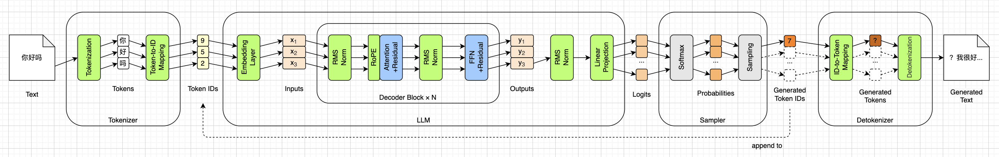
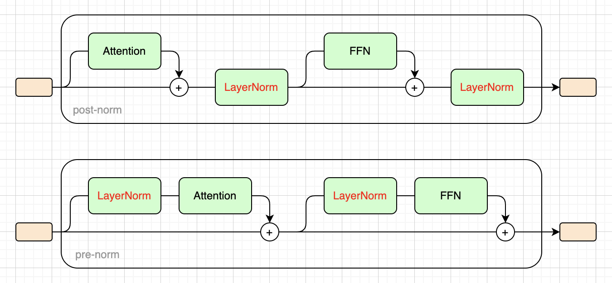
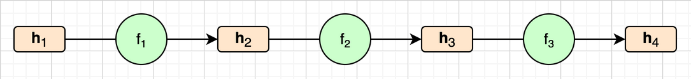
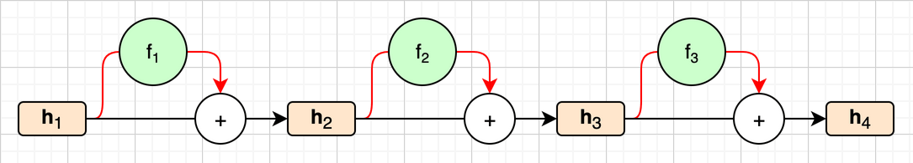
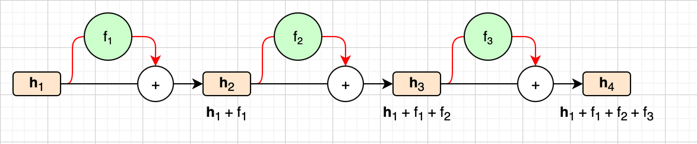
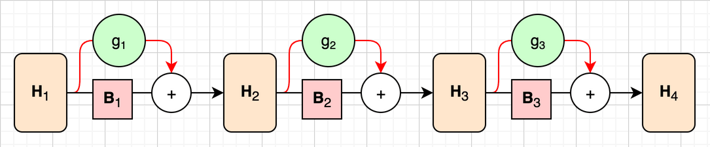
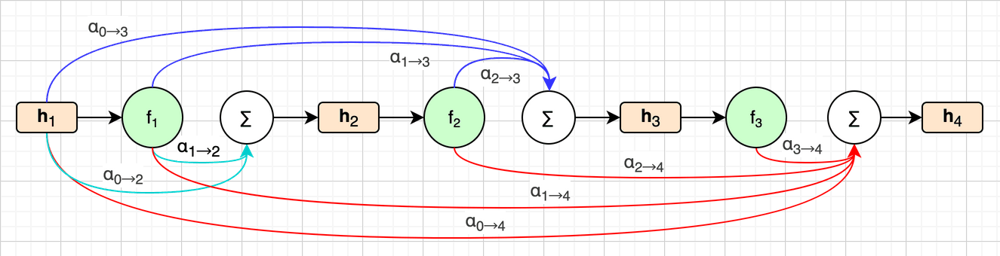
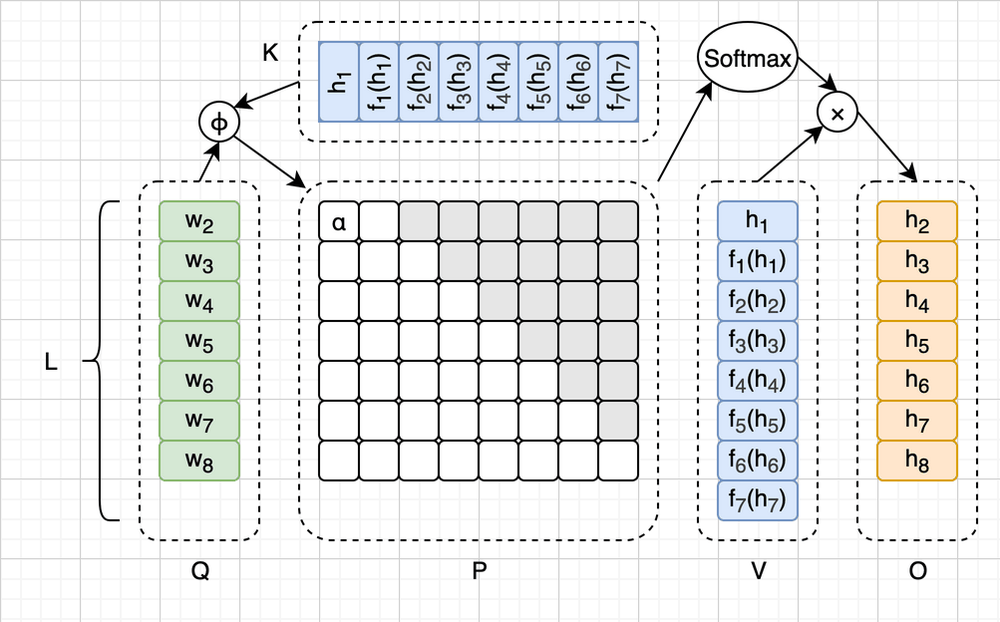
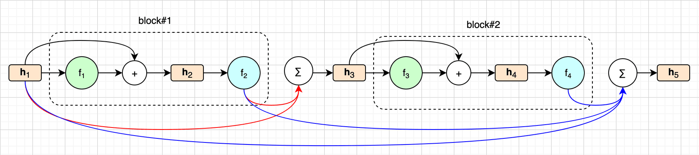

# 残差连接（Residual Connections）


在第八章，我们填上了Decoder块里的最后一个空位FFN。从那一章起，中间那30层全是真的计算，引擎第一次说出了像样的人话，而且和第一章用`transformers`库跑出来的那句话一字不差。到目前为止，我们已经实现了14个小模块中的12个，如下图所示：



这一章没有新模块。我把注意力和FFN这两个模块涂成了蓝色，因为这一章要看的，是它们名字里那个“+Residual”，也就是残差连接（Residual Connections）。第一章说过，残差连接不太好画在数据流向图里，所以只以文字形式写在了这两个模块里。其实我们从第五章起就一直在用它，`block()`方法里那两个加号就是，只是一直没有细说。

先打声招呼：这一章可以说是全书最“理论”的一章，没有新模块，引擎一行都不用改，只多了几个用来观察的小脚本。如果你只关心推理引擎是怎么跑起来的，下面“为什么需要残差连接”这一节可以整个跳过，不会影响后面的阅读。

我会先回顾一下什么是残差连接，再破例聊一点训练，说说为什么需要它。然后我们借助三个小实验，看看残差连接串起来的那条“残差流”上到底发生了什么。最后介绍近两年出现的三种改进：HC、mHC和AttnRes。


## 什么是残差连接

我们暂时回到第五章。当时为了说清楚归一化放在哪，我们提前介绍了残差连接最基本的样子：一个子层（注意力或者FFN）算完之后，并不是直接把结果往下传，而是把结果**加回到它自己的输入上**，再往下传。我们把子层记作 $f$ ，输入记作 $\mathbf{x}$ ，那么往下传的就是：

$$
\mathbf{y} = \mathbf{x} + f(\mathrm{Norm}(\mathbf{x}))
$$

第五章还打了一个比方：数据有两条路可以走。一条是**主干**，什么都不干，原样往下传；另一条是**旁路**，先归一化，再拐进子层里算一圈，最后汇回主干。下面这幅图是第五章画过的，上半部分是2017年的post-norm，下半部分就是SmolLM2用的pre-norm，中间那条直线就是主干：



在代码里，这件事就是`block()`方法里那两个加号。从第五章起，它们就没变过：

```python
    def block(self, x, layer):
        x = x + self.attn(self.rms_norm(x, layer["input_norm"]), layer)
        x = x + self.ffn(self.rms_norm(x, layer["post_attn_norm"]), layer)
        return x
```

每一行开头的`x = x + ...`，就是残差连接。一个Decoder块有两个子层，所以有两条残差连接；30个块，一共60条。

残差连接出自2015年何恺明等人的论文《Deep Residual Learning for Image Recognition》（arXiv:1512.03385），也就是著名的ResNet。它最早用在图像识别的卷积网络上，2017年的Transformer原样借了过来。“残差”这个名字，说的是子层要学的东西：没有残差连接时，子层要直接算出这一层的输出；有了残差连接，输出等于输入加上子层的结果，所以子层只需要算出输出和输入之间的**差值**。这个差值，在统计学里就叫残差。


### 多一条路

为了便于讨论，我们先把问题简化一下。注意力和FFN虽然算法不同，但在残差连接看来是一回事：都是从主干上取一份输入，算出一个形状相同的结果，再加回主干。所以下面不再区分它们，统称为子层。子层前面的那个归一化，也不再单独拎出来，直接算作子层的一部分。

我们把第 $l$ 个子层记作 $f_l$ ，把它的输入记作 $\mathbf{h}_l$ 。如果没有残差连接，每个子层的输出就直接是下一个子层的输入，可以写成：

$$
\mathbf{h}_{l+1} = f_l(\mathbf{h}_l)
$$

以3个子层为例，画出来是下面这样，数据只有一条路可走。这里的画法和前几章不太一样：我们不关心子层内部有哪些矩阵，所以把每个子层整个画成了一个绿色圆圈；橙色的圆角矩形还是向量，也就是 $\mathbf{h}_l$ 。



加上残差连接之后，子层的输出不再直接往下传，而是先加回到它自己的输入上。公式就变成了：

$$
\mathbf{h}_{l+1} = \mathbf{h}_l + f_l(\mathbf{h}_l)
$$

还是以3个子层为例，画出来是下面这样，数据有了两条路：



中间那条黑色的直线就是主干，对应公式里单独的那个 $\mathbf{h}_l$ ，它不经过任何子层，从 $\mathbf{h}_1$ 一直通到 $\mathbf{h}_4$ 。红色的线是旁路，对应 $f_l(\mathbf{h}_l)$ ：从主干上分出一份，拐进子层算一圈，再在加号处汇回主干。和上一幅图比，子层从主干上挪到了旁边。


### 一路展开

上一小节那个带残差的公式是递推的： $\mathbf{h}_{l+1}$ 由 $\mathbf{h}_l$ 算出来，而 $\mathbf{h}_l$ 又由 $\mathbf{h}_{l-1}$ 算出来。把它一路往回代，就得到：

$$
\mathbf{h}_{l+1} = \mathbf{h}_1 + f_1(\mathbf{h}_1) + f_2(\mathbf{h}_2) + \cdots + f_l(\mathbf{h}_l)
$$

我们回到上一幅图，看看主干上每一处到底是什么。 $\mathbf{h}_1$ 是词嵌入；过了第一个加号， $\mathbf{h}_2 = \mathbf{h}_1 + f_1(\mathbf{h}_1)$ ；过了第二个加号， $\mathbf{h}_3$ 又多了一份 $f_2(\mathbf{h}_2)$ ；以此类推。我们把每一处展开之后的样子，标在主干的下面，如下图所示。为了画得简洁，图里把 $f_l(\mathbf{h}_l)$ 简写成了 $f_l$ ：



可以看到，主干上其实就是一个越加越多的和。每个子层从主干上拿到的，是词嵌入加上它前面所有子层的贡献；它算出自己的那一份，再加回主干，交给后面的子层。主干上的东西只会往上加，不会被整个换掉，所以词嵌入 $\mathbf{h}_1$ 从头到尾都在，前面每个子层的贡献也都还在。

这条从词嵌入一直通到出口、一路累加的主干，有一个通俗的叫法：**残差流**（Residual Stream）。它的形状始终是`(T, 576)`，从第一层到最后一层，一个维度都不变。每个子层都从这条流里读，再往这条流里写。后面“残差流实验”那一节，看的就是这条流上每一处都写进了什么。

到这里，残差连接是什么就讲完了。下面我们来看看，为什么需要它。这一节要聊训练，如果不感兴趣，可以直接跳到后面的“残差流实验”。


## 为什么需要残差连接

前言里定过一条约定：凡是要靠反向传播才能解释的问题，本书只给结果，当时举的例子正好就是“为什么残差连接是必要的”。这一节是全书唯一的例外。不过放心，我们不求导，只用乘方。


### 层数多了，反而更差

先说一个现象。在ResNet之前，大家普遍相信，网络越深，能力越强。但何恺明他们在实验里发现，普通的卷积网络堆到一定深度之后，再往上加层，效果反而变差了：在同一个图像数据集上，56层的网络比20层的网络还要差。注意，这不是测试时的成绩差，而是训练时就学不好，所以不是常说的“过拟合”。多出来的那36层，哪怕什么都不干，原样把输入传下去，也不至于更差，可训练就是找不到这个解。

而加上残差连接之后，ResNet堆到一百多层，照样训练得好。区别就在前面那两幅图里：没有残差，数据只有一条路，必须穿过每一个子层；有了残差，多了一条不经过任何子层、直通到底的主干。


### 一路乘下去

那么，为什么多一条直通的主干，网络就能堆得这么深呢？这就要说到训练了。

训练的时候，模型先像推理一样从头算到尾，得出一个预测，再和正确答案比一比，算出差了多少。然后，这个“差了多少”的信号要从出口往回传，一层一层地告诉每个权重矩阵该往哪边调、调多少。这个往回传的过程，就是**反向传播**（Backpropagation），往回传的那个信号，叫做**梯度**（Gradient）。

我们不需要知道梯度具体怎么算，只需要知道一件事：信号每往回穿过一层，大致就要乘上一个和这一层有关的系数。从出口传到第1层，要穿过它后面的每一层，这些系数就一个接一个地乘在一起。

问题就出在“乘在一起”上。我们拿SmolLM2的30层来算一下（严格地说，它有60个子层，乘出来只会更极端）：

| 每层乘的系数 | 30层乘下来 |
| --- | --: |
| 0.5 | $0.5^{30} \approx 9.3 \times 10^{-10}$ |
| 0.9 | $0.9^{30} \approx 0.042$ |
| 1.0 | $1.0^{30} = 1$ |
| 1.1 | $1.1^{30} \approx 17.4$ |

每层小一半，传到第1层就几乎什么都不剩了。哪怕每层只是小了一成，传到第1层也只剩4%；每层只是大了一成，传到第1层就放大了17倍多。前一种情况叫**梯度消失**（Vanishing Gradient），靠前的那些层几乎收不到信号，学不动；后一种情况叫**梯度爆炸**（Exploding Gradient），信号大得离谱，权重一调就调飞了。要想两头都不出事，每一层的系数都得恰好在1附近，层数越多，这个要求就越苛刻。


### 多出来的那个1

现在加上残差连接。每个子层的输出是 $\mathbf{h}_l + f_l(\mathbf{h}_l)$ ，信号往回穿过这个子层时，也有两条路可走：一条穿过子层 $f_l$ ，乘上子层的系数，我们把它记作 $c_l$ ；另一条走主干，主干什么都不干，所以乘的是1。两条路加起来，信号穿过这个子层，乘的就是 $1 + c_l$ 。

看到这里，你可能会想起上一张表：要是每个 $c_l$ 都是0.1，乘下来不还是 $1.1^{30} \approx 17.4$ 吗？没错，残差连接其实管不了爆炸，那主要得靠第五章的归一化等手段。它管的是消失。为了看清这一点，我们先不急着乘，把乘积展开看看。以3个子层为例，用中学学过的乘法分配律：

$$
(1+c_1)(1+c_2)(1+c_3) = 1 + c_1 + c_2 + c_3 + c_1c_2 + c_1c_3 + c_2c_3 + c_1c_2c_3
$$

展开之后一共8项。每一项其实就是信号往回走的一条路：到了每个子层，要么走主干，乘1；要么穿过子层，乘 $c_l$ 。我们按穿过几个子层分一下组，就是下面这张表：

| 穿过几个子层 | 对应的项 | 有几条路 |
| --- | --- | --: |
| 0个，一路走主干 | $1$ | 1 |
| 1个 | $c_1$ 、 $c_2$ 、 $c_3$ | 3 |
| 2个 | $c_1c_2$ 、 $c_1c_3$ 、 $c_2c_3$ | 3 |
| 3个，和没有残差时一样 | $c_1c_2c_3$ | 1 |

先看最后一行，它就是没有残差时唯一的那条路，上一张表里说的消失和爆炸，都发生在这条路上。再看第一行，这就是多出来的那个1。子层的系数再小，哪怕都接近0，一路走主干的这条路乘下来也还是 $1 \times 1 \times \cdots \times 1 = 1$ 。所以从出口到第1层，至少有一条路，信号能原封不动地传回去，消失不了。前面说的“多出来的36层原样传下去也不至于更差”，有了残差连接也就容易做到了：子层什么都不加，这一层就是原样传下去。

另外，这8条路里只有1条要穿过全部子层，大多数路都很短。子层越多，这个比例越悬殊。这件事后面做实验时还会碰到。

所以残差连接的价值，主要体现在训练上。上面这个说法是一个直观的解释，严格的推导要用到求导的链式法则，这里就不展开了。对推理来说，我们只需要记住结论：残差连接不是一个可有可无的优化，SmolLM2的权重是在有残差连接的情况下训练出来的，推理时就必须原样照做。下一节会看到，把它去掉会发生什么。


## 残差流实验

残差连接的价值虽然在训练里，但它串起来的那条残差流，在推理时是看得见、摸得着的。这一章的随书源代码里有两个脚本，`residual_stream.py`和`logit_lens.py`，它们不改模型，只是把`block()`里的两个加号拆开来，多看几眼。


### 每一层加了多少

第一个脚本`residual_stream.py`还是输入“Once upon a time”，盯着最后一个位置，把每一层进来时主干的模长、注意力和FFN各自往上加的那一份的模长、出去时的模长，以及这一层前后两个向量的余弦，都打印出来。下面是其中几层（完整的30层见脚本输出）：

```
    层    进来时  注意力加     FFN加    出去时  前后余弦
     0      2.89      2.17     37.00     37.12     0.092
     1     37.12     28.75     16.36     56.46     0.853
     2     56.46     22.83     46.01     81.69     0.845
    ...
    10    144.39     24.89     42.89    143.35     0.951
    ...
    20    209.95     10.39     63.23    230.68     0.963
    ...
    24    339.16    189.02    101.71    383.67     0.791
    ...
    28    528.85     81.45    163.32    614.96     0.938
    29    614.96     62.81    359.93    635.04     0.834
```

先看最后一列。除了少数几层，大部分层前后的余弦都在0.94到0.98之间，也就是说，每过一层，主干上的向量只是转了一个不大的角度。30层就是30次小幅修正，而不是30次推倒重来，这正是“只学差值”的样子。

例外的几层也很有意思。第0层的余弦只有0.092，因为进来的是词嵌入，模长只有2.89，而第0层的FFN一下子就加了37.0，主干几乎被这一层重新写了一遍。第24层的注意力加了189.0，比别的层大好几倍；第29层，也就是最后一层，FFN加了359.9，又把方向扳了一下。

再看前面几列。第五章说过，主干的模长会一层一层往上漂，从2.89一路涨到635.04。现在我们看清楚了，这些都是各个子层一份一份加上去的。另外，大部分层里，FFN加的那一份都比注意力的大，这和第八章算的“FFN是注意力的3倍参数”也对得上。


### 去掉一层会怎样

既然每一层只是往主干上加一点东西，那么去掉其中一层，主干还在，后面的层照样能接着往下算。`residual_stream.py`接下来做的就是这件事：每次跳过一层，其余29层照常，转20圈，看看生成的话和完整模型差多少。下面是一部分结果：

```
3. 完整模型   'Once upon a time, there was a little girl named Lily. She lived in a big house with her family, but'
   跳过某一层之后，20个新词元里和完整模型相同的个数：
   跳过第 0层    0/20   ' En\xa0\xa0 Good\xa0 They Puebl ises\n\nakersToToToEach0'
   跳过第 5层    4/20   ', there was a wise old owl named Ollivac. Ollivac loved to teach'
   跳过第11层    0/20   ')\n)\xa0\xa0\xa0\xa0\xa0\xa0\xa0\xa0\xa0\xa0\xa0\xa0\xa0\xa0\xa0\xa0\xa0'
   跳过第14层   15/20   ', there was a little girl named Lily. She lived in a big city called New York, and'
   跳过第17层   18/20   ', there was a little girl named Lily. She lived in a cozy house with her family, surrounded'
   跳过第28层    0/20   "...') {: '# '# '# '# '# '# '# '# '# '# '# '# '# '# '# '# '# '#"
```

结果可能有点出乎意料：30层里，跳过大部分层，模型照样能说出通顺的英文，只是故事换了。跳过第17层，20个词元里有18个和完整模型一样，只是“big house”变成了“cozy house”；跳过第14层，小女孩Lily还在，只是搬去了纽约。只有少数几层是一跳就坏，比如第0层、第11层和第28层，一跳过就成了乱码。

如果没有残差连接，这个实验根本做不了：每一层的输入都是上一层的输出，抽掉一层，下一层拿到的就是完全陌生的东西。有了残差连接，每一层面对的都是同一条残差流，少一份贡献，流还是那条流。2016年Veit等人的论文《Residual Networks Behave Like Ensembles of Relatively Shallow Networks》（arXiv:1605.06431）专门研究过这个现象，它在ResNet上逐层删除，发现大部分层删掉之后，效果只是略微变差，于是把残差网络比作“许多个浅网络的集合”。前面“多出来的那个1”一小节数过路径，大多数路都很短，说的也是这件事。

最后，脚本还把残差连接整个去掉试了一下，也就是把`x = x + attn(...)`改成`x = attn(...)`，FFN也一样：

```
   去掉残差     'Once upon a timeomenclomenclomenclomenclomenclomenclomenclomenclomenclomenclomenclomenclomenclomenclomenclomenclomenclomenclomenclomencl'
```

又回到了第六章那种复读的样子，只是这次复读的是`omencl`。这也是上一节末尾那句话的证明：SmolLM2的权重是在有残差连接的情况下训练出来的，少了它，推理就是胡话。


### 提前看一眼答案

残差流的形状从头到尾都是`(T, 576)`，和出口要的形状一模一样。那么，我们不必等到30层走完，在任何一层停下来，都可以把主干直接送去出口：过一遍出口的归一化，再乘上词嵌入矩阵的转置，就能得到一组分数。这个办法叫做**logit lens**，2020年由一位网名叫nostalgebraist的作者在博客文章“interpreting GPT: the logit lens”里提出，意思是给中间层装一个“看分数的镜头”。它不改模型，只是多看几眼。

第二个脚本`logit_lens.py`就是这么做的。这次换一个有明确答案的输入：“The Eiffel Tower is located in the city of”（埃菲尔铁塔位于哪座城市），完整模型给出的答案是`ĠParis`。脚本对每一层都打印出排第一的词元，以及`ĠParis`的排名和概率。这里的概率是对分数做了一次Softmax，第十章会细说，你现在把它理解成“模型有几成把握”就行。下面是部分输出：

```
   位置      排第一的词元        概率  最终答案排第几  它的概率
   词嵌入    'Ġof'              1.000             429     0.000
   第0层后   'Ġmy'              0.639            8684     0.000
   第5层后   'Ġ('               0.617            5973     0.000
   第10层后  '.'                0.348            4866     0.000
   第15层后  ','                0.426            4694     0.000
   第20层后  'Âł'               0.434            5692     0.000
   第22层后  'Âł'               0.518            5425     0.000
   第23层后  ','                0.483             142     0.000
   第24层后  'Âł'               0.477              17     0.001
   第25层后  'Âł'               0.516               6     0.020
   第26层后  'Âł'               0.193               2     0.188
   第27层后  'ĠParis'           0.576               1     0.576
   第28层后  'ĠParis'           0.613               1     0.613
   第29层后  'ĠParis'           0.881               1     0.881
```

第一行是词嵌入本身，第四章说过，词嵌入拿去问“谁和我最像”，答案就是它自己，所以排第一的是`Ġof`。之后的二十多层里，排第一的都是逗号、句号、括号、空格这类东西，`Âł`是一个不换行空格（U+00A0）经过第三章那套字节映射之后的样子。`ĠParis`一直排在几千名开外，直到第23层才突然冲进前150名，第24层第17名，第26层第2名，第27层排到了第一，最后以0.881的概率胜出。

可以看到，“巴黎”这个答案并不是一点一点慢慢浮现的，而是在最后几层才被写进残差流里。前面那二十多层在干什么，从这个镜头里看不出来，它们写进去的东西，还不能直接翻译成某个词元。需要说明的是，中间层在训练时并没有被要求“能直接送去出口”，所以logit lens只是一个粗糙的镜头，看到什么都要打个折扣。不过它确实让我们看到，这条残差流就像一块大家轮流写字的白板，答案是最后几层才写上去的。

下面三节要讲的HC、mHC和AttnRes，改的都是这条残差流：要么把它变宽，要么改变各层往上写东西的方式。需要先说明的是，SmolLM2没有用其中任何一种，所以下面不改引擎，也没有核对，只讲原理，外加一个不碰模型的小演示。


## 超连接

**超连接**（Hyper-Connections，简称**HC**）出自字节跳动2024年的论文《Hyper-Connections》（arXiv:2409.19606）。它的想法是：既然一条残差流这么好用，那就多开几条。

具体来说，HC把主干扩成 $n$ 条。原来主干上的向量形状是 $[1 \times d]$ （ $d$ 是词嵌入维度，SmolLM2里是576，这里只看一个词元），扩展之后就变成了一个 $[n \times d]$ 的矩阵，每一行是一条主干。向量变成了矩阵，所以前面的 $\mathbf{h}_l$ ，在这里写成大写的 $\mathbf{H}_l$ 。第一层的输入，直接把词嵌入复制 $n$ 份就行。但每一层的子层 $f_l$ 是不变的，它还是只吃一个 $[1 \times d]$ 的向量、吐一个 $[1 \times d]$ 的向量。于是，HC需要三个小矩阵来做衔接，公式如下：

$$
\mathbf{H}_{l+1} = \mathbf{B}_l \mathbf{H}_l + \mathbf{C}_l f_l(\mathbf{A}_l \mathbf{H}_l)
$$

这里的记号和HC论文略有不同：论文把主干写成 $\mathbf{X}_l$ ，把子层写成 $F_l$ ，我们为了和前文一致，改成了 $\mathbf{H}_l$ 和 $f_l$ 。公式里的三个小矩阵，我们从里往外看：

- $\mathbf{A}_l$ 的形状是 $[1 \times n]$ ，它把 $n$ 条主干加权合成一个 $[1 \times d]$ 的向量，送进子层。
- $\mathbf{C}_l$ 的形状是 $[n \times 1]$ ，它把子层输出的那一个向量，按不同的权重分发回 $n$ 条主干，结果又是一个 $[n \times d]$ 的矩阵。
- $\mathbf{B}_l$ 的形状是 $[n \times n]$ ，它让 $n$ 条主干之间互相混合，相当于原来残差连接里“原样传下去”的那一部分。

公式的后一项里， $\mathbf{A}_l$ 、 $f_l$ 、 $\mathbf{C}_l$ 总是一起出现，其实就是把 $n$ 条主干合成一份，送进子层算一圈，再分发回去。这一串画起来太麻烦，所以我们把它打包成一个新的函数，记作 $g_l$ 。它吃进的是 $[n \times d]$ 的 $\mathbf{H}_l$ ，吐出来的也是 $[n \times d]$ ：

$$
g_l(\mathbf{H}_l) = \mathbf{C}_l f_l(\mathbf{A}_l \mathbf{H}_l)
$$

于是，HC的公式就简化成了：

$$
\mathbf{H}_{l+1} = \mathbf{B}_l \mathbf{H}_l + g_l(\mathbf{H}_l)
$$

以3个子层为例，画出来是下面这样。它和“多一条路”里那幅图很像，只有三处不同。一是主干上的方框画高了，因为现在是 $n$ 条主干摞在一起。二是旁路上的 $f_l$ ，换成了包着它的 $g_l$ 。三是主干上多了一个矩形，也就是乘上 $\mathbf{B}_l$ ，而原来的主干是什么都不干的。



如果取 $n=1$ ，主干又变回了一个向量；再让 $\mathbf{A}_l$ 、 $\mathbf{B}_l$ 、 $\mathbf{C}_l$ 都等于1，公式就变成了 $\mathbf{h}_{l+1} = \mathbf{h}_l + f_l(\mathbf{h}_l)$ ，正好是“多一条路”里那个普通的残差连接。所以HC可以看作残差连接的推广：普通残差连接里那些固定的“1”，在HC里都变成了可以训练的矩阵。HC论文里还有一种动态的版本，这三个矩阵不是训练完就固定的，而是根据输入当场算出来的，这里就不展开了。

站在推理的角度，HC多出来的计算量很小，那三个矩阵都只有 $n \times n$ 、 $1 \times n$ 、 $n \times 1$ 这么大。但主干变宽了 $n$ 倍，残差流在计算过程中占的内存也就跟着变成了 $n$ 倍。


## 流形约束超连接

HC看起来很灵活，但它有一个隐患。我们把HC的公式再简化一下，先不看旁路那一项 $g_l(\mathbf{H}_l)$ ，只看主干，也就是上图主干上那一串矩形：

$$
\mathbf{H}_{l+1} = \mathbf{B}_l \mathbf{H}_l
$$

30层走下来，主干上的东西就是被 $\mathbf{B}_{30} \cdots \mathbf{B}_2 \mathbf{B}_1$ 这一串矩阵连乘了一遍。这是不是很眼熟？这正是“为什么需要残差连接”那一节说的“一路乘下去”。普通残差连接的主干乘的是1，所以怎么乘都是1；HC把这个1换成了可以训练的矩阵 $\mathbf{B}_l$ ，主干又变成了连乘，梯度消失和爆炸的老问题，又悄悄回来了。

这一章的随书源代码里有一个`sinkhorn.py`脚本，用随机数演示了这件事。每一层取一个“单位矩阵加一点扰动”的 $4 \times 4$ 矩阵，每一个看上去都很温和，但30层乘下来，乘积里最大的数是这样变化的：

```
   层数      不加约束      双随机
      1     9.265e-01      0.6090
      5     4.495e+00      0.2516
     10     2.189e+00      0.2500
     20     1.963e+01      0.2500
     30     8.581e+02      0.2500
```

左边那一列，30层之后最大的数到了858。

2025年底，DeepSeek在论文《mHC: Manifold-Constrained Hyper-Connections》（arXiv:2512.24880）里提出了**流形约束超连接**（Manifold-Constrained Hyper-Connections，简称**mHC**）。办法是给 $\mathbf{B}_l$ 加一个约束：它必须是一个**双随机矩阵**（Doubly Stochastic Matrix）。所谓双随机矩阵，就是一个方阵，每个数都不小于0，而且每一行加起来等于1，每一列加起来也等于1。用数学语言写出来，就是下面这样，其中 $\mathbf{1}_n$ 表示 $n$ 个1组成的列向量：

$$
\mathbf{B}_l \in \{ \mathbf{M} \in \mathbb{R}^{n \times n} \mid \mathbf{M}\mathbf{1}_n = \mathbf{1}_n,\ \mathbf{1}_n^\top \mathbf{M} = \mathbf{1}_n^\top,\ \mathbf{M} \ge 0 \}
$$

你可以把双随机矩阵的每一行，看成一组加起来等于1的权重，就像第六章Softmax算出来的那样。所以 $\mathbf{B}_l$ 乘到主干上，每一条新主干，都是旧的 $n$ 条主干的一个加权平均。平均来平均去，数值不会凭空变大，也不会凭空变小。而且双随机矩阵有一个很好的性质：两个双随机矩阵相乘，结果还是双随机矩阵。所以不管乘多少层，乘积始终是双随机的，上面那张表的右边一列就是这样：30层乘下来，每个数都稳稳地停在0.25附近，也就是 $1/4$ 。名字里的“流形”，指的就是所有双随机矩阵组成的那个集合，mHC要求 $\mathbf{B}_l$ 始终待在这个集合里。

那么，怎么让一个训练出来的矩阵变成双随机矩阵呢？mHC用的是一个很老的算法，叫做**Sinkhorn-Knopp算法**。先对矩阵里每个数取指数，全部变成正数；然后每一行除以这一行的和，再每一列除以这一列的和，交替进行。来回做几次，行和、列和就都接近1了。`sinkhorn.py`对一个随机的 $4 \times 4$ 矩阵做了一遍：

```
    0次   行和 [2.0666 5.1840 4.4429 8.4108]   列和 [5.1686 6.0439 5.9814 2.9104]
    1次   行和 [1.0402 0.9580 1.0405 0.9614]   列和 [1.0000 1.0000 1.0000 1.0000]
    3次   行和 [1.0018 0.9974 1.0018 0.9989]   列和 [1.0000 1.0000 1.0000 1.0000]
   20次   行和 [1.0000 1.0000 1.0000 1.0000]   列和 [1.0000 1.0000 1.0000 1.0000]
```

每一次都是最后除列和，所以列和总是正好等于1，行和则一次比一次更接近1，做到20次，已经看不出差别了。DeepSeek-V4的技术报告里，主干扩成了4条，Sinkhorn-Knopp做20次。

站在推理的角度，mHC和HC一样，残差流要占 $n$ 倍的内存。另外，每一层还要多做20轮Sinkhorn-Knopp，不过矩阵只有 $4 \times 4$ ，这点计算量和注意力、FFN比起来可以忽略不计。


## 注意力残差

前面两种改进，都是把一条主干扩成好几条。**注意力残差**（Attention Residuals，简称**AttnRes**）走的是另一条路，它出自Kimi团队2026年的论文《Attention Residuals》（arXiv:2603.15031）。注意别被名字骗了：它不是在优化注意力机制，而是用类似注意力的办法，去优化残差连接。

还记得前面“一路展开”那一小节的公式吗？主干上的向量，等于词嵌入加上前面每个子层的贡献：

$$
\mathbf{h}_{l+1} = \mathbf{h}_1 + f_1(\mathbf{h}_1) + f_2(\mathbf{h}_2) + \cdots + f_l(\mathbf{h}_l)
$$

AttnRes关心的是第 $l$ 个子层的输入 $\mathbf{h}_l$ ，所以我们把下标往前挪一位，加到第 $l-1$ 个子层为止，再用求和符号把后面那一串收起来，就是：

$$
\mathbf{h}_l = \mathbf{h}_1 + \sum_{i=1}^{l-1} f_i(\mathbf{h}_i)
$$

在这个公式里，每一份贡献的权重都是1，一视同仁。AttnRes认为这样太死板，不同的层，也许应该更看重前面不同的层。于是它把这个简单的累加，改成了加权求和：

$$
\mathbf{h}_l = \alpha_{0 \to l} \cdot \mathbf{h}_1 + \sum_{i=1}^{l-1} \alpha_{i \to l} \cdot f_i(\mathbf{h}_i)
$$

其中 $\alpha_{i \to l}$ 表示算 $\mathbf{h}_l$ 的时候，分给第 $i$ 份贡献的权重，第0份就是词嵌入 $\mathbf{h}_1$ 。这些权重加起来等于1。注意每算一个 $\mathbf{h}_l$ ，都有自己的一套权重。以3个子层为例，算 $\mathbf{h}_2$ 要给2份贡献分配权重，算 $\mathbf{h}_3$ 要给3份，算 $\mathbf{h}_4$ 要给4份，如下图所示：



那这些权重从哪里来呢？答案就藏在名字里：用注意力算出来。论文给每个子层准备了一个可以训练的向量 $\mathbf{w}_l$ ，专门用来算它的输入 $\mathbf{h}_l$ ，当作Q；前面每一份贡献，既当K，也当V。算 $\mathbf{h}_l$ 用的权重就是：

$$
\alpha_{i \to l} = \frac{\exp(\mathbf{w}_l^\top \mathrm{RMSNorm}(\mathbf{k}_i))}{\sum_{j=0}^{l-1} \exp(\mathbf{w}_l^\top \mathrm{RMSNorm}(\mathbf{k}_j))}
$$

其中 $\mathbf{k}_0 = \mathbf{h}_1$ ，其余的 $\mathbf{k}_i = f_i(\mathbf{h}_i)$ 。这个式子你应该很熟悉了：分子是Q和K的点积再取指数，分母把这一行全加起来，这就是第六章的Softmax。唯一的区别是，K先过了一次RMSNorm，这样各层贡献的模长再大，也不会仅仅因为模长大就占便宜，这正是第四章以来我们反复遇到的那个问题。

如果把所有子层的权重放在一起，写成矩阵，就是下面这张图。图里以7个子层为例：K和V是词嵌入加上7个子层的贡献，一共8份；Q有7行，分别用来算 $\mathbf{h}_2$ 到 $\mathbf{h}_8$ ，其中 $\mathbf{h}_8$ 就是7个子层都走完之后的主干。你可以翻回第六章，和那张注意力的整体图比一比，几乎一模一样：



左边Q那一列是 $\mathbf{w}_2$ 到 $\mathbf{w}_8$ ，一行算一个 $\mathbf{h}_l$ ；上边的K和右边的V，都是前面那8份贡献。图里的 $\phi$ 就是公式指数里那一步，先对K做RMSNorm，再和 $\mathbf{w}$ 点积。它算出来的分数填进中间P这张表，按行过一遍Softmax，就成了权重 $\alpha$ ，这和第六章的权重矩阵是一回事。最右边O那一列，就是加权求和得到的 $\mathbf{h}_2$ 到 $\mathbf{h}_8$ 。P右上角灰色的部分不用算，因为算 $\mathbf{h}_l$ 时只能看前面的贡献，看不到后面的，道理和第六章的因果掩码一样。不同的是，第六章的注意力是在**各个位置**之间做加权求和，词元看词元；AttnRes是在**各个层**之间做加权求和，层看层。论文把这个版本叫做Full AttnRes。

站在推理的角度，Full AttnRes有一笔开销：算到第 $l$ 层的时候，前面每一层的输出都还要用，所以都得留着。层数是 $L$ 的话，每个词元要多存 $L$ 个向量，计算量也随 $L$ 的平方增长。好在层数通常也就几十，这笔开销还能接受。论文还给了一个更省的版本，叫Block AttnRes：把层分成几组，组内照常用普通的残差连接，组和组之间才用AttnRes。这和第六章GQA把Q头分组共用K和V，是同一种思路。以4个子层分2组为例，如下图所示：



图里每一组内部，前面的子层照常用普通的残差连接：比如 $f_1$ 的结果，在组内的加号处加回主干，得到 $\mathbf{h}_2$ ，再交给 $f_2$ 。只有每组的最后一个子层，也就是图里青色的 $f_2$ 和 $f_4$ ，才把输出交给组和组之间的 $\sum$ ，和词嵌入 $\mathbf{h}_1$ 一起参与加权求和。这样一来，每个 $\sum$ 要看的就不再是前面所有子层，而只是每组交出来的那一份。

分成 $N$ 组之后，要多存的向量就从 $L$ 个变成了 $N$ 个。据Kimi K3的技术报告，K3用的就是AttnRes。


## 本章小结

这一章没有给引擎写一行新代码，讲的是从第五章起就一直待在`block()`里的那两个加号。

残差连接其实很简单：子层算完，把结果加回到自己的输入上，再往下传。这样数据就有了两条路，主干原样往下传，旁路拐进子层算一圈。一层层展开来看，主干上每一处都是词嵌入加上前面各个子层的贡献。这条从头通到尾、形状一直是`(T, 576)`的主干，就叫残差流。

至于为什么需要它，这一章破例讲了一点训练。梯度要从出口往回传，每穿过一层大致乘一个系数，30层乘下来，系数小一点就消失，大一点就爆炸。有了残差连接，把这一串乘积展开，里面总有一项是一路走主干的1，所以梯度不会消失。不过爆炸它管不了，那主要还得靠归一化。

我们还用三个小实验看了看残差流。每一层只是把主干转一个不大的角度，30层是30次小修正；跳过其中一层，模型多半还能说通顺的话，只有少数几层一跳就坏；而把残差整个去掉，输出就成了复读的`omencl`。用logit lens在每一层后面提前看一眼答案，“巴黎”直到最后几层才出现。

最后我们看了三种改进，改的都是这条残差流。HC把主干扩成 $n$ 条，用三个小矩阵在主干和子层之间衔接，主干上也多了一次乘 $\mathbf{B}_l$ 。mHC发现这让主干又变回了连乘，于是要求 $\mathbf{B}_l$ 必须是双随机矩阵，用Sinkhorn-Knopp算法来保证。AttnRes则不再把前面各层的贡献一律相加，而是用注意力来算权重，层看层，另外还有一个分组的版本，用来省内存。这三种SmolLM2都没用，所以只讲了原理。

到这里，第一章总览图上LLM那个大方框里的每一样东西，连同在总览图上画不出来的残差连接，我们都讲完了。不过引擎现在还只会每次挑最高分，而且转多少圈是写死的。下一章，我们来做总览图上还是灰色的那两个模块：采样器。
