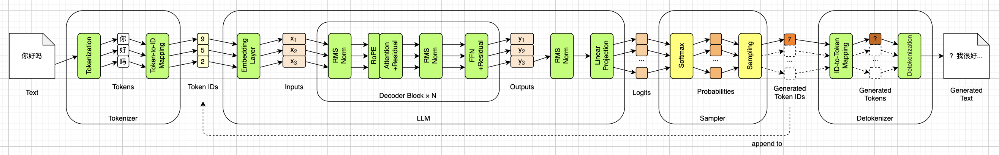
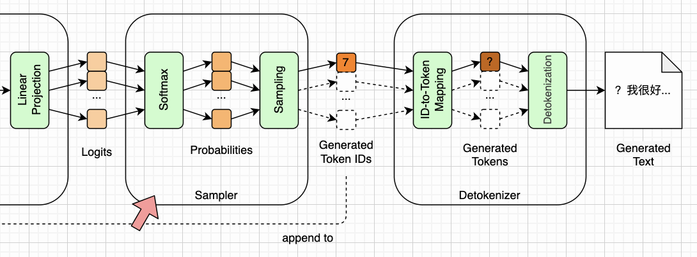
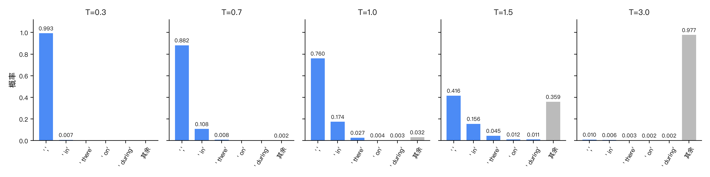
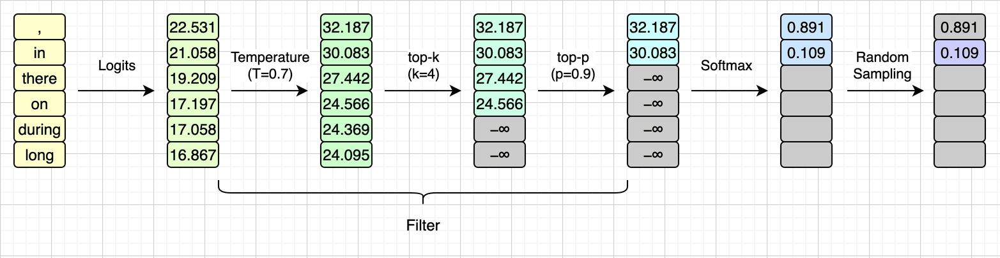
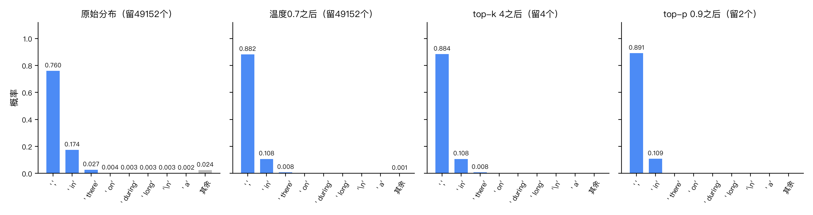

# 采样（Sampling）


到第九章为止，第一章总览图上LLM那个大方框里的每一样东西，都是我们自己写的代码了。整个路线图里14个小模块已经实现了12个，如下图所示：



还剩下的两个，就是上图采样器里那两个黄色的小模块：Softmax和Sampling。说是“还剩下”，其实从第四章起我们就一直在用一个最简单的采样器：每次都取分数最高的那个词元。这一章，我们把它换成一个真正的采样器，并且把总览图右下角那条`append to`虚线正式接上，让引擎成为一个真正的循环：生成、追加、再生成，直到模型自己说“我说完了”。

我会先说说为什么需要采样，再看看怎么把分数变成概率，以及最简单的贪婪采样有什么问题。接着介绍随机采样，以及控制它的三个旋钮：温度、top-k和top-p，还有它们的先后顺序。然后写代码：采样器、会自己停下来的生成循环，以及第三章埋下的那个流式输出的雷。最后简单说说基座模型和对话模型的区别。


## 为什么需要采样

我们先回到第一章那张总览图，把采样器那一部分放大来看。采样器夹在LLM和Detokenizer中间，里面只有两个小模块：Softmax把LLM送来的分数变成概率，Sampling再从概率里挑出一个词元ID。挑出来的ID一路往右交给Detokenizer，另一路顺着下面那条`append to`虚线绕回去，追加到输入序列的末尾，如下图所示：



LLM的输出是49152个分数，词表里每个词元一个。第四章说过，分数越高，下一个词元是它的可能性也越高。不过，LLM并不会直接告诉我们“下一个词元就是它”，它给出的其实是一张完整的“可能性清单”。举个例子，把“好好学习，天天”交给一个LLM，它可能会说：“向上”的可能性是0.91，“不”是0.04，“年”是0.02，“爱”是0.01，等等。用数学的话说，这是一个**条件概率**：在给定上文的条件下，下一个词元是谁的概率。LLM的训练过程，本质上就是让它从海量文本里学会这张清单。

既然拿到的是一张清单，那就得有人从清单里挑出一个来，追加到上文后面，再送回LLM，接着要下一张清单。这个“挑”的过程，就叫做**采样**（Sampling），负责挑的那个模块，就是**采样器**（Sampler）。

最简单的挑法，是每次都挑可能性最高的那个。我们从第四章起一直是这么做的，第八章引擎第一次说出人话，用的也是这个办法。但你用过的聊天机器人（例如豆包、DeepSeek）显然不是这样：同一个问题问两遍，得到的回答往往不一样。这些“不一样”，并不是来自模型本身。从词元ID到分数，整条流水线是一个确定性的函数，同样的输入永远得到同样的分数。第八章我们也验证过，和`transformers`库比，每一层的相对误差都不到百万分之一，挑出来的词元ID一个不差。**整条流水线上唯一有随机性的地方，就是采样器。** 模型每次说的话不一样，全部的“不一样”都发生在这个小模块里。

明白了这一点，很多事情就好理解了：为什么固定一个随机数种子，就能复现同样的输出；为什么把温度调成0，模型就变得完全可预测（至少在同一台机器上是这样，第十四章换到GPU上，分数的最后几位会变）；为什么调节模型的“创造力”，其实调的是采样器，而不是模型本身。这几件事，后面会一件一件讲到。


## 从分数到概率

LLM给出的是分数，不是概率。分数可正可负，加起来也不等于1，要当成概率用，还得先过一道Softmax。这个函数我们在第六章已经见过了，当时用它把注意力分数变成权重，这里的用法一模一样：先对每个分数取指数，全部变成正数；再除以它们的和，让它们加起来等于1。我们把第 $i$ 个词元的分数记作 $z_i$ ，一共 $n$ 个分数（对SmolLM2来说是49152个），那么第 $i$ 个词元的概率就是：

$$
p_i = \mathrm{softmax}(z_i) = \frac{e^{z_i}}{\sum_{j=1}^{n} e^{z_j}}
$$

这一章的随书源代码里有一个`sampler.py`脚本，它先让引擎算出“Once upon a time”之后的49152个分数，过一遍Softmax，再把概率最高的8个词元打印出来，下面是输出：

```
'Once upon a time'之后，概率最高的8个词元：

  ','           0.760  ##############################
  ' in'         0.174  #######
  ' there'      0.027  #
  ' on'         0.004  
  ' during'     0.003  
  ' long'       0.003  
  '\n'          0.003  
  ' a'          0.002  

  这8个加起来0.976，剩下的49144个分掉另外0.024。
```

可以看到，模型有76%的把握认为下一个词元是逗号，17.4%认为是`in`（“Once upon a time in ...”），2.7%认为是`there`（“Once upon a time there was ...”）。前8名加起来占了97.6%，剩下的49144个词元，一起分掉了最后那2.4%。这种“头部很尖、尾巴很长”的形状，是LLM输出的常态，后面我们会反复用到它。

顺便说一个实现上的细节。Softmax要对每个分数取指数，分数一大， $e^{z_i}$ 就会溢出成无穷大。所以实际的实现都会先把每个分数减去最大的那个分数，再取指数，这叫做**安全Softmax**（Safe Softmax）：

$$
p_i = \frac{e^{z_i - \max(\mathbf{z})}}{\sum_{j=1}^{n} e^{z_j - \max(\mathbf{z})}}
$$

这里的 $\mathbf{z}$ 就是全部 $n$ 个分数组成的向量。减去最大值之后，最大的那个指数正好是 $e^0 = 1$ ，其余的都小于1，就不会溢出了；而结果和原来的公式完全一样，第十二章会给出推导，到时候这个最大值还会派上大用场。PyTorch的`softmax()`内部就是这么做的，我们直接用它即可。


## 贪婪采样

有了概率，最简单的挑法就是每次挑概率最高的那个，这叫做**贪婪采样**（Greedy Sampling），也叫贪婪解码。由于Softmax不改变大小顺序，分数最高的那个，概率也一定最高，所以贪婪采样其实连Softmax都不用算，直接对分数取`argmax()`就行，第四章的`infer()`就是这么写的。

贪婪采样有一个很大的优点：它是确定性的。同样的输入，永远得到同样的输出，一个词元都不会变。第八章能和第一章那句话逐字对照，靠的就是它。所以在验证引擎写得对不对的时候，贪婪采样是最好用的。

但作为一个产品，贪婪采样有两个毛病。第一个毛病是**一成不变**：同一个问题，永远是同一个答案。第二个毛病是**容易复读**。我们换一个开头试试，把“The capital of France is”（法国的首都是）交给我们的引擎，用贪婪采样转60圈：

```
The capital of France is the capital of the country.

The capital of France is the capital of the country.

The capital of France is the capital of the country.

The capital of France is the capital of the country.

The capital of France is the capital of the country.
```

一旦掉进这种循环，就再也出不来了：每一圈看到的上文都比上一圈多了一模一样的一段，概率最高的那个词元，自然也还是指向同一个地方。第四、六、七章我们见过的那几次复读，背后也有它的影子。

治“复读”还有一个更直接的旋钮，叫做**重复惩罚**（Repetition Penalty）：凡是上文里已经出现过的词元，分数都打个折，正的除以一个大于1的数，负的乘以这个数，让模型不那么愿意把说过的话再说一遍。`transformers`库里有现成的实现，参数名就是`repetition_penalty`，文档建议取1.2左右。它和后面要讲的温度、top-k、top-p一样，都是在抽之前改分数，只是多看了一眼上文。SmolLM2的默认配置里没有它，本书也不实现，这一章靠随机采样来打破复读。

还有一点不太直观：每一步都挑最好的，并不等于整句话最好。当前这一步排第二的词元，也许通向一句整体上好得多的话，但贪婪采样只看眼前这一步，看不到那么远。有一种叫做**束搜索**（Beam Search）的办法，会同时保留好几条候选路线往前走，最后挑整体最好的一条，机器翻译里用得很多。不过它的计算量要大好几倍，而且在开放式的文本生成里，效果往往还是不如下面要讲的随机采样，本书就不展开了。


## 随机采样

那不挑最高的，挑什么呢？最自然的想法是：**按概率随机挑**。逗号的概率是0.760，那就有76%的机会挑中它；`in`是0.174，就有17.4%的机会挑中它。这叫做**随机采样**（Random Sampling）。用PyTorch写，就是一个`torch.multinomial()`函数：给它一组概率，它就按这组概率随机抽一个下标出来。

那随机数又是从哪来的呢？计算机里的随机数，大多是**伪随机数**：从一个叫做**随机数种子**（Random Seed）的整数出发，按一套固定的算法，一个接一个地算出来。算出来的数看着毫无规律，但只要种子相同，算出来的就是同一串数。所以说，采样器里的“随机”，其实也是确定的：固定了种子，每一次抽到的都一样；平时不固定种子，程序就从操作系统那里取一个不可预测的数当种子，每次运行才各不相同。本章开头说“固定一个随机数种子，就能复现同样的输出”，道理就在这里。

随机采样解决了贪婪采样的两个毛病，同一个开头每次都可能走向不同的故事，复读的循环也有机会被打破。我们还是用“The capital of France is”，换成随机采样再转60圈，参数是温度0.7、top-p 0.9、随机数种子42，它们的含义后面会解释。模型生成的其实是不带换行的一整段，下面的换行是`engine.py`为了排版加的，只在空格处断开，文字一个字不改：

```
The capital of France is a place where you can see things like the famous
Paris Opera House, the famous Parisian Museum, and the famous Parisian Museum.
Paris is a city in the south of France, which means it is in the southern part
of France. It is the capital of France. It is located in the
```

不复读了，而且还提到了巴黎。不过你可能也注意到了，这段话里有一句是错的：巴黎并不在法国南部。这就是常说的**幻觉**（Hallucination）：模型一本正经地胡说八道。LLM只负责按概率预测下一个词元，并不会核对自己说的是不是事实，随机采样只会让这个问题更明显。所以，LLM的回答一定要自己核实，这对135M的小模型尤其如此。

但随机采样也带来了一个新问题：**长尾**。还记得前面那张表吗？前8名占了97.6%，可剩下的那49144个词元，加起来也还有2.4%。单看一步，2.4%不算什么，可生成是一步接一步的。粗略地算一下，如果每一步都有2.4%的机会抽到一个尾巴上的词元，转100圈下来，一次都抽不到的概率只有 $0.976^{100} \approx 8.8\%$ 。而尾巴上的词元，很多都是和上文八竿子打不着的东西，一旦抽中一个，它就会被追加进上文，后面整段话都可能被带偏。所以，实际用的随机采样，并不是直接按原始概率抽，而是先把概率分布的形状改一改，再抽。


## 过滤器

改形状的旋钮主要有三个：温度、top-k和top-p。它们都不是抽法，而是抽之前对分数做的预处理，我们把它们统称为**过滤器**（Filter）：分数进，分数出，只改形状，不做抽取。真正的“抽”，始终只有最后那一步。下面我们挨个来看这三个过滤器。


### 温度

**温度**（Temperature）是最常用的一个旋钮，做法也最简单：在过Softmax之前，把每个分数都除以同一个数 $T$ 。和前面的Softmax公式对比一下，只是每个 $z$ 都换成了 $z / T$ ：

$$
p_i = \frac{e^{z_i / T}}{\sum_{j=1}^{n} e^{z_j / T}}
$$

当 $T=1$ 时，这就是普通的Softmax。 $T$ 小于1，分数之间的差距被放大，高的更高、低的更低，分布变得更“尖”，模型更保守，更倾向于挑概率高的那几个； $T$ 大于1，分数之间的差距被压平，分布变得更“平”，冷门的词元也有了机会，模型更“放飞”。`sampler.py`把前面那5个词元在不同温度下的概率算了一遍：

```
                  T=0.3    T=0.7    T=1.0    T=1.5    T=3.0
  ','             0.993    0.882    0.760    0.416    0.010
  ' in'           0.007    0.108    0.174    0.156    0.006
  ' there'        0.000    0.008    0.027    0.045    0.003
  ' on'           0.000    0.000    0.004    0.012    0.002
  ' during'       0.000    0.000    0.003    0.011    0.002
```

$T=0.3$ 时，逗号的概率涨到了0.993，几乎就是贪婪采样； $T=1.5$ 时，逗号掉到了0.416，`there`反而从0.027涨到了0.045；到了 $T=3.0$ ，连逗号都只剩0.010了，这5个词元加起来还不到2.5%，其余的概率都被摊到了那几万个尾巴词元上。把这张表画出来，就是下面这样。每一格里，蓝色是这5个词元，最后那根灰色的“其余”，是剩下几万个词元加在一起的概率：



从左往右，蓝色的头部一路变矮，灰色的尾巴一路变高。 $T=1.5$ 时，“其余”已经占了0.359，是`in`的两倍还多；到了 $T=3.0$ ，几乎全是尾巴。

这个名字来自物理学里的玻尔兹曼分布：温度越高，粒子越活跃，各种状态出现的机会越平均。放到这里，温度越高，各个词元被抽中的机会越平均。

温度有两个极限值得一提。 $T$ 趋于无穷大时，所有分数都被压成了0，分布变成了均匀分布，49152个词元机会均等，模型就是在随机吐词，和第三章那个假引擎没什么两样。 $T$ 趋于0时，最高分和其他分数的差距被放大到无穷，分布变成了只有最高分那一个是1、其余全是0，也就是贪婪采样。所以，贪婪采样可以看作温度为0的随机采样。不过要注意，这只是一个极限，代码里不能真的去除以0，后面写代码时会专门处理。

这一章的随书源代码里还有一个`temperature.py`脚本，用同一个开头、同一个随机数种子，把温度从0一路拧到1.5，各生成40个词元，下面是输出。和前面一样，模型生成的每一段都不带换行，折行是脚本为了排版加的：

```
T=0  （32/40个互不相同）
  Once upon a time, there was a little girl named Lily. She lived in a big
  house with her family, but she didn't have many toys to play with. One day,
  her mom told her that she could

T=0.3  （33/40个互不相同）
  Once upon a time, there was a curious little girl named Lily. She loved to
  learn new things and had a special talent for remembering things. One day,
  she found a book about the history of the United States and

T=0.7  （35/40个互不相同）
  Once upon a time, there was a curious little girl named Lily. She loved to
  count things around her - apples, balls, and even bugs! One day she found
  two little sticks, each about the size of a

T=1.0  （37/40个互不相同）
  Once upon a time, Baron Thibaud of Edinburgh was thinking of getting
  married. He had stayed awake all day to try and remember the date, but no
  coffee apart from some jolly tea from his father’s

T=1.5  （40/40个互不相同）
  Once upon a time, Baron Thwaite branched off Jay Dopien Lynch Hay Haz Johnny
  Flat Light By Flowers strong diversity to org Shaw Hom\'taresite Night apart
  Troy buried Freaked Harmonologies residing Extreme outs company
```

$T=0$ 就是第八章那句话； $T=0.3$ 和 $T=0.7$ 还是那个叫Lily的小女孩，只是故事各有不同； $T=1.0$ 换了一个苏格兰男爵，文字还算通顺；到了 $T=1.5$ ，前半句还像样，后面就成了一串毫不相干的单词。温度越高，故事越多样，也越容易胡说八道，中间那一档才是比较好用的。

脚本最后还验证了一件事： $T=1.0$ 时，同一个种子跑两次，结果一字不差；换一个种子，结果就不一样了。模型没有变，分数没有变，变的只有采样器里那个随机数生成器。


### top-k

温度能让分布变尖，但它不会把任何一个词元的概率真的变成0，长尾问题依然在。直接一点的办法，是把尾巴砍掉，这就是**top-k**：只保留分数最高的 $k$ 个词元，其余的全部砍掉，然后在剩下的 $k$ 个里面按概率抽。

怎么“砍掉”呢？把它们的分数换成负无穷就行。过Softmax的时候， $e^{-\infty} = 0$ ，被砍掉的词元概率正好是0，剩下的 $k$ 个会自动重新归一，加起来还是1。这一招你应该很眼熟，第六章的因果掩码就是这么干的，第八章MoE的路由器也是。

脚本`sampler.py`也把不同的 $k$ 值试了一下，看看还剩几个词元、原来的概率还剩多少：

```
  top_k=1           1个   0.7600
  top_k=5           5个   0.9684
  top_k=50         50个   0.9933
  top_k=500       500个   0.9988
```

$k=1$ 就是贪婪采样； $k=50$ 时，留下的50个词元占了原来99.3%的概率，砍掉的那49102个词元，加起来还不到0.7%。

top-k的问题在于， $k$ 是固定的，它不看分布长什么样。模型很有把握的时候，比如上面那个例子，前两名就占了93%，留50个就太多了，等于把48个明显不该选的词元也放了进来；模型拿不准的时候，可能有上百个词元都说得通，留50个又太少了，会砍掉一些不错的候选。这个短板，要靠下一个过滤器来补。


### top-p

**top-p**又叫**核采样**（Nucleus Sampling），出自2019年Holtzman等人的论文《The Curious Case of Neural Text Degeneration》（arXiv:1904.09751）。它不固定留几个，而是固定留多少概率：把词元按概率从大到小排好，一个一个累加，加到 $p$ 为止，剩下的全部砍掉。这样留下来的那一小撮，就是所谓的“核”。

这样一来，候选集的大小就是自适应的了。还是用`sampler.py`的输出来看：

```
  top_p=0.5         1个   0.7600
  top_p=0.9         2个   0.9341
  top_p=0.95        3个   0.9616
  top_p=0.99       30个   0.9902
```

对“Once upon a time”来说，模型很有把握， $p=0.9$ 只留了2个词元，逗号和`in`。可同样是 $p=0.9$ ，换一个开头，结果就很不一样了。这一章的随书源代码里还有一个`check_filters.py`脚本，用了三个开头。对“def fibonacci(n):”这样的代码开头， $p=0.9$ 留下9个；而对“The capital of France is”，模型拿不准后面该接什么， $p=0.9$ 一下子留下了406个。同一个旋钮，分布尖的时候自动收紧，分布平的时候自动放宽，这正是top-k做不到的。top-k和top-p也可以一起用，先砍到 $k$ 个，再在里面取核。

top-p有一个特别容易写错的地方，就是**边界上的那个词元**。我们来看一个小例子：三个词元的概率分别是0.6、0.3、0.1， $p=0.7$ ，应该留几个？

最顺手的写法，是从大到小累加，一超过 $p$ 就截断：0.6还不到0.7，留下；加上第二个变成0.9，超过了0.7，砍掉。这样只留1个。但`transformers`的写法不一样：它是从小到大排，从最小的开始砍，只要砍掉的那些加起来还不超过 $1-p$ ，也就是0.3，就接着砍。0.1砍掉，加起来是0.1；再砍0.3，加起来是0.4，超过了0.3，所以停下，0.3那个留下来。这样留了2个。

区别就在那个跨过阈值的边界词元：0.6加上它，才刚好够0.7。`transformers`库会留下它，所以实际留下的概率总是不小于 $p$ ；顺手的写法会把它一起砍掉，候选集就系统性地偏小。两种写法生成的文字都很通顺，程序也不报错，又是一个只有核对才能发现的错误。`check_filters.py`故意按顺手的写法做错了一次：

```
    0.6 / 0.3 / 0.1，top_p=0.7   transformers留2个，我们留2个，降序写法留1个
    真logits，top_p=0.9    正确留   2个，降序写法留   1个，逐位相同 False
```

拿“Once upon a time”的真实分数来试， $p=0.9$ 时，正确的写法留下逗号和`in`，顺手的写法只留下逗号，等于在这一步退化成了贪婪采样。


### 先后顺序

三个过滤器都讲完了，现在把它们串起来，拿“Once upon a time”之后真实的分数走一遍。温度和top-p用的是后面“代码效果”那一节的参数，0.7和0.9；那里没有开top-k，这里加一个 $k=4$ ，好让每一步都看得出变化。整个采样器的流程如下图所示：



图里的每一列，其实都是一个49152维的向量，这里只画了分数最高的6个词元。从左往右看：温度把每个分数都除以0.7，大小顺序没变，差距拉开了；top-k 4把第5、6名换成了负无穷；top-p 0.9再把`there`和`on`也换成负无穷，只剩逗号和`in`。到这里，三个过滤器做的都是同一件事：分数进，分数出，有的被改大小，有的被换成负无穷。过一遍Softmax之后，49152个词元里只有这两个还有概率，0.891和0.109，加起来正好是1。最后按这个概率抽一个，种子42抽到的是`in`，所以“代码效果”那一节的故事，是从“Once upon a time in”开始的。

上面那张图看的是分数，我们再换成概率看一遍。每过一个过滤器，就过一次Softmax，看看分布的形状变成了什么样，横轴是原始概率最高的8个词元，灰色的还是“其余”：



可以看到，温度把分布变尖了，逗号从0.760涨到0.882，“其余”几乎被压没了；top-k 4只留下前4名，后面4根柱子和“其余”都归零了，但被砍掉的那些加起来本来就只有千分之二左右，前4名的概率几乎没变，逗号只从0.882涨到0.884；top-p 0.9下手最狠，只留下逗号和`in`两个，再重新归一。

最后还有一个问题：这个顺序能不能随便排？答案是不能。`transformers`库的顺序是温度、top-k、top-p，我们也照这个顺序来。先说top-k：温度是把每个分数都除以同一个正数，排名不会变，而top-k只看排名，所以温度和top-k谁先谁后，留下的都是同样的 $k$ 个。要紧的是温度和top-p。温度改的是分数之间的差距，而top-p看的是概率，概率正是由这些差距决定的。所以温度放在top-p前面还是后面，改变的就不只是概率的大小，而是**哪些词元能入选**。脚本`check_filters.py`也把顺序颠倒过来试了一下：

```
    T=0.5、top_p=0.9   先温度留   1个，先top-p留   2个
    T=1.5、top_p=0.9   先温度留 992个，先top-p留   2个
```

$T=1.5$ 时，先过温度，分布被压平了，top-p要累加到0.9，需要992个词元；先过top-p，用的是原来的分布，只留下2个，之后再过温度，也只是在这2个里面重新分配概率。两种顺序，候选集一个是992个，一个是2个，生成的文字会大不一样。


## 代码实现

理论讲完了，下面我们把采样器写进推理引擎。这一章要改的地方比前几章多一些：`Config`补一个字段，`Model`一行不动，新写一个`sampler.py`和一个`detokenizer.py`，`Engine`类也终于要改了。


### Config

先来看`Config`类，这一章只多了一个字段：

```python
        # 第十章新要的一个。0号词元就是`<|endoftext|>`，第三章数特殊词元时见过。
        # 采样器抽到它，生成循环就停。
        self.eos_token_id = self.raw["eos_token_id"] # 0
```

第三章说过，`<|endoftext|>`一个人干了三份活，它的ID是0。这一章用的是其中一份：EOS，也就是第三章说的End of Sequence。你在别的资料里可能还会看到End of Sentence这种说法，不过对LLM来说，它标的并不是一句话的结束，而是一整篇文档的结束，所以`<|endoftext|>`这个名字更贴切。训练语料里，每篇文档的末尾都有这么一个词元，所以模型学会了：一段话说完了，下一个词元就是它。生成循环一抽到它，就该停了。


### 三个过滤器

然后是这一章的重点，`sampler.py`。三个过滤器都写成了纯函数，分数进，分数出，不抽取，也不保存任何状态。先看温度，它只有一行：

```python
def apply_temperature(logits, temperature):
    return logits / temperature
```

再看top-k。先用`torch.topk()`找到第 $k$ 大的那个分数，把它当门槛，严格低于它的都换成负无穷：

```python
FILTER_VALUE = float("-inf") # 和因果掩码一样，置成-inf，softmax之后就是0

def apply_top_k(logits, k):
    if k <= 0 or k >= logits.shape[-1]:
        return logits
    threshold = torch.topk(logits, k).values[..., -1, None]
    return logits.masked_fill(logits < threshold, FILTER_VALUE)
```

$k=0$ 表示不截断，原样返回。最后是top-p，它照着`transformers`库的写法，升序排、从小的开始砍：

```python
def apply_top_p(logits, p):
    if p >= 1.0:
        return logits
    sorted_logits, order = torch.sort(logits)          # 升序
    cumulative = sorted_logits.softmax(-1).cumsum(-1)  # 从最小的累加上去
    remove = cumulative <= 1 - p                       # 这一段加起来不到1 - p，砍
    remove[..., -1] = False                            # 最大的那个永远留着
    remove = remove.scatter(-1, order, remove)         # 换回词表里的位置
    return logits.masked_fill(remove, FILTER_VALUE)
```

这几行要稍微解释一下。`torch.sort()`返回两样东西：排好序的分数，以及每个分数原来在词表里的位置`order`。第二行过Softmax、再用`cumsum()`从最小的开始累加，得到的`cumulative`里，第 $j$ 个数就是最小的那 $j+1$ 个词元的概率之和。第三行把累加和不超过 $1-p$ 的位置都标成要砍的。第四行是个保险：最大的那个词元永远留着，免得 $p$ 很小时把候选集砍空了。到这里，`remove`还是按排序后的顺序排的，第五行的`scatter()`按`order`把它换回词表里原来的位置，最后再统一换成负无穷。

你可能会问：top-p明明是按概率来挑的，为什么不干脆放到Softmax后面，直接在概率上砍？其实也可以，砍完再重新归一，结果一模一样。之所以这么写，是因为温度只能作用在分数上，索性让三个过滤器都“分数进、分数出”，砍掉的统一换成负无穷，归一化留给最后那一次Softmax。`transformers`库也是这么设计的，它的过滤器收进来、交出去的也都是分数。所以top-p是按概率决定、在分数上执行：第二行那次Softmax只是临时算一下，用完就扔。


### 两个采样器

有了过滤器，我们就可以写采样器了。这里有一个设计上的选择：贪婪和随机，要不要写在一个函数里，用`if`来区分？比如下面这样：

```
if temperature == 0:
    next_id = argmax(logits)
else:
    next_id = 按概率抽一个
```

我们没有这么做，而是把它们写成了两个类，`GreedySampler`和`RandomSampler`，对外都只有一个用法：把分数交给它，它还回来一个词元ID。用哪一个，由`Sampler.build()`在构造的时候决定一次：

```python
class Sampler:
    @staticmethod
    def build(temperature=1.0, top_k=0, top_p=1.0, seed=None):
        if temperature == 0:
            return GreedySampler() # T趋于0的极限，不是除以0
        return RandomSampler(temperature, top_k, top_p, seed)


class GreedySampler(Sampler):
    def __call__(self, logits):
        return int(logits.argmax())
```

老实说，这么做并不是为了快。每一圈判断一次`if`，和那30层的计算比起来，根本不值一提。真正的好处是生成循环可以写得很干净：循环里只有一句`sampler(logits)`，它不需要知道手里拿的是贪婪还是随机。贪婪和随机也能各自单独测试，以后要加新的采样策略，只要再写一个类就行，模型和循环都不用动。而且这里还顺手解决了温度为0的问题：前面说过，贪婪采样是温度趋于0的极限，`build()`看到0，就直接交给`GreedySampler`，根本不会走到除以0那一步。

随机采样器`RandomSampler`稍微长一点，我们只看它的核心：

```python
class RandomSampler(Sampler):
    def __init__(self, temperature=1.0, top_k=0, top_p=1.0, seed=None):
        self.temperature = temperature
        self.top_k = top_k
        self.top_p = top_p
        self.generator = torch.Generator()
        if seed is None:
            self.generator.seed()
        else:
            self.generator.manual_seed(seed)

    def filter(self, logits):
        logits = apply_temperature(logits, self.temperature)
        logits = apply_top_k(logits, self.top_k)
        return apply_top_p(logits, self.top_p)

    def __call__(self, logits):
        probs = self.filter(logits).softmax(-1) # (49152,)，被砍掉的正好是0
        return int(torch.multinomial(probs, 1, generator=self.generator))
```

这两个方法各管一半。`filter()`按温度、top-k、top-p的顺序把三个过滤器串起来，这是确定性的那一半。`__call__()`先过滤，再过Softmax，最后用`torch.multinomial()`按概率抽一个，这是随机的那一半，也是整个引擎里唯一一处用到随机数的地方。

注意构造函数里的那个`torch.Generator()`：每个采样器都自带一个随机数生成器。PyTorch也有一个全局的随机数生成器，但如果用它，程序里别处只要用了一次随机数，比如第五章拿来冒充空位的`randn_like()`，采样的结果就跟着变了。自带一个，固定了种子就一定能复现，也不会和别处互相干扰。

不给种子的那个分支也有讲究。`torch.Generator()`新建出来的时候，种子并不是随机的，而是一个写死的数（67280421310721）。要是不调用`seed()`，每次运行程序，抽到的就都是同一串，“随机采样”其实一点都不随机。这种错误同样不报错，生成的文字也很通顺，只是每次都一模一样。`seed()`的意思是从操作系统那里取一个真正不可预测的数来当种子，这样不固定种子的时候，每次运行才会各不相同。


### 生成循环

最后是`Engine`类。从第四章起，它一直是“转`ROUNDS`圈，每圈取最高分”，这一章终于要改了。我们把原来的`generate()`方法改写成了一个`stream()`方法：

```python
    def stream(self, ids, sampler=GREEDY, max_new_tokens=MAX_NEW_TOKENS):
        ids = list(ids)  # 复制一份，不去改调用方手里那个list
        for _ in range(max_new_tokens):
            next_id = self.infer(ids, sampler)
            if next_id == self.eos: # 模型自己认为说完了
                return
            ids.append(next_id)
            yield next_id

    def infer(self, ids, sampler=GREEDY):
        logits = self.model.forward(ids) # (T,) → (49152,)
        return sampler(logits)           # (49152,) → 一个ID
```

先看`infer()`，只改了最后一行：挑下一个ID的活，不再写死成`argmax()`，而是交给传进来的采样器。默认的采样器是`GREEDY`，也就是一个`GreedySampler`，所以不传采样器的时候，行为和前几章一模一样。

再看`stream()`，就是那个循环，也就是总览图上那条`append to`虚线：算分数，挑一个，追加到序列末尾，再来一圈。它有两个停止条件。一个是抽到了EOS，模型自己认为说完了，EOS本身不吐出来。另一个是`max_new_tokens`，转到这么多圈就停，这是个兜底，免得模型一直不说EOS，循环永远停不下来。

这里的`yield`是Python的生成器语法，对不熟悉Python的读者，可以这样理解：`stream()`每挑出一个新词元，就先把它交出去，调用方拿到之后可以马上处理，比如印到屏幕上，然后`stream()`再接着往下算。这样就不用等全部词元都生成完了，才一次性交出一个列表。原来的`generate()`方法还留着，它就是把`stream()`吐出来的词元收齐了再交出去。


### 第三章埋的雷

前面`stream()`一个一个地吐词元，我们自然想来一个印一个，做出聊天机器人那种打字机的效果。可是这里有一个坑，第三章就埋下了：必须把整串ID拼完再解码，不能一个词元一个词元地来。一个汉字占三个UTF-8字节，BPE是按字节切的，完全可能把一个汉字切进两个词元。单独解码其中任何一个，都只有半个汉字，读不成字。

这一章的随书源代码里有一个`detokenizer.py`，专门演示了这件事。它把“第十章：采样”切成词元，然后一个一个地解码。SmolLM2主要处理英文，自己很少生成中文，但这个坑还是值得知道：换成擅长中文的模型，比如第十三章的Qwen3，几乎每一句话都会碰到它。

```
      ID  词元        字节            逐个decode      先进缓冲
   40562  'ç¬'      e7 ac         '�'           ''
     122  '¬'       ac            '�'           '第'
   27991  'åį'      e5 8d         '�'           ''
     219  'ģ'       81            '�'           '十'
   47287  'ç«'      e7 ab         '�'           ''
     250  'ł'       a0            '�'           '章'
   24713  'ï¼ļ'     ef bc 9a      '：'           '：'
   27219  'éĩ'      e9 87         '�'           ''
     225  'ĩ'       87            '�'           '采'
   26519  'æł'      e6 a0         '�'           ''
     132  '·'       b7            '�'           '样'

  逐个decode拼起来   '������：����'
  先进缓冲再印       '第十章：采样'
  整段decode         '第十章：采样'
```

这6个字切成了11个词元，除了全角冒号，每个汉字都被切成了两半，前一半两个字节，后一半一个字节。逐个解码，每一半都印出了一个`�`，拼起来是一串乱码。

办法是加一个字节缓冲：每个词元先换回它代表的那几个字节，放进缓冲里，能凑成完整的字符就印出来，凑不齐就先扣着，等下一个词元。上面最后一列就是这么印出来的：第一个词元进来，只有`e7 ac`两个字节，凑不成字，印一个空串；第二个词元带来`ac`，三个字节齐了，印出“第”。`detokenizer.py`里的`StreamDecoder`类干的就是这件事：

```python
class StreamDecoder:
    def __init__(self, tok):
        self.tok = tok
        self.char_to_byte = {c: b for b, c in byte_to_char().items()}
        self.buffer = codecs.getincrementaldecoder("utf-8")(errors="replace")

    def to_bytes(self, i):
        return bytes(self.char_to_byte[c] for c in self.tok.id_to_token(i))

    def push(self, i):
        return self.buffer.decode(self.to_bytes(i))

    def flush(self):
        return self.buffer.decode(b"", final=True)
```

先看`to_bytes()`，它把一个词元ID换回字节：先查词表得到词元字符串，再把字符串里的每个字符，按第三章那张字节映射表反查回一个字节，比如`Ġ`换回空格`0x20`。缓冲本身我们没有自己写，用的是Python标准库里的增量UTF-8解码器，喂给它的字节末尾要是凑不成一个字符，它就先扣着，下一次喂进来的字节接在后面再读。

最后那个`flush()`也不能忘。生成循环随时可能停下，`max_new_tokens`到了，可不管一个汉字是不是才吐出一半。这时缓冲里还扣着一两个字节，不调用`flush()`，它们就被悄悄丢掉了，屏幕上什么都看不出来；调用了，`final=True`会把它们当坏字节印成一个`�`，至少让人知道这里断过。`engine.py`在循环结束之后就调用了它一次。

这个坑只在流式输出时才会出现，整段解码完全没有问题。纯ASCII的英文也碰不到它，因为一个ASCII字符正好一个字节，怎么切都在字符边界上。不过英文文本里也不全是ASCII：一个emoji`😀`占四个字节，SmolLM2会把它切成3个词元，逐个解码就是3个`�`。所以它是一个典型的、只有推理时才会踩到的坑。


### 核对

采样器写完了，怎么知道它写对了呢？这一章的核对和前面几章不太一样，因为随机采样的输出，本来就该每次不一样，没法和`transformers`逐个ID比较。所以我们把采样器拆成两半来验。

确定性的那一半，也就是三个过滤器，可以严格核对。`check_filters.py`拿它们和`transformers`里对应的`TemperatureLogitsWarper`、`TopKLogitsWarper`、`TopPLogitsWarper`比了一下，三个开头、各种参数，单独比、串起来比，全部逐位相同。前面那个边界词元和先后顺序的实验，也是这个脚本做的。

随机的那一半，换成两条判据。`check_draw.py`先验证可复现：同一个种子抽两遍，结果完全相同；换一个种子，结果就不同；同一个种子，中间插进别的随机数操作，结果也不受影响，这就是自带随机数生成器的好处。然后验证分布正确：造一个已知的小分布，抽40,000次，看每个词元被抽中的频率，是不是收敛到了它应有的概率：

```
    T=1.0，top_k=2
        词元        目标        经验        误差
           0    0.7311    0.7291    0.0020
           1    0.2689    0.2709    0.0020
           2    0.0000    0.0000    0.0000
           3    0.0000    0.0000    0.0000
      最大误差0.0020，在统计误差以内
```

这里用的是4个词元的分数`[2, 1, 0, -1]`，top-k取2。被砍掉的两个词元，40,000次里一次都没被抽中；留下的两个，经验频率和目标概率只差0.002。抽40,000次，频率本身就会有零点几个百分点的统计误差，这个差距在误差范围之内。

最后，第八章的`check_forward.py`也搬了过来，再跑一遍四级验收。默认的采样器是贪婪，所以采样器接进来以后，贪婪那条路一个ID都不能变。结果四级全部通过，和第八章一模一样。


## 代码效果

代码写完了，我们来跑一下引擎。`engine.py`现在可以从命令行接收采样参数了，什么都不加，就是贪婪采样，输出和第八章一字不差。我们加上温度0.7、top-p 0.9，固定种子42，看看效果：

```
输入     'Once upon a time'   [6403, 1980, 253, 655]
采样器   RandomSampler(temperature=0.7, top_k=off, top_p=0.9)
最多     20个新词元，抽到EOS（ID 0）就停

Once upon a time in the beautiful town of Naples, there lived two best friends
named Max and Lily. They loved exploring

20个新词元，到了上限停下，用时1.1秒，每个0.06秒
```

这次第一个词元抽到的是`in`，而不是逗号，于是故事从意大利的那不勒斯开始了。你在屏幕上看到的，是一个词一个词蹦出来的，就像聊天机器人那样。

你可能注意到了，最后一行说的是“到了上限停下”，而不是“抽到EOS”。这是因为SmolLM2是一个基座模型，它学的是续写文档，而一篇讲故事的文档，往往很长，20个词元远远不到该结束的时候。我们换一个开头，“Copyright 2024. All rights reserved.”，这句话通常出现在网页或者文档的最末尾：

```
输入     'Copyright 2024. All rights reserved.'   [14129, 216, 34, 32, 34, 36, 30, 2018, 2387, 10261, 30]
采样器   GreedySampler()
最多     20个新词元，抽到EOS（ID 0）就停

Copyright 2024. All rights reserved.

0个新词元，抽到EOS停下，用时0.1秒
```

模型挑出来的第一个词元就是EOS，一个新词元都没生成，循环就停了。它从训练语料里学到了，这句话后面通常就是文档的结尾。总览图上那条`append to`虚线，现在终于有了两个出口：模型自己说完了，或者到了我们设的上限。

最后再看一个数字。同样是贪婪采样，生成20个词元时，每个平均0.05秒；把上限调到100个，每个平均就变成了0.08秒；调到300个，每个要0.2到0.3秒。生成得越多，每个词元就越慢。原因我们在第一章就说过了：每转一圈，都要把整个序列从头到尾重算一遍。第一圈算4个词元，第100圈就要算103个。这个问题，留到下一章来解决。


## 基座模型和对话模型

最后简单说一件事。你可能会想，既然引擎已经能用了，那能不能像聊天机器人那样，问它一个问题呢？我们来试一下。第三章提到过，SmolLM2的词表里有两个特殊词元，`<|im_start|>`和`<|im_end|>`，它们是ChatML这种对话格式用的。按照这个格式，一个问题要写成下面这样：

```
<|im_start|>user
What is the capital of France?<|im_end|>
<|im_start|>assistant
```

意思是：用户说了一句话，现在轮到助手说了。我们把这段文字交给引擎，用贪婪采样转40圈：

```
<|im_start|>user
What is the capital of France?<|im_end|>
<|im_start|>assistant
What is the capital of France?
What is the capital of France?
What is the capital of France?
What is the capital of France?
What is the capital of France?
```

它并没有回答问题，而是把问题复读了一遍又一遍。第三章说过，本书用的是SmolLM2的**基座模型**（Base Model），它只在海量文本上学会了“续写”，并没有学过怎么扮演一个助手。那两个特殊词元虽然被认出来了（输入的ID里，1和2就是它们），但模型并不知道它们意味着“该你回答了”。

能回答问题的，是在基座模型的基础上，再用大量对话数据训练过的**对话模型**，也叫指令模型（Instruct Model），比如SmolLM2-135M-Instruct，它和我们用的基座版一样大。这个后续的训练过程叫做后训练，不在本书的讨论范围内。对推理引擎来说，对话模型和基座模型的架构一模一样，只是权重不同：换一份权重，再按对话模板把用户的问题包装成上面那种格式，就能和它对话了。这件事我们留到第十三章，换上Qwen3-0.6B的对话版，在那里第一次和模型对话，顺带也会把SmolLM2-135M-Instruct换上试一下，看看同一个问题它答得怎么样。

不过，基座模型也不是完全不能用。你只要把问题写成它在训练语料里见过的样子，比如问答的格式，它就能答上来。还是用贪婪采样，转20圈：

```
Q: What is the capital of France?
A: Paris.

Q: What is the capital of France?
A: Paris.
```

它答出了“Paris.”，然后又接着写了一组一模一样的问答，因为在它看来，这是一份问答文档，后面理应还有下一题。说到底，基座模型干的只有一件事：续写。

这一节和前面贪婪、随机采样那几段输出，都是`engine.py`跑出来的，具体命令见这一章随书源代码里的`README.md`。


## 本章小结

这一章补上了总览图上最后两个灰色的小模块，Softmax和Sampling，引擎第一次成为了一个真正的循环。

我们先弄清了为什么需要采样。LLM给出的是一张“下一个词元是谁”的概率清单，采样器负责从清单里挑一个。从词元ID到分数，整条流水线是确定性的，模型每次说的话不一样，全部的随机性都来自采样器。

接着我们从最简单的贪婪采样出发，看到了它一成不变、容易复读的毛病，又看到了直接按概率随机抽会被长尾带偏。于是有了三个过滤器：温度把分数之间的差距放大或压平，温度为0就是贪婪；top-k只留分数最高的 $k$ 个；top-p只留累计概率够 $p$ 的那一撮，候选集大小随分布自适应，边界上的那个词元要留下。三者的顺序是温度、top-k、top-p，其中温度和top-p的顺序一换，候选集就变了。

然后我们写了代码。`Config`补了一个`eos_token_id`；`sampler.py`里三个过滤器是纯函数，贪婪和随机是两个类，由`build()`在构造时选定；`Engine`的生成循环抽到EOS就停，最多转`max_new_tokens`圈；`detokenizer.py`用一个字节缓冲，排掉了第三章埋下的那颗雷。过滤器和`transformers`逐位核对，抽样本身用可复现和频率收敛来验证，贪婪那条路的四级验收也全部通过。引擎现在是：

```
ids → embed → [norm → attn → norm → ffn] × 30 → norm → lm_head → sampler → id
 ^                                                                         |
 +------------------------------- append to -------------------------------+
```

最后我们还看了一眼基座模型和对话模型：架构一样，权重不同，基座模型只会续写。

到这里，“跑通”这一部分就结束了。第一章那五行`transformers`代码背后发生的每一件事，我们都自己写了一遍。不过刚才也看到了，生成得越多，每个词元就越慢，因为每一圈都要把整个序列重算一遍。从下一章开始，我们进入“跑快”这一部分，第一个要解决的，就是这个问题：KV Cache。
