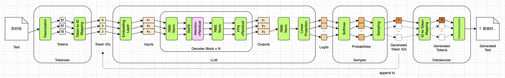

# KV Cache


在第十章，我们给引擎装上了真正的采样器，并且把总览图上那条`append to`虚线正式接上了：生成、追加、再生成，直到模型自己说完，或者到了上限。到这里，第一章那五行`transformers`代码背后发生的每一件事，我们都自己写了一遍，14个小模块全部变成了绿色，如下图所示：



从这一章开始，我们进入本书的第二部分：“跑快”。前面十章问的都是“算得对不对”，从这一章起，问题变成了“算得快不快”。不过要先说清楚：这一部分**不会**在总览图上增加任何新的方框。上图里我把注意力机制涂成了粉色，因为这一章和下一章改的都是它，但改的不是“算什么”，而是“怎么算”。数据流还是那条数据流，算出来的结果也必须和前面一模一样。

这一章要解决的，是第十章末尾留下的那个问题：生成得越多，每个词元就越慢。我会先把这个浪费算清楚，再说说该把什么存下来，也就是KV Cache。接着看看推理过程因此分成的两个阶段：预填充（Prefill）和解码（Decode），以及KV Cache要占多少内存。然后写代码、对拍、测速。最后简单介绍几种让缓存变得更小的办法。


## 慢在哪里

### 把浪费算出来

我们先回顾一下第十章的生成循环。每转一圈，都要把整个序列从头到尾送进30个Decoder块算一遍，然后只取最后一个位置的分数，挑出一个新词元，追加到序列末尾，再转下一圈。

第一章算过一笔账：“Once upon a time”是4个词元，生成20个新词元，第一圈算4个，第二圈算5个，……，第20圈算23个，加起来一共算了270个位置，可我们真正想要的只有20个。这一章的随书源代码里有一个`speed.py`脚本，它把这笔账算得更长一些：

```
一  开头4个词元，再生成n个，一共要过模型多少个位置
         n          不带缓存       带缓存      倍数
        20             270          23      11.7
       100           5,350         103      51.9
      1000         503,500       1,003     502.0
```

“带缓存”那一列是这一章要做到的：开头那4个词元一次算完，之后每圈只算新来的那1个。生成20个词元，浪费还不算大，11倍多；生成1000个，就是500倍。而且这个倍数会随着生成的长度一直往上涨。

### 为什么是纯粹的浪费

说它是浪费，并不夸张，因为重算出来的东西，和上一圈算出来的**一模一样**。

这要归功于第六章的因果掩码。每个词元只能看到它自己和它前面的词元，看不到后面的。所以往序列末尾追加一个新词元，前面那些位置根本看不见它，它们在每一层里的每一个中间结果，都不会因为它的到来而改变。第六章讲因果掩码的时候就说过：往序列末尾追加一个新词元时，注意力分数矩阵只是多出了一行一列，前面那些行一个数都不会变。

不只是注意力。第八章说过，FFN是严格逐词元的；第五章说过，归一化也是逐词元的。注意力的输出不变，FFN和归一化的输入就不变，输出也就不变。一层层推下去，前面每个位置在每一层的结果都和上一圈一样。第 $n$ 圈重算的那前 $n-1$ 个位置，算出来的数和第 $n-1$ 圈完全相同。

既然如此，为什么不把算过的东西存下来呢？


## 该存什么

存什么呢？我们先想一想，新来的那个词元，到底需要前面的词元给它提供什么。

整个模型里，只有注意力会让词元之间互相看。归一化、FFN、出口的线性投影，都是逐词元的，新词元自己算自己的就行，用不着别人的东西。所以要找的，就在注意力里面。

第六章那个展开的注意力公式，正好能回答这个问题。把它抄过来，我们只看最后一个位置，也就是新来的第 $a$ 个词元：

$$
\mathbf{o}_a = \sum_{b=1}^{a}
\frac{\exp(\mathbf{q}_a \cdot \mathbf{k}_b / \sqrt{d_k})}{\sum_{c=1}^{a} \exp(\mathbf{q}_a \cdot \mathbf{k}_c / \sqrt{d_k})}
\mathbf{v}_b
$$

新词元要用到三样东西：它自己的 $\mathbf{q}_a$ ，以及从第1个到第 $a$ 个，所有词元的 $\mathbf{k}_b$ 和 $\mathbf{v}_b$ 。Q只要它自己的那一个，K和V却要全套历史。而历史上的K和V，前面已经说过了，每一圈算出来都一模一样。所以，要存的就是**每一层的K和V**。这个缓存，就叫做**KV缓存**（KV Cache），名字说的就是它存的东西。

下面这两幅图，把单个注意力头在两种情况下的计算画了出来，为了画得简单，图里用一个汉字代表一个词元。第一幅是第一次把“好好学习”这4个字整段送进去的时候，Q、K、V都要算4行，注意力分数是一张 $4 \times 4$ 的表，灰色的是因果掩码盖住的部分。其中K和V画成了深灰色，表示它们要存进缓存：


第二幅是预测出“天”之后，下一圈的计算。这一次只有“天”是新的：Q只算它自己那一行 $\mathbf{q}_5$ ；K和V也只算它自己那一行，追加到缓存的末尾；注意力分数从一张表变成了一行，“天”的 $\mathbf{q}_5$ 和缓存里全部5个K各算一个点积，再对5个V加权求和，得到它自己那一行输出。图里那些淡掉的格子，就是不用再算的部分：


这两幅图用的是我之前写博客时的记号： $n$ 是序列长度，也就是本书的 $T$ ； $d$ 是词嵌入维度，也就是576； $k$ 和 $v$ 是每个头的维度，也就是64。

你可能会问：为什么只存K和V，不把Q也存下来？因为用不着。前面那些位置的Q，只在算它们自己那一行注意力的时候用过一次，新词元并不需要它们。那为什么不干脆把每个位置的输出也存下来？也用不着，新词元只取最后一个位置的分数，前面位置的输出，生成时用不上。


## Prefill和Decode

有了KV Cache，推理过程就自然分成了性质很不一样的两个阶段。

第一个阶段叫**预填充**（Prefill）：把用户给的整段提示词，一次性送进模型。这一步和前面几章一模一样，T个词元并行算一遍，顺便把每一层的K和V都存进缓存，缓存从空变成T个。这一圈的最后一个位置，算出第一个新词元。

第二个阶段叫**解码**（Decode）：从第二圈开始，每次只送进刚生成的那1个词元。它在每一层算出自己的Q、K、V，把K和V追加到缓存末尾，再拿Q和缓存里的全部K、V做注意力。缓存每一圈多一个。

这一章的`model.py`把这两个阶段的形状都打印了出来，还是“Once upon a time”：

```
prefill  喂4个   x (4, 576)   分数表 (9, 4, 4)   缓存里存了4个，每层k (3, 4, 64)
decode   喂1个   x (1, 576)   分数表 (9, 1, 5)   缓存里存了5个   ','
decode   喂1个   x (1, 576)   分数表 (9, 1, 6)   缓存里存了6个   'Ġthere'
decode   喂1个   x (1, 576)   分数表 (9, 1, 7)   缓存里存了7个   'Ġwas'
```

prefill时，输入是`(4, 576)`，9个头各一张 $4 \times 4$ 的分数表，和第六章一样。decode时，输入缩成了`(1, 576)`，分数表也从一张方表变成了一行：`(9, 1, 5)`，`(9, 1, 6)`，`(9, 1, 7)`，每一圈多一列，因为缓存里多了一个位置。注意缓存里每层的K，形状是`(3, 4, 64)`：存的是3个KV头，不是9个，这一点后面算内存账时还会说到。

两个阶段的差别，可以列成下面这张表：

| | Prefill | Decode |
| --- | --- | --- |
| 输入 | 整段提示词，T个词元 | 刚生成的1个词元 |
| 形状 | `(T, 576)` | `(1, 576)` |
| 分数表 | 每个头 $T \times T$ | 每个头 $1 \times L$ ， $L$ 是缓存长度 |
| 缓存 | 从空到T | 每圈加1 |
| 因果掩码 | 需要 | 不需要 |
| 次数 | 1次 | 每生成一个词元1次 |

表里有一行值得单独说一下：decode时不需要因果掩码。第六章最后就预告过这件事：新词元是序列里的最后一个，其他词元都在它前面，它本来就全都能看，没有什么需要遮的。所以decode时，分数表那唯一一行一个都不用盖，代码里干脆就不建掩码了。

第七章也埋了一个伏笔：RoPE的位置“总是从0开始数，这一点到第十一章加KV Cache的时候还要改”。现在就是那个时候。decode时送进来的只有1个词元，可它并不在第0个位置。缓存里已经存了 $L$ 个，它就在第 $L$ 个位置，RoPE必须按这个位置去转它的Q和K。


## 内存账

KV Cache的本质，是**拿内存换计算**。省下的计算前面已经算过了，下面来算算要花多少内存。这一章的随书源代码里有一个`kv_cache.py`，下面是它算的账：

```
内存账：
  每个词元每层   K + V = 2 × 3 × 64 = 384个数
  fp32           384 × 4 = 1,536字节
  30层           1,536 × 30 = 46,080字节
  8192个位置     46,080 × 8192 = 377,487,360字节

  真分配一个     377,487,360字节，和算的相同
```

每个词元在每一层要存一个K和一个V，各是3个头、每头64维，一共384个数；按FP32算，每个数4个字节，就是1,536字节；30层，每个词元46,080字节，大约46KB。SmolLM2的上下文最长是8192个词元，存满了就是377,487,360字节，大约377.5MB。脚本还真的分配了一个8192个位置的缓存，实际占的字节数和算出来的一个不差。把这笔账写成一般的公式，就是：

$$
\text{缓存字节数} = 2 \times n_\mathrm{kv} \times d_\mathrm{head} \times L_\mathrm{layer} \times \text{每个数的字节数} \times \text{词元数}
$$

开头的2是K和V两份， $n_\mathrm{kv}$ 是KV头数， $d_\mathrm{head}$ 是每个头的维度， $L_\mathrm{layer}$ 是层数。

### GQA在这里兑现

还记得第六章的GQA吗？SmolLM2有9个Q头，却只有3个KV头。当时说过，GQA省下的一点参数不是重点，它真正省的是推理时的内存，要到第十一章才能真正看出来。现在就是兑现的时候：

```
       上下文       GQA，3个kv头        不用GQA，9个
         128           5.9 MB          17.7 MB
        1024          47.2 MB         141.6 MB
        8192         377.5 MB        1132.5 MB
```

上面这个公式里，缓存大小和KV头数成正比。要是9个KV头，8192个位置就要1132.5MB，是现在的三倍。注意力的参数，GQA只省了13,271,040个，不到全模型的一成；缓存却直接省了三分之二。一个为推理而做的设计，只有在推理时才看得出它的价值。

### 和权重比一比

第二章说过，SmolLM2的权重读进内存，升成FP32之后是538.1MB。而上下文存满8192个词元时，一条序列的缓存就有377.5MB，相当于权重的70%。

这还只是一条序列。真正的推理服务，同时要伺候成百上千个用户，每个用户的对话都要有自己的一份缓存，而权重只需要一份。所以在生产环境里，显存的大头往往不是模型的权重，而是KV Cache。如何管理这么多份长短不一的缓存，就成了推理引擎最核心的工程问题之一，比如vLLM提出的PagedAttention，就是借用操作系统里分页管理内存的思路来管理KV Cache。不过那已经超出了本书的范围。


## 代码实现

理论讲完了，下面我们把KV Cache写进推理引擎。和前几章一样，`Config`和`Weights`一行不动，第十章的`sampler.py`和`detokenizer.py`也一行不动。要改的是`Model`和`Engine`两个类，外加一个新文件`kv_cache.py`。

### 缓存是一个开关，不是一条分支

先说一个设计上的选择。加缓存最直接的写法，是在模型里到处判断：

```
if cache is not None:
    把新的k、v追加进缓存，取出全部历史
else:
    就用这一次算出来的k、v
```

这样写的问题是，注意力的代码会分裂成两套逻辑，带缓存一套，不带缓存一套，两套都要维护、都要测，而且很容易出现两套行为对不上的bug，而这恰恰是这一章最难查的错误。

所以我们沿用第十章采样器的思路：用两个接口一样的类，代替一个`if`。一个是`KVCache`，真的存；另一个是`NoCache`，什么都不存。下面是`NoCache`：

```python
class NoCache:
    length = 0  # 永远是0：位置从0数起，掩码就是T×T那张

    def update(self, i, k, v):
        return k, v

    def advance(self, t):
        pass


NO_CACHE = NoCache()  # 只要一个，大家共用
```

它的`update()`方法把传进来的K和V原样返回，`length`永远是0，`advance()`什么都不做。这样一来，模型代码里就不需要任何`if cache is not None`：传进来的是`NO_CACHE`，所有和位置、缓存有关的计算，都自动退化成第十章的样子，一位都不差；传进来的是`KVCache`，就真的存。默认参数就是`NO_CACHE`，所以不传缓存的时候，模型的行为和第十章完全一样。

`KVCache`继承了`NoCache`，接口一样，只是真的存东西：

```python
class KVCache(NoCache):
    def __init__(self, config, max_len, dtype=torch.float32):
        n_kv_heads = config.num_key_value_heads                       # 3
        head_dim = config.hidden_size // config.num_attention_heads    # 64
        shape = (n_kv_heads, max_len, head_dim)                        # (3, max_len, 64)
        self.k = [torch.zeros(shape, dtype=dtype) for _ in range(config.num_hidden_layers)]
        self.v = [torch.zeros(shape, dtype=dtype) for _ in range(config.num_hidden_layers)]
        self.max_len = max_len
        self.length = 0  # 已经存了几个位置，盖掉NoCache那个类属性
```

每一层一个K、一个V，形状都是`(3, max_len, 64)`，30层就是60个张量。空间在一开始就一次分配好，之后往里填。我们没有用`torch.cat()`一圈一圈地往后接，因为那样每来一个词元，都要把整段历史重新分配、复制一遍。

然后是`update()`和`advance()`：

```python
    def update(self, i, k, v):
        T = k.shape[1]
        end = self.length + T
        if end > self.max_len:
            raise ValueError(f"缓存满了：要存到第{end}个位置，只开了{self.max_len}个")
        self.k[i][:, self.length:end] = k
        self.v[i][:, self.length:end] = v
        return self.k[i][:, :end], self.v[i][:, :end]

    def advance(self, t):
        self.length += t
```

`update()`把第`i`层这一次算出来的K和V，写到缓存里已有内容的后面，然后把从头到现在的全部历史交回去，形状从`(3, T, 64)`变成了`(3, length + T, 64)`。注意它**不**推进`length`，推进是`advance()`的事，这一点后面讲坑的时候再细说。

### 模型

`Model`类里，缓存要从`forward()`一路传到`attn()`：`forward()`传给`block()`，`block()`再传给`attn()`，同时还要带上一个层号`i`，缓存靠它找到这一层的那一份。整个模型里只有注意力用得着缓存，归一化、FFN、出口都是逐词元的，一行不用改。

`attn()`里一共改了三处。第一处是RoPE，多了一个起始位置：

```python
        start = cache.length # x的第0行在第几个位置
```

```python
        q = self.rope(q, start) # (9, T, 64)
        k = self.rope(k, start) # (3, T, 64)
```

`rope()`方法也相应地多了一个`start`参数，查cos和sin表的时候，不再从第0行取，而是从第`start`行取：

```python
        cos = self.cos[start:start + T] # (T, 64)
        sin = self.sin[start:start + T] # (T, 64)
```

不带缓存时，`start`是`NO_CACHE`的`length`，也就是0，和第七章一模一样。

第二处是把K和V交给缓存。转完RoPE之后、复制成9个头之前，加两行：

```python
        k, v = cache.update(i, k, v) # (3, T, 64) → (3, L, 64)
        L = k.shape[1]               # start + T
```

这两行的位置是讲究过的。放在RoPE之后，存进去的就是转过的K，位置在写进去的那一刻就定了，以后永远不用再转；放在复制之前，存的就只是3个KV头，缓存只有9个头时的三分之一。

第三处是因果掩码。分数表的形状从`(9, T, T)`变成了`(9, T, L)`，掩码也要跟着变：

```python
        if T > 1:
            future = torch.ones(T, L, dtype=torch.bool).triu(start + 1) # (T, L)
            scores = scores.masked_fill(future, float("-inf"))
```

分数表的第 $a$ 行，对应的是第`start + a`个位置上的词元，它右边那些位置才是未来，所以`triu()`的偏移从1变成了`start + 1`。不带缓存时，`start`是0，L就是T，又回到了第六章那张 $T \times T$ 的表。而decode时T为1，那唯一一行能看见全部历史，掩码全是`False`，干脆就不建了。

最后，`forward()`在30层都走完之后，统一推进一次缓存的偏移：

```python
        for i, layer in enumerate(self.weights.layers):    # 30个Decoder块
            hidden = self.block(hidden, layer, i, cache)
        cache.advance(len(ids))                            # 30层都写完了，才挪偏移
```

### 引擎

`Engine`类的改动更小。生成循环本身一行没多，变的只是每一圈喂给模型的东西：

```python
        cache = self.new_cache(cache, len(ids) + max_new_tokens)
        ids = list(ids)  # 复制一份，不去改调用方手里那个list
        for _ in range(max_new_tokens):
            feed = ids[cache.length:] # 第1圈整段，之后每圈1个
            next_id = self.infer(feed, sampler, cache)
```

关键就是`feed = ids[cache.length:]`这一句：缓存里存了多少个，就跳过多少个，只喂还没存的那几个。第一圈缓存是空的，`length`是0，喂的是整段提示词，这就是prefill；之后每一圈，缓存里比`ids`少一个，喂的就是刚生成的那1个，这就是decode。要是传的是`NO_CACHE`，`length`永远是0，每圈喂的都是整串，就退回到了第十章的走法。同样没有`if`。

`new_cache()`在循环开始之前，按调用方的意思准备好缓存：传`True`就新开一个，传`False`就用`NO_CACHE`，传一个已经存了东西的`KVCache`，就接着用它。

### 三个坑

这一章有三个特别容易写错的地方，而且都不会报错，只是结果悄悄地错了。

**第一，存RoPE之后的K。** 要是存的是旋转之前的K，每一圈都得把整段历史重新转一遍，白费计算不说，还特别容易转错角度。存转过之后的，历史就永远不用再动了。

**第二，RoPE要从`cache.length`起算，而不是从0起算。** 写成从0起，程序照样能跑，只是decode时每一个新词元都被当成了第0个位置，RoPE编码出来的距离全是错的。

**第三，30层共用一个偏移，全部写完才推进一次。** 每一层都要把这一次的K和V写到同一个偏移上。要是在`update()`里就推进`length`，第0层写完之后偏移就挪了，第1层会写到更后面的位置，读回来的历史里也会混进一大段从没写过的0，后面29层全都错位。

还有一个容易忽略的细节。生成结束之后，缓存里的词元数，比输出的总词元数少一个：最后吐出来的那个词元，是最后一次`forward()`算出来的，还从来没有被喂回模型。所以想接着上一轮往下说，比如多轮对话的场景，就要把整串历史连同这个缓存一起交回去，`ids[cache.length:]`会自然地从漏掉的那一个喂起。


## 对拍

这一章的对拍，判据比前面几章都严：不是相对误差，而是**逐个ID相等**。

道理是这样的。生成是一连串的argmax（或者采样）。缓存要是错了一个位置，并不会表现成数值上的微小抖动，而是某一圈挑中了另一个词元，这个词元又被喂回去，后面整段话从此跑偏。错误是离散的、会被放大的，所以判据也必须是离散的。

好在我们有一个现成的、可信的基准：不带缓存的那条路。它就是第十章的走法，已经和第一章那句话一字不差地对过了。所以这一章最关键的测试只有一条：**带缓存生成的结果，和不带缓存生成的结果，逐个ID相等。** 这一章的随书源代码里有一个`check_cache.py`脚本，下面是它的输出：

```
一  各生成100个新词元，贪婪
    'Once upon a time'           100个   相同
    'The capital of France is'   100个   相同
    'def fibonacci(n):'           55个   相同
    随机采样，T=0.8，top_p=0.95，同一个种子   相同

二  逐个位置比logits，共101个位置
    最大相对误差   1.1e-05（序列长5时）
    第一名领先第二名，最少也有   2.0e-03

三  接着上一轮往下说
    第一轮之后，输出14个，缓存里13个（最后那个还没喂回去）
    两轮各10个 == 一次20个   相同
```

第一项，三个开头各生成100个新词元，带缓存和不带缓存逐个相同（“def fibonacci(n):”生成到第55个就抽到了EOS）。随机采样也一样，只要种子相同，两条路抽出来的也逐个相同。

第二项说明了为什么判据是ID而不是分数。两条路算出来的分数，其实并不逐位相同，最大的相对误差有1.1e-5。这是因为两条路的矩阵形状不一样：不带缓存时，最后一个位置是在一张 $T \times T$ 的大表里和别的行一起算的；带缓存时，它自己单独算一行。矩阵乘法的分块方式不同，加法的先后顺序就不同，最后几位也就跟着变了。但这点差别，远远不够把一个argmax翻过来：每个位置的第一名，都至少领先第二名2.0e-3。

第三项验证的就是前面说的那个细节：第一轮生成10个，缓存里比输出少一个；把整串历史连同缓存交回去，再生成10个，结果和一次生成20个完全相同。

为了看看做错了会怎样，脚本还故意按前面说的第二个和第三个坑，各做错了一次：

```
四  故意做错，贪婪生成20个
    正确         'Once upon a time, there was a little girl named Lily. She lived in a big house with her family, but'
    位置从0起    'Once upon a time, the day I was a man was born, I was a man, I was born, I'
                 第2个新词元起不同，不报错
    每层advance  'Once upon a time, printing of Tanzania vacani highâovernin theviationsomorphismry fly sizeupassetta'
                 第2个新词元起不同，不报错
```

两种错法，第1个新词元都还是对的，因为第一圈是prefill，缓存还是空的，错不到哪去；从第2个新词元，也就是第一次decode开始，就全都跑偏了。“位置从0起”那一行最有意思：它说的话是通顺的英文，只是越说越绕，“I was a man, I was born”。这就是RoPE按错的距离编码的后果：模型没有崩溃，只是悄悄地变笨了。如果只看它能不能生成通顺的文字，这个bug是发现不了的。

最后，第十章的`check_forward.py`也搬了过来，四级验收照样全部通过：逐层比和argmax走不带缓存的整串，贪婪解码走缓存，20个ID和第一章一个不差。


## 代码效果

终于可以名正言顺地谈性能了。这是全书唯一一次可以正当地谈性能，而且前提是上一节已经证明了：快了，但一个ID都没变。`speed.py`分别用带缓存和不带缓存两条路，各生成200个词元，记下每个词元花了多少时间，每20个取一次平均，画成了下面这张图。数字和机器有关，我用的是一台老旧的Intel芯片MacBook，只用CPU：

```
二  每生成一个词元平均花了多少毫秒，共200个    # 不带缓存   * 带缓存
    1            46.7  #########
                137.2  **************************
    2-21         50.3  #########
                 43.8  ********
    22-41        63.5  ############
                 40.7  ********
    42-61       100.5  ###################
                 41.8  ********
    ...
    162-181     213.3  ########################################
                 43.2  ********
    182-200     213.7  ########################################
                 45.3  ********

    合计   不带缓存27.6秒，带缓存8.7秒，快了3.2倍
```

不带缓存的那条（`#`），每个词元的耗时一路往上爬，从50毫秒左右涨到了210毫秒以上，因为每一圈要算的位置越来越多。带缓存的那条（`*`），从第2个词元起就一直平在40多毫秒，不管前面已经生成了多少。200个词元加起来，带缓存快了3.2倍；生成得越长，这个倍数就越大。

第1个词元是个例外，两条路做的事情几乎一样，都是把开头那4个词元整段算一遍，带缓存那条反而还慢一些，因为它是第一次走带缓存的那段代码，还要把这4个词元的K和V写进缓存。这一点开销，后面每一圈都赚回来了。

### 为什么decode贵

还有一个现象值得细看：开头那十几圈，两条路其实差不多快。不带缓存的第2到21个词元，每圈要算5到24个位置，平均50.3毫秒；带缓存的每圈只算1个位置，也要43.8毫秒。算的位置少了十几倍，时间却只少了一点点。这是为什么呢？

`speed.py`的最后一部分专门量了一下。在同一段128个词元的序列上，prefill一次把128个词元全部送进去，decode一次只送1个：

```
三  prefill和decode，都是在128个词元上
    prefill  一次喂128个     144.1毫秒   每个 1.13毫秒
    decode   一次喂1个        43.0毫秒   每个43.04毫秒
    同样一个词元，decode贵了38倍

    两种都要把538 MB的权重从内存里读一遍。prefill读一遍，算128个词元；
    decode读一遍，只算1个。decode这一步相当于每秒搬12.5 GB，时间主要花在搬上。
```

prefill算128个词元，只用了144.1毫秒，平均每个1.13毫秒；decode只算1个，却要43.0毫秒。同样是一个词元，decode贵了38倍。

原因在于，不管一次送进去几个词元，30层的权重都得从内存里完整地读一遍，一共538MB。prefill读一遍权重，能算128个词元，每个词元分摊到的读取量很小，时间主要花在计算上，所以说prefill是**计算密集型**（Compute-bound）的。decode读一遍权重，只算1个词元，算的那点东西转眼就完了，时间大部分花在等数据从内存里搬过来上，所以说decode是**内存带宽密集型**（Memory-bound）的。按43.0毫秒读一遍538MB来算，相当于每秒搬12.5GB，这和普通笔记本内存带宽的上限是同一个量级。

这也解释了前面那个现象：开头十几圈，不带缓存每圈算十几个位置，带缓存每圈算1个，可两者都要把权重读一遍，时间就差不多。缓存真正的威力，要等序列变长以后才显现出来。

prefill和decode瓶颈不同，这是现代推理引擎几乎所有复杂性的来源。比如，既然decode一次只算1个词元太浪费，那就把很多个用户的decode凑成一批，读一遍权重，同时给好几个用户各算一个词元，这就是**批处理**（Batching）。又比如，既然两个阶段对硬件的要求不一样，那就干脆把prefill和decode放到不同的机器上去跑，这叫做**PD分离**（Prefill-Decode Disaggregation）。这些都属于推理服务的架构，超出了本书的范围，我们知道它们为什么存在就够了。


## 让缓存更小

前面算过，KV Cache可能比模型权重还大。所以，怎么让缓存变得更小，是近几年LLM架构上最热门的方向之一。最后我们简单看几种思路，都不展开，知道它们在解决什么问题就行。

**少存几个头。** 这就是第六章介绍的MQA和GQA：几个Q头共用一组K和V，缓存就按比例缩小。SmolLM2的GQA把缓存缩到了三分之一，MQA更狠，所有Q头只共用一组。

**把K和V压缩一下再存。** DeepSeek-V2提出的**多头潜在注意力**（Multi-head Latent Attention，简称**MLA**），不再直接存每个头的K和V，而是先把它们压缩成一个维度低得多的向量，缓存里只存这个压缩后的向量，用的时候再通过一个矩阵还原出来。还原用的矩阵，还可以通过矩阵乘法的结合律，提前合并到Q和输出投影的权重里去，这样推理时连还原这一步都省了。

**存的数少用几位。** 本书全程用FP32，每个数4个字节。实际的推理引擎，KV Cache通常用16位存，甚至用8位、4位存，缓存也就跟着缩小到一半、四分之一，甚至更小。代价是精度，就像第二章说的BF16一样。

**只留一部分。** 还记得第八章的注意力汇聚点吗？大量的注意力都落在序列开头的那几个词元上。2023年提出这个概念的那篇论文，正是拿它来压缩KV Cache：只保留开头那几个词元，再加上最近的一段窗口，中间的全部丢掉，缓存的大小就固定住了，不再随序列变长。代价是模型会“忘掉”中间的内容。另外还有各种稀疏注意力，让每个词元只和挑出来的一部分历史词元算注意力，它们主要省的是计算，但也给压缩缓存留出了空间。


## 本章小结

这一章没有在总览图上增加任何方框，改的只是那条`append to`虚线怎么走。

我们先把浪费算清楚了。第十章的生成循环，每一圈都把整个序列重算一遍，生成1000个词元，要过模型50多万个位置，可真正需要的只有1000个。而且重算出来的东西和上一圈一模一样，这要归功于因果掩码：往末尾追加一个词元，前面任何位置的任何中间结果都不会变。

接着我们找到了该存的东西：每一层的K和V。新词元只需要自己的Q，以及全部历史的K和V。存下它们，推理就分成了两个阶段：prefill一次吃完整段提示词，把缓存填满；decode每次只算刚生成的那1个词元，缓存每圈加1。decode时不需要因果掩码，RoPE要从缓存的长度起算。

我们还算了一笔内存账：每个词元46,080字节，8192个位置是377.5MB，相当于FP32权重的70%。要是不用GQA，这个数还要再翻三倍，第六章那个9个Q头、3个KV头的设计，在这里才兑现了价值。KV Cache的本质，就是拿内存换计算。

然后我们写了代码。`KVCache`和`NoCache`接口一样，前者真存，后者不存，模型里没有一个`if cache is not None`；`attn()`里改了RoPE的起点、把K和V交给缓存、掩码随缓存变宽；引擎里只有一句`ids[cache.length:]`。三个坑都不报错：存RoPE之后的K，RoPE从缓存长度起算，30层写完才推进偏移。对拍的判据是逐个ID相等，带缓存和不带缓存一个都不差。

最后我们测了速度：生成200个词元，带缓存快了3.2倍，每个词元的耗时不再随长度增长。我们还看到，decode一个词元比prefill贵了38倍，因为它读一遍权重只算1个词元，是内存带宽密集型的。批处理、PD分离这些推理服务里的技术，都是从这里长出来的。引擎现在是：

```
ids → embed → [norm → attn → norm → ffn] × 30 → norm → lm_head → logits → sampler → id
 ^                  ↕                                                              |
 |              KV Cache                                                           |
 +---------------------------- append to，只喂新的那一个 -----------------------------+
```

不过还剩最后一个问题。decode时，分数表只有一行，可prefill时，它还是一张 $T \times T$ 的方表。提示词一长，光是把这张表存下来，就会撑爆内存。下一章，我们来看FlashAttention是怎么对付它的。
