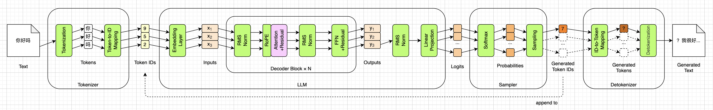
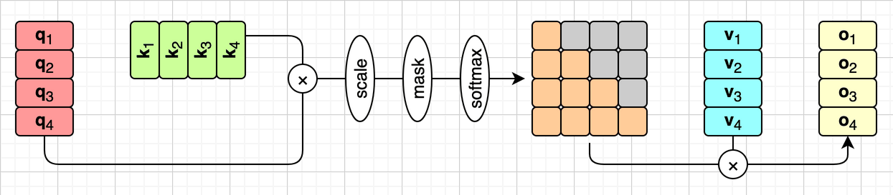
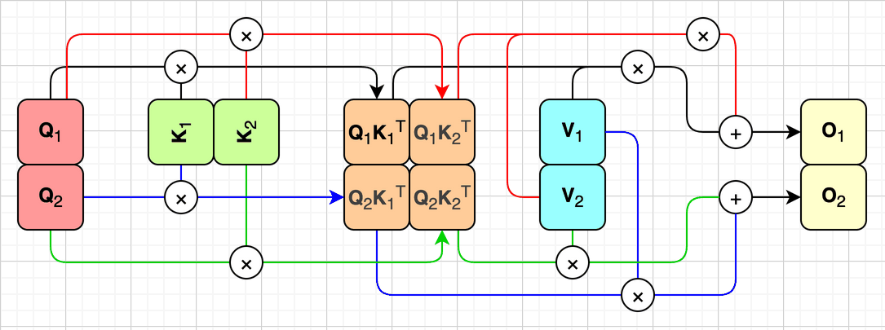
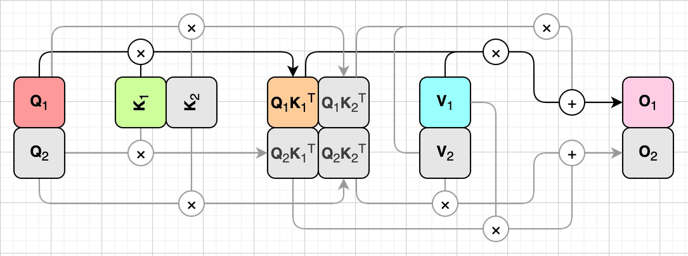
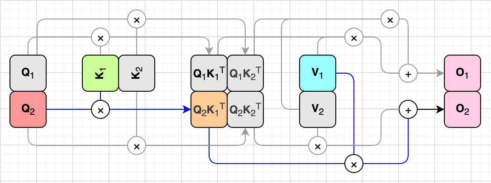
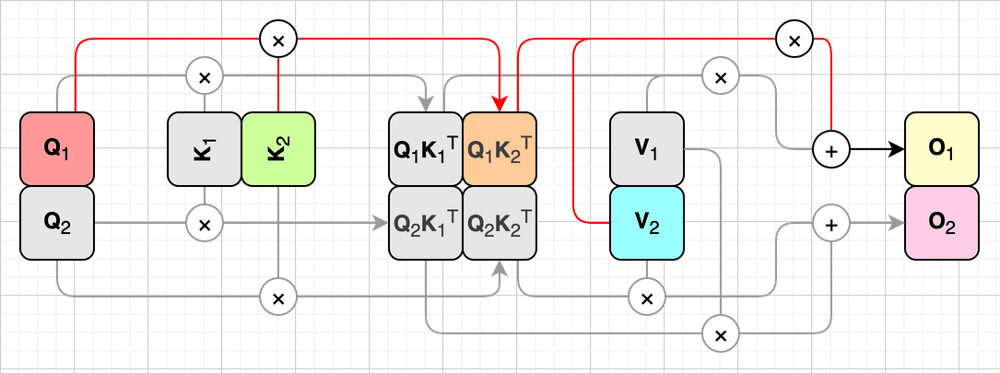
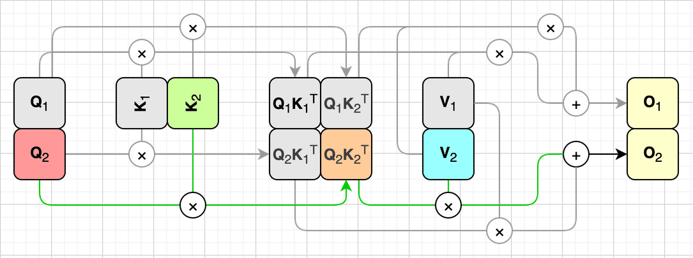
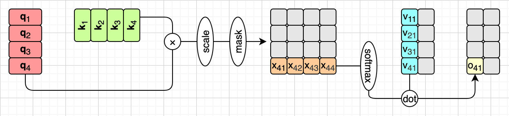
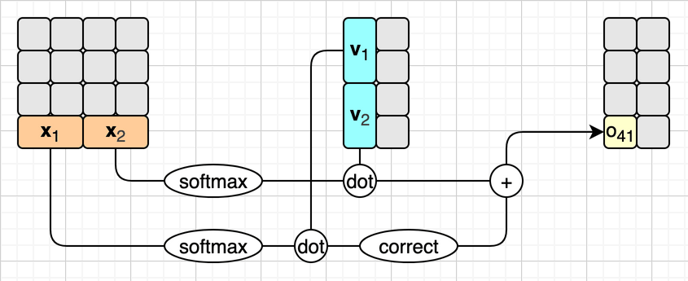

# FlashAttention


在第十一章，我们给引擎加上了KV缓存。每一圈不再把整个序列从头重算，而是只算刚生成的那一个词元，历史上的K和V从缓存里取。推理因此分成了prefill和decode两个阶段，生成200个词元快了3.4倍，而且一个ID都没变。和上一章一样，这一章也不在总览图上增加任何方框，要讲的还是图上那个粉色的注意力机制：换一种算法来算它，结果一模一样，如下图所示：



这是“跑快”这一部分的最后一章。它要对付的，是第六章就埋下的那句话：注意力分数是一张 $T \times T$ 的表，序列长度翻一倍，这张表就要变成原来的四倍。第十一章的decode阶段，这张表只剩一行，不成问题；可prefill阶段，它还是一张完整的方表。提示词一长，光是把这张表存下来，内存就吃不消了。

先把话说在前面：这一章介绍的**FlashAttention**，出自2022年Dao等人的论文《FlashAttention: Fast and Memory-Efficient Exact Attention with IO-Awareness》（arXiv:2205.14135），本质上是针对GPU显存层级做的优化。我们在CPU上可以把它的数学原理验证清楚，算出来的结果和原来的注意力一模一样，也能看到它省下的内存。至于速度，我原本以为在CPU上用Python循环写出来只会更慢，结果却有点出乎意料，后面会如实报告。

我会先算一算这张表到底有多大，再说说GPU上真正的瓶颈在哪里。然后复习一下Softmax，看看分块计算会在哪里卡住，以及FlashAttention借来的“在线Softmax”是怎么把它解开的。最后把这些拼成完整的算法，用纯PyTorch写出来，在CPU上核对、量内存、量速度。


## 为什么需要FlashAttention

FlashAttention要对付的，是注意力分数表带来的两个麻烦：一是存不下，二是搬不动。前一个在CPU上也看得见，后一个要到GPU的存储层级里才看得清楚。我们一个一个来看。


### 注意力的内存墙

我们先来算一算这张表有多大。第六章说过，SmolLM2每一层有9个头，每个头都要算一张 $T \times T$ 的注意力分数表，过完Softmax，又得到一张同样大小的注意力权重表（第六章代码里的`probs`）。我们取SmolLM2支持的最长上下文，T=8192，按本书全程使用的FP32来算，一层注意力里光是分数表就有：

```
8192 × 8192 × 9 × 4 = 2,415,919,104字节
```

大约2.4GB。而第二章说过，整个模型的权重升成FP32之后也只有538MB，**一层的注意力分数表，就是全部权重的4倍多**。这还没算过完Softmax之后的那张注意力权重表，它也一样大。

这还只是SmolLM2。如今的大模型，上下文动辄128K（131072个词元），不少还标称到了1M。这张表随T平方增长，T变成16倍，表就变成256倍：T=131072时，光是一个头的一张表，按FP32就要68.7GB，换成GPU上常用的BF16也要34.4GB，一张40GB显存的A100，连一个头都放不下。

而且，这张表只是一个临时的中间结果。它算出来，过一遍Softmax，和V做一次加权求和，然后就被扔掉了，没有任何东西需要长期留着它。第十一章的KV缓存存的是K和V，它们是 $T \times 64$ 的，随序列长度线性增长；而这张表是 $T \times T$ 的，随序列长度平方增长。序列越长，这个临时的中间结果比真正要存的东西大得越多。

前面说过，decode阶段这张表只剩一行，所以FlashAttention主要帮的是prefill阶段。（上下文很长时，decode也可以沿着K和V的方向切块，分给很多计算单元并行去算，这叫Flash-Decoding，本书不展开。）此外，训练时每一次都是整段序列一起算，相当于每一次都是prefill，所以FlashAttention对训练的帮助更大。不过训练不是本书的话题，我们只看推理。


### 真正的瓶颈：搬数据

如果只是内存不够，办法其实很简单：一次少算几行就行了。分数表的每一行对应一个词元的Q，而Softmax是按行算的，一行只看它自己。所以我们可以每次只拿一小块Q，比如128个词元，和全部的K算出一张 $128 \times T$ 的分数表。这几行都是完整的，直接做Softmax、乘上V，就得到了这128个词元的输出，然后把这张小表扔掉，换下一块。同一时刻只存在这么一小条表，T=8192时，一层从2.4GB降到了大约38MB，算出来的结果一个数都不变。

但FlashAttention要解决的，不只是“存不下”，还有“搬不动”。按行切开之后，每一小条表照样要完整地算出来、写进内存，再读回来做Softmax、乘V，所有小条加起来，搬运的总量和原来那张大表一样多。这要从GPU的存储层级说起。

GPU上的存储分好几层，我们只看其中两层。一层是**HBM**（High Bandwidth Memory），也就是平常说的显存，容量大，几十GB；另一层是**SRAM**，在芯片上，离计算单元最近，速度快得多，可容量很小。FlashAttention的论文里给过一组A100的数字：

| | 容量 | 带宽 |
| --- | --- | --- |
| GPU的SRAM | 20MB | 19TB/s |
| GPU的HBM | 40GB | 1.5TB/s |
| CPU的内存 | 超过1TB | 12.8GB/s |

最后一行的CPU内存，带宽是每秒12.8GB。还记得第十一章那个数吗？我们量出来，decode一步相当于每秒搬12.7GB的权重，正好就是这个量级。

计算单元只能处理已经放进SRAM的数据，所以HBM里的数据要先搬进SRAM，算完再写回HBM。我们来看看注意力在这上面是怎么算的。和第十一章一样，这里只看单头注意力，不管GQA，也不管RoPE。而且FlashAttention换掉的只是注意力中间的那一段，前面的Q、K、V投影和后面的输出投影都不动，所以我们只需要第十一章那组简化公式的最后一行：

$$
\mathbf{O} = \mathrm{softmax}\left(\mathrm{mask}\left(\frac{\mathbf{Q} \times \mathbf{K}^\top}{\sqrt{d_k}}\right)\right) \mathbf{V}
$$

这一章后面讲的，都是这一行式子。它看起来只有一行，真算起来却要分好几步，中间还要产生好几张很大的表。按照最朴素的写法，它可以拆成下面这几步：

1. 把Q、K、V都算好，放在HBM里，也就是下图红色、绿色和青色的方块。
2. 计算 $\mathbf{Q}\mathbf{K}^\top$ ，放在HBM里。
3. 把 $\mathbf{Q}\mathbf{K}^\top$ 逐元素缩放，也就是除以 $\sqrt{d_k}$ 。
4. 对缩放之后的 $\mathbf{Q}\mathbf{K}^\top$ 盖上因果掩码，再逐行做Softmax，得到注意力权重表，也就是下图中间那张橙色的表，灰色的格子是被掩码盖住的未来。
5. 用它和V做矩阵乘法，得到输出 $\mathbf{O}$ ，也就是下图黄色的方块。



这张图沿用了第十一章的画法，假设一共4个词元，每个词元的Q、K、V和输出各画成一格。后面讲分块的几张图，为了画得简单，都先不画因果掩码，它不影响我们要讨论的问题，到“因果掩码”一节再把它加回来。

在GPU上，那张 $T \times T$ 的大表要在HBM和SRAM之间来回搬好几趟：第2步算出来，写进HBM；第3、4步各要把它读进来一遍，算完再写回去；第5步再读进来一遍，和V相乘。计算本身其实很快，可时间全都花在了来回搬运上，计算单元大部分时候都在等数据。

所以FlashAttention的目标并不是“少算”。它要做的浮点运算，和朴素的写法一样多，甚至还要多一点（因果掩码其实能让它少算一半，这个后面再说）。它的目标是：**不把那张完整的大表写进HBM**，全程在SRAM里一小块一小块地算完。这是一个关于数据搬运（IO）的优化，而不是一个关于计算量的优化，FlashAttention论文的标题里专门写了“IO-Awareness”，说的就是这件事。理解了这一点，这一章就理解了一半。


## Softmax

要想一小块一小块地算，第一个拦路虎就是Softmax。这个函数我们已经见过好几次了：第六章第一次碰到它，用它把注意力分数变成一行加起来等于1的权重；第十章又用它把LLM输出的49152个分数变成概率；第八章MoE的路由器、第九章的AttnRes里，也都有它的身影。我们先把它复习一下，这里的 $\mathbf{x}$ 是一行分数，一共 $n$ 个数（放到注意力里， $n$ 就是这一行的长度）：

$$
\mathrm{softmax}(x_i) = \frac{e^{x_i}}{\sum_{j=1}^{n} e^{x_j}}
$$

第十章说过一个实现上的细节：如果某个 $x_i$ 特别大， $e^{x_i}$ 就会溢出，所以实际的实现都会先把每个数减去这一行的最大值，再取指数，也就是安全Softmax。当时没有解释为什么结果不变，现在我们把它展开写出来：

$$
\begin{aligned}
\mathrm{softmax}(x_i)
&= \frac{e^{x_i - \max(\mathbf{x})}}{\sum_{j=1}^{n} e^{x_j - \max(\mathbf{x})}} \\
&= \frac{e^{x_i} / e^{\max(\mathbf{x})}}{\sum_{j=1}^{n} e^{x_j} / e^{\max(\mathbf{x})}} \\
&= \frac{e^{x_i}}{\sum_{j=1}^{n} e^{x_j}}
\end{aligned}
$$

减去最大值，相当于分子分母同时乘了一个系数 $1/e^{\max(\mathbf{x})}$ ，结果自然不变。别小看这个系数，后面能不能把分块的结果拼对，关键就在它身上。

麻烦也在这里：分母要把一整行的数都加起来，最大值也是一整行的最大值。不看完一整行，Softmax就算不出来。而分块计算，恰恰就是不一次看完一整行。


## 分块计算

我们先把Softmax放到一边，看看分块计算本身是怎么回事。我们把Q、K、V和输出 $\mathbf{O}$ 都沿着行切成两块，比如4个词元、每个头2维，前两个词元一块，后两个词元一块，那张 $\mathbf{Q}\mathbf{K}^\top$ 的表就相应地被切成了四块。图里不再画出每一个词元，每一块只画成一格，如下图所示：



先不管缩放和Softmax，只看 $(\mathbf{Q}\mathbf{K}^\top)\mathbf{V}$ 。根据矩阵乘法的规则，分块计算的结果和直接计算的结果完全一样：

$$
\begin{aligned}
\mathbf{O}_1 &= (\mathbf{Q}_1 \mathbf{K}_1^\top) \mathbf{V}_1 + (\mathbf{Q}_1 \mathbf{K}_2^\top) \mathbf{V}_2 \\
\mathbf{O}_2 &= (\mathbf{Q}_2 \mathbf{K}_1^\top) \mathbf{V}_1 + (\mathbf{Q}_2 \mathbf{K}_2^\top) \mathbf{V}_2
\end{aligned}
$$

上图用四种颜色，画出了公式里的四项：黑色是 $\mathbf{Q}_1 \mathbf{K}_1^\top$ 再乘 $\mathbf{V}_1$ ，红色是 $\mathbf{Q}_1 \mathbf{K}_2^\top$ 再乘 $\mathbf{V}_2$ ，两路在加号处汇合，就是 $\mathbf{O}_1$ ；蓝色和绿色同理，汇合成 $\mathbf{O}_2$ 。把缩放加进来也没有问题，每一块都除以同一个 $\sqrt{d_k}$ ，等式照样成立。可是一旦把Softmax也加进来，每一块各自做Softmax再加起来，结果就和整行做Softmax不一样了。这正是前面说的那个拦路虎。这个问题我们下一小节解决，先把分块的过程说清楚，它一共分四步。

第一步，把 $\mathbf{K}_1$ 、 $\mathbf{V}_1$ 和 $\mathbf{Q}_1$ 搬进SRAM，算出这一小块的注意力，暂时记作 $\mathbf{O}_1$ 。它还不是最终结果，所以涂成了粉色。图里灰色的部分，是这一步用不到的：



第二步， $\mathbf{K}_1$ 和 $\mathbf{V}_1$ 不动，把 $\mathbf{Q}_1$ 换成 $\mathbf{Q}_2$ ，再算一小块，暂时记作 $\mathbf{O}_2$ ，同样还不是最终结果：



第三步， $\mathbf{K}_1$ 和 $\mathbf{V}_1$ 已经用完了，换成 $\mathbf{K}_2$ 和 $\mathbf{V}_2$ ，再把 $\mathbf{Q}_1$ 拿回来，算出另一小块。把它和第一步算出的那一块合起来，就是最终的 $\mathbf{O}_1$ ，涂成了黄色，和前面那张整体图里的输出一个颜色。怎么个合法，就是下一小节要讲的在线Softmax：



第四步，把 $\mathbf{Q}_1$ 换成 $\mathbf{Q}_2$ ，再算一小块，和第二步的那一块合起来，就是最终的 $\mathbf{O}_2$ ，也涂成了黄色：



四步走完，那张 $\mathbf{Q}\mathbf{K}^\top$ 的大表从头到尾都没有完整地出现过，每次只有其中一小块在SRAM里，用完就扔。如果你去读FlashAttention的论文，会看到一段两层循环的伪代码，它基本上就对应这四步。


## 在线Softmax

现在来解决Softmax的问题。Softmax是按行算的，所以我们只盯着注意力分数表的一行看。这次挑最后一行，也就是第4个词元那一行：包括它自己在内的4个位置都看得见，没有被掩码盖住的格子，正好是完整的一行。

和前面一样，我们先把公式简化一下。缩放先不管，假设这一行已经除过 $\sqrt{d_k}$ 了；掩码也不用管，最后一行本来就没有被盖住的格子。另外，前面那行公式是矩阵形式，算的是整张表；现在只看一行，就可以写成向量形式：

$$
o = \mathrm{softmax}(\mathbf{x}) \times \mathbf{v}
$$

这里的 $\mathbf{x}$ 是一个行向量，就是分数表的那一行，它的4个数就是下图里的 $x_{41}$ 到 $x_{44}$ ，后面省掉行号，简写成 $x_1$ 到 $x_4$ 。 $\mathbf{v}$ 是一个列向量，就是V的第一列：图里V和输出 $\mathbf{O}$ 都是4行2列，也就是每个头2维，为了好算，我们只看第1列，后面简写成 $v_1$ 到 $v_4$ 。行向量乘列向量，其实就是两者的点积（图里的dot），结果是一个数，就是输出 $\mathbf{O}$ 第4行第1列的那个数 $o_{41}$ ，后面简写成 $o$ 。上面这个公式如下图右半部分所示：



图里那一步softmax，我们用第十章的安全Softmax来算：这一行的每个数，先减去这一行的最大值，再取指数。把它代进上面的公式，展开写，就是：

$$
o = \sum_{i=1}^{4} \frac{e^{x_i - m}}{\sum_{j=1}^{4} e^{x_j - m}} v_i
  = \frac{\sum_{i=1}^{4} e^{x_i - m} v_i}{\sum_{j=1}^{4} e^{x_j - m}}
$$

其中 $m = \max(\mathbf{x})$ 是这一行的最大值。注意第二个等号：分母和 $i$ 无关，可以提到求和外面去。于是 $o$ 就变成了一个分数，分子是加权求和，分母是权重之和。

现在把 $\mathbf{x}$ 和 $\mathbf{v}$ 都切成两半。前一半只能看到前2个数，并不知道整行的最大值是多少，只好用这一半的最大值 $m_1$ 来算，我们把它的分子和分母分别记作 $y_1$ 和 $\ell_1$ （ $\ell$ 是手写体的小写字母l，FlashAttention论文用它表示分母，写成手写体是为了不和数字1混淆）。后一半也一样，用它自己的最大值 $m_2$ ，分子和分母记作 $y_2$ 和 $\ell_2$ ：

$$
\begin{aligned}
y_1 &= \sum_{i=1}^{2} e^{x_i - m_1} v_i, & \ell_1 &= \sum_{j=1}^{2} e^{x_j - m_1} \\
y_2 &= \sum_{i=3}^{4} e^{x_i - m_2} v_i, & \ell_2 &= \sum_{j=3}^{4} e^{x_j - m_2}
\end{aligned}
$$

这里有一个细节很重要：我们并不直接把前一半的 $y_1 / \ell_1$ 算出来存着，而是把分子 $y_1$ 、分母 $\ell_1$ 和最大值 $m_1$ 这三样，分别存下来。为什么要这样，看看直接相加会怎样就清楚了。如果把两半的分子、分母各自相加，会得到：

$$
\frac{y_1 + y_2}{\ell_1 + \ell_2}
$$

问题出在哪里，一眼就能看出来：前一半减的是 $m_1$ ，后一半减的是 $m_2$ ，两半用的“基准”不一样，不能直接相加。可是等算完后一半的时候，我们就知道整行的最大值了，它就是 $m = \max(m_1, m_2)$ 。而换基准只需要乘一个系数：

$$
e^{x_i - m} = e^{x_i - m_1} \cdot e^{m_1 - m}
$$

也就是说，前一半已经算好的分子和分母，只要各乘上一个 $e^{m_1 - m}$ ，就换成了以 $m$ 为基准；后一半同理，乘上 $e^{m_2 - m}$ 。换完基准，就可以放心地相加了：

$$
o = \frac{y_1 e^{m_1 - m} + y_2 e^{m_2 - m}}{\ell_1 e^{m_1 - m} + \ell_2 e^{m_2 - m}}
$$

这就是**在线Softmax**（Online Softmax）的核心：边走边修正。它并不是FlashAttention发明的，而是出自2018年NVIDIA的Milakov和Gimelshein的论文《Online normalizer calculation for softmax》（arXiv:1805.02867），FlashAttention的贡献，是把它和分块计算合在了一起。手里一直维护着三样东西：目前见过的最大值、以它为基准的分母、以它为基准的分子。每来一块新数据，先看最大值要不要更新；要更新的话，就把手里的分子、分母乘上一个修正系数，再把新的一块加进去。



上图把切成两半的过程画了出来。图里粗体的 $\mathbf{x}_1$ 、 $\mathbf{x}_2$ 和 $\mathbf{v}_1$ 、 $\mathbf{v}_2$ ，指的是切出来的两半，不是单个的数。图里的softmax，指的是用当时手里的最大值算出分子和分母，还没有相除；correct就是乘上修正系数。你可能注意到，图里只有前一半要修正。这是因为在线的做法是边走边算：前一半算的时候，手里只有它自己的最大值 $m_1$ ；等后一半进来，先把最大值更新成 $m$ ，再直接用 $m$ 去算后一半，这样后一半就不用修正了，要修正的只是手里已经算好的前一半。前面的公式为了对称，两半各用各的最大值，最后各自修正，结果是一样的。

我们给这一行填上具体的数，算一遍： $\mathbf{x} = [1, 3, 2, 5]$ ， $\mathbf{v} = [10, 20, 30, 40]$ 。先按普通的办法算。整行的最大值是5，四个权重分别是0.0152、0.1125、0.0414、0.8310，和 $\mathbf{v}$ 做点积， $o \approx 36.88$ 。再分块算。前一块是 $[1, 3]$ ，最大值 $m_1 = 3$ ；后一块是 $[2, 5]$ ，最大值 $m_2 = 5$ 。两块各自算出分子和分母：

$$
\begin{aligned}
y_1 &= 10 e^{1-3} + 20 e^{3-3} \approx 21.353, & \ell_1 &= e^{1-3} + e^{3-3} \approx 1.1353 \\
y_2 &= 30 e^{2-5} + 40 e^{5-5} \approx 41.494, & \ell_2 &= e^{2-5} + e^{5-5} \approx 1.0498
\end{aligned}
$$

整行的最大值是 $m = \max(3, 5) = 5$ ，前一块要乘的修正系数是 $e^{3-5} \approx 0.1353$ ，后一块的最大值本来就是5，系数是1。于是：

$$
o = \frac{21.353 \times 0.1353 + 41.494}{1.1353 \times 0.1353 + 1.0498}
  \approx \frac{44.383}{1.2034}
  \approx 36.88
$$

和普通的办法算出来的一样。要特别强调一点：**在线Softmax不是近似算法**，它和普通的Softmax在数学上严格相等，实际算出来的差别，只来自浮点数舍入的先后顺序不同。

最后交代一下：为了好画、好算，这一节和上一节的图和例子都用了很小的数，4个词元，每个头2维，而且只切成了两块。真实情况要大得多：SmolLM2每个头64维，序列长度可以到8192，后面的代码每块取128个词元，一行就要切成64块。但不管切成多少块，做法都和这里一模一样：分块计算是一块一块地乘，再加起来；在线Softmax是每来一块，就修正一次手里的分子和分母。切成两块看懂了，切成多少块都是一样的。


## FlashAttention

到这里，FlashAttention的两样核心技术，分块计算和在线Softmax，就都讲完了。把它们合在一起，就是完整的FlashAttention。我们把它写成伪代码，变量名沿用前面的： $m$ 是最大值， $\ell$ 是分母，分子就直接累加在输出O上，也就是前面的 $y$ 。大致是下面这样：

```
把Q、K、V都沿着行切成小块
for 每一块 Qi:
    m = -∞，ℓ = 0，O = 0          ← 这一块Q的最大值、分母、分子
    for 每一块 Kj, Vj:
        S = Qi × Kjᵀ / √dk         ← 一小块分数，只在SRAM里
        m_new = max(m, S每一行的最大值)
        P = exp(S - m_new)
        ℓ = ℓ × exp(m - m_new) + P每一行的和
        O = O × exp(m - m_new) + P × Vj
        m = m_new
    Oi = O / ℓ                     ← 这一块Q的最终输出
```

外层循环每次拿一块Q，内层循环把K和V一块一块地过一遍，用在线Softmax维护每一行的最大值、分母和分子，内层走完，最后除一次分母，就是这一块Q的输出。临时用到的空间，只和块的大小有关，和序列长度T无关。那张2.4GB的大表，从此不存在了，它被拆成了几千个能放进SRAM的小块，用完即扔。

注意这里的循环顺序和前面“分块计算”一节画的四步不太一样：那四步是外层循环K、V，内层循环Q，那是2022年第一版FlashAttention的写法；这里是外层循环Q，内层循环K、V，是2023年第二版《FlashAttention-2: Faster Attention with Better Parallelism and Work Partitioning》（arXiv:2307.08691）的写法，它让每一块Q的输出只写一次。两种顺序算出来的结果是一样的。


### 因果掩码

前面讲分块的那几张图都没有画因果掩码，现在把它加回来。它在分块计算里反而带来了一个好处：如果一整块K、V全都在这一块Q的“未来”，也就是那一小块分数整个落在 $\mathbf{Q}\mathbf{K}^\top$ 的右上角，那么它的权重全是0，这一块根本不用算，直接跳过就行。只有正好压在对角线上的那些块，才需要像第六章那样，把块里右上角的部分换成负无穷。所以带上因果掩码之后，差不多一半的块都可以跳过。


### 一笔交易

FlashAttention也不是白拿的。为了不存那张大表，它要多做一些计算：推理时，多出来的是那些修正系数，每来一块K、V，手里的分子和分母都要再乘一次；训练时还有更大的一笔，反向传播要用到的那张大表，FlashAttention选择在需要的时候重新算一遍，而不是存下来。这是一笔**用计算换搬运**的交易：多花一点算力，省下一大块显存，更省下了大量的数据搬运。

在GPU上，这笔交易极其划算，因为搬运比计算贵得多，FlashAttention的论文报告了好几倍的加速。后来FlashAttention又出了好几个版本，针对新的GPU架构不断改进，不过核心思想一直没变，还是分块加在线Softmax。

第十一章那个“KV缓存是拿内存换计算”，和这里正好相反。两章合在一起看，推理引擎的优化，说到底就是在计算、内存和搬运这三者之间做交易，具体怎么换才划算，要看硬件。


## 代码实现

理论讲完了，下面我们把FlashAttention用纯PyTorch写出来。这一章的随书源代码在`code/book/ch12/`下面，和第九章一样，引擎一行都不改，`model.py`等几个文件和第十一章逐字节相同。原因有两个：一是前面说过，decode时分数表只有一行，分块只帮得上prefill，而我们的提示词通常只有几个词元；二是要接进带缓存的生成循环，还得处理第十一章那个`start`偏移和掩码，引擎会复杂不少。所以这一章只写两个脚本，把原理验证清楚。


### 在线Softmax

第一个脚本是`online_softmax.py`，它不加载模型，只把前面那个手算的例子一步一步打印出来：每进来一块，就打印一行，看这一块进来之后，最大值怎么变、修正系数是多少，以及手里的分母和分子变成了多少。最后再拿1000个随机数试一次，看它和PyTorch自带的Softmax差多少。下面是输出：

```
一次看完整行：
  权重 [0.0152, 0.1125, 0.0414, 0.831]
  o = 36.8806

切成两块，每块2个：
  块[1.0, 3.0]   最大值 -inf → 3.0   修正系数 0.0000   分母 1.1353   分子 21.3534
  块[2.0, 5.0]   最大值 3.0 → 5.0   修正系数 0.1353   分母 1.2034   分子 44.3835
  o = 分子 / 分母 = 36.8806

1000个随机数，块大小7：torch.softmax -0.071287419985   在线 -0.071287419985   相对误差 1.9e-16
```

第一块进来之前，手里的最大值是负无穷，所以第一块的修正系数是0，反正手里本来也什么都没有。第二块进来，最大值从3变成了5，手里的分母和分子都乘上了 $e^{3-5} \approx 0.1353$ ，再加上第二块自己的那一份，最后得到的36.8806，和一次看完整行算出来的一样。最后一行换成了1000个随机数，每块7个，相对误差只有1.9e-16，这已经是64位浮点数本身的舍入误差了。在线Softmax不是近似，这里看得很清楚。


### 分块注意力

第二个脚本是`flash_attn.py`。它的核心，就是把前面那段伪代码照着写成的一个函数`flash_attention()`，变量名也尽量和伪代码对应：`m`、`l`、`o`就是伪代码里的 $m$ 、 $\ell$ 、O，`qs`和`qe`是这一块Q的起止位置，`ks`和`ke`是这一块K、V的起止位置。下面是这个函数：

```python
def flash_attention(q, k, v, block=BLOCK, stats=None):
    """带因果掩码的分块注意力。q、k、v各(头数, T, 64) → (头数, T, 64)。

    stats是个dict，给了就往里记两样东西：最大的临时张量有多少字节，
    以及一共算了多少块、跳过了多少块。
    """
    H, T, d = q.shape
    out = torch.empty_like(q)
    scale = d ** -0.5
    for qs in range(0, T, block):                      # 外层：一块Q
        qe = min(qs + block, T)
        qi = q[:, qs:qe]                               # (H, Bq, d)
        m = torch.full((H, qe - qs, 1), float("-inf"))  # 这一块Q每一行的最大值
        l = torch.zeros(H, qe - qs, 1)                 # 以m为基准的分母
        o = torch.zeros(H, qe - qs, d)                 # 以m为基准的分子
        for ks in range(0, T, block):                  # 内层：一块K、V
            if ks >= qe:                               # 整块都在未来，跳过
                if stats is not None:
                    stats["skipped"] = stats.get("skipped", 0) + 1
                continue
            ke = min(ks + block, T)
            s = qi @ k[:, ks:ke].transpose(-1, -2) * scale  # (H, Bq, Bk)，只有一小块
            if ke > qs:                                # 压在对角线上：块里也有未来
                rows = torch.arange(qs, qe)[:, None]
                cols = torch.arange(ks, ke)[None, :]
                s = s.masked_fill(cols > rows, float("-inf"))
            m_new = torch.maximum(m, s.amax(-1, keepdim=True))
            p = torch.exp(s - m_new)                   # (H, Bq, Bk)
            fix = torch.exp(m - m_new)                 # 旧的基准换成新的
            l = l * fix + p.sum(-1, keepdim=True)
            o = o * fix + p @ v[:, ks:ke]
            m = m_new
            if stats is not None:
                stats["computed"] = stats.get("computed", 0) + 1
                big = max(t.numel() * t.element_size() for t in (s, p, o))
                stats["peak"] = max(stats.get("peak", 0), big)
        out[:, qs:qe] = o / l                          # 最后除一次分母
    return out
```

和伪代码比，多了两样东西。一是因果掩码：`ks >= qe`说明这一整块K都在这一块Q的“未来”，直接跳过；`ke > qs`说明这一块正好压在对角线上，块里有一部分是未来，按第六章的办法换成负无穷。二是那个`stats`，它只是记录用的：最大的临时张量有多大，一共算了多少块、跳过了多少块，后面量内存时要用到。

要把它接进模型，只需要把`attn()`中间那一段，也就是“分数表、掩码、Softmax、加权求和”，换成这个函数，前面的投影、拆头、RoPE和后面的拼头、输出投影都不变。脚本里的`attn_flash()`就是这么写的，然后临时把模型的`attn`换成它。因为它不处理KV缓存，生成的时候走的是不带缓存的那条路，每圈整串重算，正好让每一圈都用上分块。


## 代码效果

代码写好了，下面来看`flash_attn.py`跑出来的结果。这个脚本一共打印了五段，我们按三个问题来看：第一，它算得对不对，先拿随机的Q、K、V和一次算完的写法比，再把它接进模型，看看生成的文字变没变；第二，它省了多少内存，在T=8192时和那张2.4GB的大表比一比；第三，它是快还是慢。前两个问题的答案和硬件无关，换一台机器跑也是一样的；第三个问题的答案和机器关系很大，下面的数字都来自我那台老旧的Intel芯片MacBook，只用CPU。


### 核对

第一段先不碰模型，拿随机的Q、K、V，9个头、每头64维，和一次算完整张表的写法比。T取了几个不同的值，有的正好是块大小128的整数倍，有的不是，看看最后那一块不满的时候会不会出错：

```
一  随机的q、k、v，9个头，每头64维，块大小128
         T        相对误差
       100     1.3e-07
       128     2.3e-07
      1000     1.4e-07
      2048     1.7e-07
```

不管T是不是块大小的整数倍，相对误差都在1e-7上下，只是浮点数舍入的先后顺序不同。然后把SmolLM2全部30层的注意力都换成分块版：

```
二  30层的注意力都换成分块版，逐层最大相对误差 9.5e-07
    贪婪生成  'Once upon a time, there was a little girl named Lily. She lived in a big house with her family, but'
    和原来的一字不差
```

逐层的最大相对误差是9.5e-7，和第八章四级验收里逐层比出来的误差是同一个量级；贪婪生成的20个词元，和第一章那句话一字不差。也就是说，分块版可以原样换掉原来的注意力，模型察觉不到任何区别。


### 内存

核对完了，再来看内存。我们把T加到8192，也就是SmolLM2支持的最长上下文，用随机的Q、K、V跑一层分块版，记下运行时最大的那个临时张量有多大，顺便数一数一共算了多少块、跳过了多少块：

```
三  T=8192，一层9个头
    原来那张分数表        2,415,919,104字节
    分块版最大的临时张量         589,824字节
    4096块里算了2080块，跳过2016块（整块都在未来）
    用时 1.02秒
```

原来那张分数表，一层就要2,415,919,104字节，也就是本章开头算的2.4GB；而分块版运行时最大的临时张量只有589,824字节，大约590KB，是一小块 $128 \times 128$ 的分数表，9个头。一个随T平方增长，一个只和块的大小有关。另外，4096块里有2016块整个落在“未来”，直接跳过了，差不多正好是一半，这就是前面说的因果掩码带来的好处。


### 耗时

最后量耗时。按我原来的预想，Python写的两层循环，每一小块都要经过Python这一层调用一次，在CPU上只会更慢。这次还是拿一次算完的写法做对比，T从512加到4096，两种写法各量一次，量之前都先热身一遍，免得第一次运行的额外开销混进来。可实际量出来是这样的：

```
四  耗时，单位毫秒
         T      一次算完        分块       是几倍
       512       6.2       5.4       0.9
      1024      40.4      13.7       0.3
      2048     227.3      53.1       0.2
      4096     692.7     205.6       0.3
```

分块版反而更快。T=512时两者差不多，T到了1024以上，分块版都只用了一次算完的三成左右，T=2048时更是只有四分之一左右，和我的预想正好相反。为什么？换不同的块大小再量一次，就看清楚了：

```
五  T=2048，换不同的块大小，一次算完是231.7毫秒
       块大小       一块分数表        耗时        是一次算完的几倍
         8         2KB  3653.3ms           15.77
        16         9KB  1067.9ms            4.61
        32        37KB   351.2ms            1.52
        64       147KB   120.6ms            0.52
       128       590KB    54.7ms            0.24
       256      2359KB    57.2ms            0.25
       512      9437KB   107.6ms            0.46
      2048    150995KB   321.8ms            1.39
```

这张表里有两个原因。第一个原因是跳过的那一半块：一次算完的写法，把右上角那一半也老老实实算了，再用掩码盖掉；分块版根本没算它们。光这一条，要算的块就少了差不多一半，前面量内存时数过，4096块里跳过了2016块。

第二个原因更有意思：CPU也有自己的“SRAM”。CPU上有好几级缓存，离计算单元越近的越快、越小。一次算完的写法，T=2048时那张分数表有151MB，远远超出了缓存的大小，算的时候只能在内存和缓存之间反复搬运；而块大小取128或256时，一块分数表只有几百KB到两MB多，能放进缓存里，算完就扔，不用再写回内存。这和GPU上的SRAM与HBM是同一个道理，只是CPU的这道“悬崖”没有GPU那么陡，而且缓存是硬件自动管理的，不用程序员操心。

但块也不能太小。块大小取8时，分块版比一次算完慢了15倍多。这时每一块的计算量太小，两层循环要转几万次，每一次都要经过Python这一层，来回调用的开销把一切都压垮了。块大小取2048时，整张表就是一块，又回到了一次算完，还多出了修正系数那些额外的计算，比一次算完还慢。所以块大小有一个最合适的范围：太小，被Python的开销拖累；太大，装不进缓存。在我这台机器上，是128到256。

不过，也别把这个结果看得太重。我们比的对手，是第六章那种一次算完的写法，它本来就把右上角那一半算了白算，又不管缓存装不装得下，算不上一个强对手。所以它并不说明这个Python循环的版本是一个好的CPU实现，第十四章还会拿PyTorch自带的`F.scaled_dot_product_attention()`来比一比。它说明的是另一件事：FlashAttention背后的道理，也就是“别把大表写出来，一小块一小块地在快的存储里算完”，在CPU上同样成立。只是在GPU上，它要写成一个融合好的GPU内核，才能发挥出全部威力。用Python循环在GPU上拼，每一次小计算都要单独启动一次，会被启动开销拖垮，第十四章也会碰到这个问题。


## 本章小结

这一章和上一章一样，没有在总览图上增加任何方框。我们讲的是注意力内部的另一种算法，数学上和原来完全等价；不过它只帮得上prefill，所以这一章只用脚本验证了它，引擎本身没有改。我们先算了一笔账：T=8192时，一层注意力的分数表就有2.4GB，是全部FP32权重的4倍多，而它只是一个算完就扔的中间结果。接着我们看到，GPU上真正的瓶颈不是计算，而是在HBM和SRAM之间来回搬运这张大表。FlashAttention的目标，就是不把它完整地写出来。

为此需要两样东西。一是分块计算：把Q、K、V切成小块，每次只在SRAM里算一小块；不考虑Softmax的话，分块计算和直接计算完全一样。二是在线Softmax：Softmax需要整行的最大值和总和，分块时看不到整行，那就边走边修正，维护目前的最大值、分母和分子，最大值一变，就给手里的分子分母乘一个修正系数。它不是近似，和普通的Softmax严格相等。两者合起来，就是外层循环Q、内层循环K和V的FlashAttention，临时空间只和块的大小有关。带上因果掩码，还能跳过差不多一半的块。

FlashAttention是一笔用计算换搬运的交易，在GPU上非常划算。我们用纯PyTorch把它写了出来：它和原来的注意力只差浮点舍入，贪婪生成一字不差；T=8192时，最大的临时张量只有590KB，而原来那张表有2.4GB。在CPU上，块大小合适时它甚至比一次算完还快，原因有两个：一是跳过了未来的块，二是小块装得进CPU的缓存；块太小，又会被Python循环的开销拖垮。

到这里，“跑快”这一部分就结束了。我们从第一章那五行调用`transformers`库的代码出发，加载了真实的SmolLM2权重，分词和读权重交给了现成的库，其余的词嵌入、归一化、注意力、位置编码、前馈网络、残差连接和采样，都是自己写的，又加上了KV缓存和FlashAttention，每一步都和`transformers`库对过数，最后生成的那句话一字不差。不过，到现在为止我们只认识SmolLM2这一个模型。下一章，我们换一个模型，看看这个引擎要改多少，顺便把全书回顾一遍。
