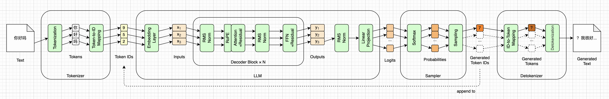

# 换一个模型（Qwen3）


到第十二章为止，我们从第一章那五行`transformers`代码出发，把推理引擎的每一个部件都自己写了一遍：分词、词嵌入、归一化、注意力、位置编码、前馈网络、残差连接、采样，再加上KV Cache和FlashAttention。引擎能说话，而且和`transformers`一字不差。总览图上的每一个小模块，都已经是绿色的了：



不过，这一路上我们只认识一个模型：SmolLM2-135M。前言说过，选它是因为它够小、够新，学会了它，“主流模型的结构就都认识了”。这句话到底成不成立？最好的检验办法，就是换一个模型，看看我们的引擎要改多少。

这一章就来做这件事。我们换上阿里的Qwen3-0.6B，然后按照全书的顺序，从第二章到第十二章，一章一章地走一遍：这一章讲的东西，换成Qwen3之后变了没有，代码要不要改，改哪里。所以，这一章既是一次换模型的实战，也是对全书的一次回顾。顺着这些改动，我们还会把引擎里几处“恰好对SmolLM2成立”的写法，改成真正从配置文件里读出来，让它更像一个引擎，而不是一个只会跑SmolLM2的程序。最后，我们会换上Qwen3的对话版，第一次真正和我们的引擎聊几句。


## 为什么是Qwen3-0.6B

Qwen3是阿里在2025年4月底开源的一个模型系列，从0.6B到235B都有，0.6B是其中最小的一个。选它有三个理由。

第一，它和SmolLM2是同一条路线：Decoder-only的Transformer，RMSNorm、RoPE、GQA、SwiGLU、权重共享一样不缺。差异不多，但每一处都正好落在前面某一章讲过的东西上，很适合拿来回顾。

第二，它有**基座版**和**对话版**两份权重，`Qwen3-0.6B-Base`和`Qwen3-0.6B`，架构一模一样。基座版用来和`transformers`对拍，对话版用来兑现第十章那句话：引擎一行不改，换一份权重，就能对话。

第三，许可证是Apache 2.0，不需要登录就能下载，0.6B在CPU上也跑得动。

你可能会问，为什么不用更新的模型？Qwen在2026年3月发布了Qwen3.5小模型系列，最小的是0.8B。但从Qwen3.5开始，架构换成了线性注意力和普通注意力的混合，和本书走的不再是一条路了。我们在本章最后再看看它。也就是说，Qwen3-0.6B是Qwen在标准Transformer这条路上，最后一代的小模型。


## 下载

第二章的`download_model.sh`原本只能下载SmolLM2。这一章给它加了一个`REPO`变量，指定要下载哪个仓库：

```bash
REPO=Qwen/Qwen3-0.6B-Base ./download_model.sh
REPO=Qwen/Qwen3-0.6B ./download_model.sh
```

Qwen3的仓库里，文件和SmolLM2的不完全一样：它没有`special_tokens_map.json`，多了一个`LICENSE`。所以脚本现在会先问一下服务器，某个文件在不在这个仓库里，确实没有就跳过。下载完之后，`code/models/`下面有三个目录，一个模型一个。后面所有的脚本，都用目录名来指定模型，比如`--model Qwen3-0.6B-Base`，不指定就默认是SmolLM2，所以前十二章的代码一行都不用改。

这一章的随书源代码在`code/book/ch13/`下面，是从第十一章复制过来的，第十二章还没有代码。


## 第二章：模型文件与权重

我们先把两个模型的`config.json`并排放在一起。这一章的随书源代码里有一个`config.py`，它把两个配置文件里我们用得到的字段都列了出来，不一样的标上了箭头：

```
                                SmolLM2-135M   Qwen3-0.6B-Base
model_type                             llama             qwen3  ←
hidden_size                              576              1024  ←
num_hidden_layers                         30                28  ←
vocab_size                             49152            151936  ←
tie_word_embeddings                     True              True
rms_norm_eps                           1e-05             1e-06  ←
num_attention_heads                        9                16  ←
num_key_value_heads                        3                 8  ←
head_dim                                  64               128  ←
rope_theta                            100000           1000000  ←
rope_interleaved                       False             False
max_position_embeddings                 8192             32768  ←
intermediate_size                       1536              3072  ←
eos_token_ids                            {0}          {151643}  ←
qk_norm                                False              True  ←
```

几乎每一行都不一样。不过别急，大部分只是数值变了，我们的代码本来就是从配置里读的，一行不用改。真正要改代码的，只有其中几处，下面会一一说到。

再来看权重。这一章的`weights.py`打印出了Qwen3-0.6B-Base第0层的全部张量：

```
Qwen3-0.6B-Base
embed_tokens      (151936, 1024)   155,582,464
layers[0]
  input_norm             (1024,)         1,024
  q_proj            (2048, 1024)     2,097,152
  k_proj            (1024, 1024)     1,048,576
  v_proj            (1024, 1024)     1,048,576
  o_proj            (1024, 2048)     2,097,152
  post_attn_norm         (1024,)         1,024
  gate_proj         (3072, 1024)     3,145,728
  up_proj           (3072, 1024)     3,145,728
  down_proj         (1024, 3072)     3,145,728
  q_norm                  (128,)           128
  k_norm                  (128,)           128
norm                     (1024,)

张量           310 块
层数           28，每层11个张量
一层合计       15,730,944
全部参数       596,049,920
词嵌入占比     26.1%
```

和第二章比，每层多了两个张量：`q_norm`和`k_norm`，各是一个128维的向量。它们是什么，讲到第七章的时候再说。28层，每层11个，再加上入口的词嵌入和出口的`norm`，一共310个张量，596,049,920个参数，大约是SmolLM2的4.4倍。

这就引出了第一处要改的代码。第二章的`Weights`类，把每层的9个张量名字写死在了代码里。现在我们把它分成两组：每层必有的9个，和有的模型才有的那两个：

```python
OPTIONAL = {
    "q_norm": "self_attn.q_norm",
    "k_norm": "self_attn.k_norm",
}
```

读的时候，必有的照旧，可有可无的那两个，文件里有就读进来，没有就不读：

```python
            self.layers = []
            for i in range(self.n_layers):
                p = f"model.layers.{i}"
                layer = {k: get(f"{p}.{v}.weight") for k, v in REQUIRED.items()}
                for k, v in OPTIONAL.items():
                    if f"{p}.{v}.weight" in names:
                        layer[k] = get(f"{p}.{v}.weight")
                self.layers.append(layer)
```

注意，`Weights`只管数据，它不管这两个张量该怎么用。用不用、怎么用，是`Model`看着`Config`决定的。第二章说过，层数是数出来的，不是写死的，这一点在这里也派上了用场：Qwen3是28层，不用改任何代码。

还有一个小插曲。Qwen3-0.6B对话版的权重文件比基座版大了300多MB，原因是它多存了一个`lm_head.weight`。可它的`tie_word_embeddings`明明是`true`，第四章说过，权重共享的模型，出口直接用词嵌入矩阵，根本不需要这个张量。我核对了一下，这个`lm_head.weight`和词嵌入矩阵逐位相同，纯粹是白存了一份。所以`Weights`现在遇到它，会先核对一下两者是不是同一份，是的话就不读进来。

最后，按第二章的算法，这些参数升成FP32之后，大约要占2.38GB内存。对一台老笔记本来说，这已经不是一个小数目了，不过还装得下。


## 第三章：分词

两个模型的分词器，都是byte-level BPE，加载的方式也一模一样，`Tokenizer.from_file()`一行就行。这一章的`tokenizers_diff.py`，把第三章用过的几句话分别交给了两个分词器：

```
一  文件结构
  SmolLM2-135M      词表   49152   特殊词元  17个   合并规则  48900条   预处理['Digits', 'ByteLevel']
  Qwen3-0.6B-Base   词表  151665   特殊词元  22个   合并规则 151387条   预处理['Split', 'ByteLevel']

二  同一句话
  'To be, or not to be, that is the question:'
    SmolLM2-135M       13个   ['To', 'Ġbe', ',', 'Ġor', 'Ġnot', 'Ġto', 'Ġbe', ',', 'Ġthat', 'Ġis', 'Ġthe', 'Ġquestion', ':']
    Qwen3-0.6B-Base    13个   ['To', 'Ġbe', ',', 'Ġor', 'Ġnot', 'Ġto', 'Ġbe', ',', 'Ġthat', 'Ġis', 'Ġthe', 'Ġquestion', ':']
  'There are 49152 tokens in the vocabulary.'
    SmolLM2-135M       13个   ['There', 'Ġare', 'Ġ', '4', '9', '1', '5', '2', 'Ġtokens', 'Ġin', 'Ġthe', 'Ġvocabulary', '.']
    Qwen3-0.6B-Base    13个   ['There', 'Ġare', 'Ġ', '4', '9', '1', '5', '2', 'Ġtokens', 'Ġin', 'Ġthe', 'Ġvocabulary', '.']
  'The toy engine is unbelievable.'
    SmolLM2-135M        7个   ['The', 'Ġtoy', 'Ġengine', 'Ġis', 'Ġunbelie', 'vable', '.']
    Qwen3-0.6B-Base     6个   ['The', 'Ġtoy', 'Ġengine', 'Ġis', 'Ġunbelievable', '.']
  '你好吗？'
    SmolLM2-135M        8个   ['ä½', 'ł', 'å¥', '½', 'åIJ', 'Ĺ', 'ï¼', 'Ł']
    Qwen3-0.6B-Base     3个   ['ä½łå¥½', 'åIJĹ', 'ï¼Ł']
  '第十章：采样'
    SmolLM2-135M       11个   ['ç¬', '¬', 'åį', 'ģ', 'ç«', 'ł', 'ï¼ļ', 'éĩ', 'ĩ', 'æł', '·']
    Qwen3-0.6B-Base     5个   ['第åįģ', 'ç«ł', 'ï¼ļ', 'éĩĩ', 'æł·']
```

英文的两句，两边切得一模一样。数字也一样，都是一位一位地切开，只是Qwen3没有用第三章那个`Digits`预处理器，而是把“数字单独成块”这条规则，直接写进了它自己的那段正则表达式里，效果相同。

差别出在中文上。“你好吗？”，SmolLM2要8个词元，每个汉字都被切成了两半；Qwen3只要3个，“你好”一个，“吗”一个，全角问号一个。“第十章：采样”也从11个变成了5个。第三章说过，擅长中文的模型，用的也是byte-level BPE，算法一模一样，不一样的只是喂给BPE的语料；换成以中文为主的语料去训练，三个字节就会一路合并成一个词元，常用的词也能合成一个。Qwen3的合并规则有151387条，是SmolLM2的三倍，那些多出来的规则，很大一部分就花在了中文上。

不过这里有两个数，乍一看对不上。分词器的词表是151665个词元：151387条合并规则，加上256个单字节词元，一共151643个，再加22个特殊词元。可`config.json`里写的`vocab_size`是151936，多出了271个。这多出来的271行，在词嵌入矩阵里是有的，但没有任何一个词元会用到它们。151936正好是128的1187倍，补成这样一个整数倍，是为了矩阵的形状对硬件更友好。对推理来说，这271行从来不会被查到，到出口时它们的分数也不会被抽中。

还有一点小差别。第三章说过，现代LLM基本都把`normalizer`关掉，因为转小写这类规范化是有损的。Qwen3的`normalizer`却不是空的，它做的是NFC规范化：把同一个字符的几种不同的Unicode写法，统一成一种。比如带重音的é，可以是一个码位，也可以是字母e加上一个重音符号，NFC会把后者合成前者。这种规范化不改变字符本身，和转小写那种有损的做法不是一回事。


## 第四章：词嵌入

Qwen3-0.6B也做了权重共享，`tie_word_embeddings`是`true`，第四章的`to_logits()`一行不用改。

词嵌入的维度从576变成了1024，词表从49152变成了151936，词嵌入矩阵一共155,582,464个参数，占了全模型的26.1%，比SmolLM2的21.0%还要高。这正好印证了第四章的那个说法：模型越小，词嵌入矩阵的占比越高，权重共享省下的参数就越可观。Qwen3-0.6B的词表大了三倍，就更舍不得再存一份了。


## 第五章：归一化

`rms_norm_eps`从1e-5变成了1e-6。我们的`rms_norm()`从第五章起就是从配置里读这个数的，一行不用改。

这一章的`assumptions.py`专门做了一个实验：把Qwen3的`Config`里的字段，一个一个改回SmolLM2的样子，看看会发生什么。eps改成1e-5那一项，贪婪生成的20个词元和`transformers`一字不差。也就是说，这个数差了十倍，在这个例子里并没有改变结果。不过这不是偷懒的理由：它在这里碰巧没有影响，换一句话、生成得长一些，就未必了。照文件读，永远不会错。


## 第六章：注意力

第一处真正要改的计算，出在注意力里。

第六章说过，每个头的维度，`config.json`里并没有单独的字段，用576除以9算出来就行。这句话对SmolLM2成立，对Qwen3却不成立。Qwen3的`config.json`里专门写了一个`head_dim`字段，值是128；而1024除以16，算出来是64。所以Qwen3的`q_proj`形状是`[2048, 1024]`：16个头，每个头128维，一共2048维，比词嵌入的1024维还宽。相应地，`o_proj`的形状是`[1024, 2048]`，把2048维投影回1024维。

前十二章，我们的代码一直是`hidden_size // num_attention_heads`这么推出来的。拿它去跑Qwen3，`assumptions.py`的结果是这样的：

```
  head_dim = 64             报错   RuntimeError: shape '[4, 16, 64]' is invalid for input of size 8192
```

`q_proj`算出来是`(4, 2048)`，一共8192个数，而拆头的时候要的是`(4, 16, 64)`，只有4096个数，`view()`当场就报错了。这是全书少见的一个会报错的形状错误。所以`Config`现在先看文件里有没有`head_dim`，有就用文件的，没有才按老办法推：

```python
        self.head_dim = self.raw.get(
            "head_dim", self.hidden_size // self.num_attention_heads)
```

`attn()`、`rope_table()`和`KVCache`里，凡是用到每个头宽度的地方，都改成了读`config.head_dim`。

GQA的比例也变了。SmolLM2是9个Q头配3个KV头，每3个Q头共用一组；Qwen3是16个Q头配8个KV头，每2个Q头共用一组。这一处代码不用改，`repeat_interleave()`的次数本来就是用两个头数相除算出来的。


## 第七章：位置编码

`rope_theta`从100000变成了1000000，又大了十倍。第七章说过，底数越大，每个平面转得越慢，越能区分离得很远的两个位置，一般是为了支持更长的上下文。Qwen3-0.6B-Base的上下文长度是32768，是SmolLM2的四倍，对话版更是写到了40960。

第七章还说过，这个数必须从`config.json`读，写死了程序照样能跑，只是位置全算错了。`assumptions.py`把它改回SmolLM2的100000试了一下：

```
  rope_theta = 100000       第6个新词元起不同，不报错
                            ', there was a man named John who loved to travel. He had a dream of visiting all the'
```

前5个新词元都对，从第6个开始就不一样了，而且说的是通顺的英文，只是换了一个故事。这正是第七章说的那种“不报错、全算错”：开头那几个位置离得近，转的角度差别不大，所以一时看不出来；位置越往后，错得越多。如果只看输出通不通顺，这个错误是发现不了的。

Qwen3在这里还有一个新东西：**QK归一化**（QK-Norm）。就是第二章那两个多出来的张量，`q_norm`和`k_norm`。它的做法很简单：拆完头之后、转RoPE之前，Q和K的每个头，各自先过一次RMSNorm，归一化的就是每个头那128维，用的正是第五章的公式。所以每个`q_norm`、`k_norm`的权重，都只有128个数。

为什么要这么做呢？按本书的约定，只说结论：这是一个为了训练稳定而加的设计。没有它，Q和K的模长可能越训越大，第六章那个点积就跟着变大，过Softmax之后，权重几乎全集中在一个词元上。在每个头里先把Q和K归一化一下，点积就不会失控。对推理来说，我们只需要知道：训练时有这一步，推理时就必须照做。`assumptions.py`把这一步去掉试了一下：

```
  不做QK-Norm                 第1个新词元起不同，不报错
                            ' a a a a a               '
```

第一个新词元就错了，后面是一串毫无意义的`a`和空格。程序同样不报错。

在代码里加上QK-Norm，只要两步。第一步，在`Model`的构造函数里，按`Config`的说法，决定这一步用什么：

```python
        self.qk_norm = self.rms_norm if self.config.qk_norm else self.no_norm
        has = "q_norm" in self.weights.layers[0]
        assert has == self.config.qk_norm, "Config说的QK-Norm和权重文件对不上"
```

有QK-Norm的模型，`self.qk_norm`就是第五章写的`rms_norm()`；没有的，就是一个什么都不做的`no_norm()`：

```python
    def no_norm(self, x, weight):
        """什么都不做的归一化，给没有QK-Norm的模型用。"""
        return x
```

`Config`里的`qk_norm`，是按`model_type`来认的，因为`config.json`里并没有一个字段专门说这件事，这是架构上的差别，不是超参数上的差别。下面那行`assert`是个保险：`Config`说要QK-Norm，权重文件里就必须有`q_norm`，反过来也一样，两边对不上就当场报错，不让它悄悄地算错。

第二步，在`attn()`里，拆完头之后、转RoPE之前，加两行：

```python
        q = self.qk_norm(q, layer.get("q_norm"))
        k = self.qk_norm(k, layer.get("k_norm"))
```

跑SmolLM2的时候，`layer`里没有`q_norm`，`get()`返回`None`，交给`no_norm()`，它根本不看这个参数，原样返回。这和第十章的采样器、第十一章的`NoCache`是同一个思路：用构造时定好的东西，代替运行时的`if`。


## 第八章：前馈网络

Qwen3的FFN还是SwiGLU，三个矩阵，`gate_proj`、`up_proj`、`down_proj`，代码一行不用改。

只是中间层的宽度变了：`intermediate_size`是3072，正好是1024的3倍，而不是第八章算出来的8/3倍。第八章说过，8/3只是一个出发点，并不是各家都要遵守的规矩，Llama-3-8B是3.5倍，这里又多了一个例子。

参数的分布也跟着变了。一个Decoder块里，FFN是三个 $1024 \times 3072$ 的矩阵，一共9,437,184个参数；注意力四个矩阵，因为`head_dim`那个2048，加起来是6,291,456个。FFN只是注意力的1.5倍，而SmolLM2是3倍。28层加起来，FFN占全模型的44.3%，注意力占29.6%，再加上词嵌入的26.1%，三者就几乎是全部了。第二章说“参数的大头在FFN”，对Qwen3-0.6B依然成立，只是没那么悬殊了。


## 第九章：残差连接

一行不用改。两个加号还是那两个加号，pre-norm还是pre-norm，每层两个RMSNorm，出口一个，28层一共57个。


## 第十章：采样

第十章的采样器一行不用改，但生成循环里有一处要改：EOS。

第十章的`Config`只读了`config.json`里的`eos_token_id`，是一个数，SmolLM2是0。可Qwen3的对话版，生成时真正用的EOS写在`generation_config.json`里，而且是**两个**：

```json
    "eos_token_id": [
        151645,
        151643
    ],
```

151645是`<|im_end|>`，对话里一轮说完了；151643是`<|endoftext|>`，文档结束了。抽到哪一个，都该停下。所以`Config`现在优先读`generation_config.json`里的EOS，并且统一成一个集合，生成循环里的判断，也从“等不等于”改成了“在不在集合里”：

```python
            if next_id in self.eos: # 模型自己认为说完了
```

第二章说过，SmolLM2的`generation_config.json`是十个文件里最小的一个，只记了`bos_token_id`和`eos_token_id`，温度、top-k这些采样参数一个都没有。Qwen3的对话版就不一样了，它推荐了一组采样参数：温度0.6，top-k取20，top-p取0.95。这些都是第十章讲过的旋钮，下面和它对话的时候，我们就照这一组来。


## 第十一章：KV Cache

KV Cache的代码一行没改，只是把每个头的宽度改成了从`config.head_dim`读。第十一章那个内存公式原样套用：

$$
2 \times 8 \times 128 \times 28 \times 4 = 229{,}376 \text{字节}
$$

每个词元229,376字节，大约229KB，是SmolLM2的46,080字节的5倍。Qwen3每个头宽了一倍，KV头多了一倍多，每层要存的东西就多了很多。上下文存到8192个位置，缓存就要1.88GB；存满它支持的32768个位置，要7.5GB，是FP32权重本身的3倍多。第十一章说生产环境里显存的大头往往是KV Cache，换成一个稍大一点的模型，就看得很清楚了。

速度也可以比一比。同样是带缓存、贪婪生成100个词元，SmolLM2每个词元0.048秒，Qwen3-0.6B-Base每个0.166秒，慢了3.5倍。参数多了4.4倍，时间只多了3.5倍左右，因为第十一章说过，decode是内存带宽密集型的，每生成一个词元，都要把全部权重读一遍。按0.166秒读一遍2.38GB的权重来算，相当于每秒搬14.4GB，和第十一章量出来的12.5GB/s是同一个量级。


## 第十二章：FlashAttention

和第九章一样，FlashAttention和具体是哪个模型无关，它只是注意力的另一种算法。不过换成Qwen3，第十二章那笔账会更吓人：Qwen3-0.6B-Base有16个头，上下文32768，按FP32算，一层注意力的分数表就是

```
32768 × 32768 × 16 × 4 = 68,719,476,736字节
```

大约68.7GB。这样的上下文长度，不用FlashAttention，连一层都算不下来。


## 对拍

改完了代码，按全书的规矩，要和`transformers`对拍。这一章的`baseline.py`做的事情和第一章那个一样：用`transformers`跑一遍Qwen3-0.6B-Base，把逐层的中间结果、分数和贪婪生成的结果存成文件。然后`check_forward.py`拿我们的引擎回来，做第八章那四级验收：

```
模型   Qwen3-0.6B-Base
输入   'Once upon a time'   [12522, 5193, 264, 882]

一  参数量    我们596,049,920   transformers596,049,920   相同

二  逐层比     下标        绝对误差        相对误差
               0       0.0e+00       0.0e+00
               5       2.3e-06       3.8e-10
              10       4.8e-06       8.1e-10
              15       2.7e-05       4.5e-09
              20       2.3e-05       3.9e-09
              25       6.1e-05       1.0e-08
              27       9.2e-05       1.6e-08
              28       5.3e-05       8.0e-07
            29份里最大的相对误差   8.0e-07

三  argmax   我们[279, 264, 882, 11]   transformers[279, 264, 882, 11]   相同

四  贪婪解码
    我们     'Once upon a time, there was a man who was very poor. He had no money to buy anything. He was'
    transformers 'Once upon a time, there was a man who was very poor. He had no money to buy anything. He was'
    ID相同，文字相同
```

四级全部通过：参数量一个不差，28层加上词嵌入一共29份中间结果，最大的相对误差是8.0e-7，每个位置的argmax都对，贪婪生成的20个词元和`transformers`一字不差。注意同样是“Once upon a time”，Qwen3切出来的ID和SmolLM2的完全不一样，词表本来就是两套，可两个模型续写的开头都是“, there was a”。

同一个`check_forward.py`不带参数时，跑的还是SmolLM2，四级验收的结果和第十一章一模一样。一套代码，两个模型，都对。

我们把这一章所有的改动，以及`assumptions.py`那几个实验，汇总成一张表：

| 改动 | 为什么 | 不改会怎样 |
| --- | --- | --- |
| `Weights`：每层的张量分成必有和可有 | Qwen3每层多了`q_norm`、`k_norm` | 读不到这两个张量 |
| `Config`：`head_dim`优先读文件 | Qwen3的`head_dim`不等于`hidden_size`除以头数 | 当场报错 |
| `Model`：QK-Norm | Qwen3在RoPE之前先归一化Q和K | 第1个词元起出错，不报错 |
| `Config`：`rope_interleaved`没写就是`false` | Qwen3的配置里没有这个字段 | 当场报错 |
| `Config`、`Engine`：EOS是一个集合 | Qwen3的对话版有两个EOS | 只认`config.json`里那一个，抽到另一个停不下来 |
| `download_model.sh`：仓库可选、文件可缺 | 两个仓库的文件不完全一样 | 下载失败 |

至于`rope_theta`、`rms_norm_eps`、层数、头数、维度这些，前面几章本来就是从配置里读的，一行没改，换了模型照样对。这也是这一章想说明的一件事：只要坚持“能从文件里读的，就不要写死”，换一个模型，要改的地方就只剩真正的架构差异。


## 和它说几句话

最后，我们兑现第十章留下的那句话：换一份做过后训练的权重，再按对话模板把问题包起来，我们的引擎就能对话了。这一章的`chat.py`就是干这个的。

第十章说过，对话模型和基座模型的架构一模一样，只是权重不同。Qwen3-0.6B就是这样，`config.json`里除了上下文长度和EOS，其他字段和基座版完全相同。对话模板也还是第三章、第十章见过的ChatML：

```
<|im_start|>user
What is the capital of France?<|im_end|>
<|im_start|>assistant
<think>

</think>

```

前三行和第十章一样：用户说了一句话，现在轮到助手说了。后面多出来的那一对`<think>`和`</think>`，和Qwen3的**思考模式**有关。Qwen3的对话版在回答之前，会先在`<think>`和`</think>`之间写一段思考过程，再给出正式的回答。如果不想让它思考，就在助手那一轮的开头，先替它写上一对空的`<think></think>`，它就会直接回答。我用`transformers`里的对话模板核对过，这就是它关掉思考模式时生成的格式，一个字符都不差。

我们按`generation_config.json`推荐的那组参数来采样，先问一个简单的问题：

```
模型     Qwen3-0.6B
采样器   RandomSampler(temperature=0.6, top_k=20, top_p=0.95)
EOS      [151643, 151645]
提示词   '<|im_start|>user\nWhat is the capital of France?<|im_end|>\n<|im_start|>assistant\n<think>\n\n</think>\n\n'
         19个词元

The capital of France is **Paris**.

9个新词元，抽到EOS停下，用时1.5秒
```

它回答了，而且说完就停了：第9个新词元之后，它自己抽到了`<|im_end|>`。和第十章那个只会复读问题的基座模型比，这就是后训练带来的区别。

再问一个稍微复杂一点的：“Why is the sky blue? Answer in two sentences.”（天为什么是蓝的？用两句话回答。）

```
The sky appears blue because of the way light interacts with water molecules in the atmosphere. When sunlight passes through the air, it scatters the shorter wavelengths of light (blue) more than longer wavelengths (red or orange), creating the blue color.

49个新词元，抽到EOS停下，用时7.1秒
```

两句话，格式也对。不过第一句里有一个错误：天空的蓝色来自阳光被空气分子散射，和水分子没有关系。这又是第十章说过的幻觉，0.6B的小模型尤其如此，它说的话一定要自己核实。

最后试一下思考模式。去掉那对空的`<think></think>`，问它“What is 17 + 25?”：

```
<think>
Okay, so I need to find 17 plus 25. Let me think. First, I remember that when you add numbers, you just add their values together. So 17 plus 25... let me write that down: 17 + 25.
...
So all methods point to 42. Therefore, I think the answer is 42.
</think>

To solve the addition problem $ 17 + 25 $, we can break it down into simpler steps:
...
$$
\boxed{42}
$$

963个新词元，抽到EOS停下，用时183.9秒
```

它先写了一大段思考，中间一会儿算出42，一会儿又算出15、67，自己发现不对，再重新验算，最后才确定答案是42，然后在`</think>`之后给出正式的回答。一道两位数加法，它用了963个词元、三分钟。思考模式能让模型在难题上更可靠，代价就是这么多的词元，每一个都要过一遍28层。这也正是第十一章那些优化在实际中这么重要的原因。

到这里，我们的推理引擎第一次真正和人对话了。引擎的代码，和第十一章比，只多了前面那张表里的几处改动；对话所需要的一切，只是换了一份权重，再拼了一段字符串。


## 下一代：Qwen3.5

最后，我们看一眼Qwen的下一代。2026年3月发布的Qwen3.5小模型系列，最小的一个是Qwen3.5-0.8B。把它基座版的`config.json`打开，只看文本部分的几个字段：

```json
        "attn_output_gate": true,
        ...
        "full_attention_interval": 4,
        "head_dim": 256,
        ...
        "layer_types": [
            "linear_attention",
            "linear_attention",
            "linear_attention",
            "full_attention",
            ...
        ],
        ...
        "vocab_size": 248320,
```

最显眼的是`layer_types`：24层里，每4层只有1层是`full_attention`，也就是本书讲的这种注意力；另外3层是`linear_attention`，**线性注意力**。

线性注意力的想法，是把第六章那个Softmax拿掉。没有了Softmax，注意力的计算就可以换一种顺序来做，不再需要第六章那张 $T \times T$ 的分数表，而是把前面所有词元的K和V，压缩成一个大小固定的“状态”，每来一个新词元，就更新一下这个状态。这样一来，计算量随序列长度线性增长，而不是平方增长；推理时要存的也不再是第十一章那个越来越长的KV Cache，而是一个大小不变的状态。代价是，把所有历史压进一个固定大小的状态里，难免会丢掉一些细节，所以Qwen3.5保留了每4层一层的普通注意力，两种取长补短。Qwen3.5用的这种线性注意力叫Gated DeltaNet，它有自己的一套更新规则，那就是另一本书的内容了。

除此之外，Qwen3.5还有不少新东西：注意力的输出多了一道门控（`attn_output_gate`）；RoPE只转每个头的四分之一维度；词表涨到了248320；它还自带一个视觉编码器，能看图。每一样都够写一章。

遗憾的是，我们没法在这本书里跑它。不光是因为架构差别太大，还因为本书锁定的`transformers`版本还不支持它，而支持它的新版本，又要求更新的PyTorch，在我这台老旧的Intel芯片MacBook上装不上。没有`transformers`当参照，就没法对拍，而对拍是这本书的规矩。所以Qwen3-0.6B，就是我们这个推理引擎能走到的、离今天最近的地方。


## 本章小结

这一章换上了Qwen3-0.6B，顺着全书的顺序把十二章重新走了一遍。

第二章，Qwen3每层多了`q_norm`和`k_norm`，`Weights`把张量分成了必有和可有两组；对话版文件里还多存了一份和词嵌入一模一样的`lm_head`。第三章，同样是byte-level BPE，Qwen3的词表大了三倍，中文的词元数少了一半多；配置里的`vocab_size`比分词器的词表多出271行，是为了凑成128的整数倍。第四章，权重共享照旧，词嵌入占比反而更高。第五章，eps从文件里读，一行不改。第六章，`head_dim`单独写在了配置里，不再等于维度除以头数，推出来的写法会当场报错。第七章，RoPE的底数又大了十倍，写死了不报错、只是悄悄跑偏；新增的QK-Norm在RoPE之前把Q和K各归一化一次，少了它第一个词元就错。第八章，中间层是3倍宽，不是8/3。第九章不变。第十章，EOS变成了一个集合。第十一章，每个词元的缓存大了5倍，速度慢了3.5倍。第十二章不变，只是那张大表大得更吓人了。

改完之后，四级验收全部通过，同一套代码，SmolLM2和Qwen3都和`transformers`一字不差。换上对话版的权重，按ChatML把问题包起来，引擎第一次真正回答了我们的问题，还能先思考、再回答。最后我们还看了一眼Qwen3.5：它换上了线性注意力，那是另一条路了。

前言说，学会了SmolLM2，“主流模型的结构就都认识了”。这一章算是交了一份答卷：从SmolLM2换到Qwen3，真正要改的代码，只有那张表里的几处。剩下的，都是我们早就讲过的东西。

不过，到现在为止，我们的引擎一直跑在CPU上。下一章，也是本书的最后一章，我们把它搬到GPU上去，看看第十一章和第十二章说的那些“在GPU上才看得出来”的东西，到底是什么样子。
