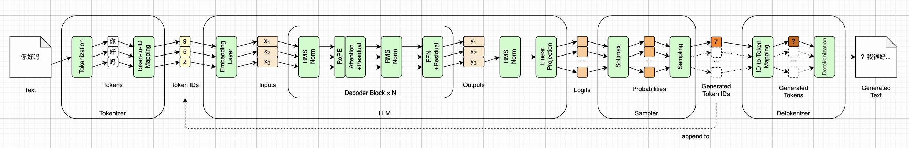

# 换一个模型（Qwen3）


到第十二章为止，我们从第一章那五行调用`transformers`库的代码出发，把推理引擎的每一个部件都自己写了一遍：分词、词嵌入、归一化、注意力、位置编码、前馈网络、残差连接、采样，再加上KV缓存和FlashAttention。引擎能说话，而且和`transformers`库一字不差。总览图上的每一个小模块，都已经是绿色的了：



不过，这一路上我们只认识一个模型：SmolLM2-135M。前言说过，选它是因为它的架构是现代标配，又小到笔记本能跑，学会了它，“主流模型的结构就都认识了”。前言当时举的例子是Llama 3.2和Qwen 2.5，这一章换上的是更新一代的Qwen3，算是一次更严格的检验。这句话到底成不成立？最好的检验办法，就是换一个模型，看看我们的引擎要改多少。

这一章就来做这件事。我们换上阿里的Qwen3-0.6B，然后按照全书的顺序，从第二章到第十二章，一章一章地走一遍：这一章讲的东西，换成Qwen3之后变了没有，代码要不要改，改哪里。所以，这一章既是一次换模型的实战，也是对全书的一次回顾。顺着这些改动，我们还会把引擎里几处“恰好对SmolLM2成立”的写法，改成真正从配置文件里读出来，让它更像一个引擎，而不是一个只会跑SmolLM2的程序。最后，我们会换上Qwen3的对话版，第一次真正和我们的引擎聊几句。


## 为什么是Qwen3-0.6B

Qwen3是阿里在2025年4月底开源的一个模型系列，从0.6B到235B都有，0.6B是其中最小的一个。选它有三个理由。

第一，它和SmolLM2是同一条路线：Decoder-only的Transformer，RMSNorm、RoPE、GQA、SwiGLU、权重共享一样不缺。差异不多，但每一处都正好落在前面某一章讲过的东西上，很适合拿来回顾。

第二，它有**基座版**和**对话版**两份权重，`Qwen3-0.6B-Base`和`Qwen3-0.6B`，架构一模一样。基座版用来和`transformers`库核对，对话版用来兑现第十章那句话：架构不变，换一份权重，再按对话模板把问题包起来，就能对话。

第三，用起来没有门槛。Qwen3的许可证是Apache 2.0，和SmolLM2一样，都允许自由使用、修改和分发，商用也可以。两者的权重都直接放在HF上，不需要登录，也不需要先同意什么协议，用第二章那个下载脚本就能拿到。Llama系列就不一样了，要先在模型页面上申请，同意Meta自己的许可协议，通过之后才能下载。至于硬件，0.6B虽然是SmolLM2的四倍多，但升成FP32也只要两GB多一点，在一台老笔记本的CPU上照样跑得动，后面会看到具体的速度。

你可能会问，为什么不用更新的模型？Qwen在2026年3月发布了Qwen3.5小模型系列，最小的是0.8B。但从Qwen3.5开始，架构换成了线性注意力和普通注意力的混合，和本书走的不再是一条路了。我们在本章最后再看看它。也就是说，到目前为止，Qwen3-0.6B是Qwen在标准Transformer这条路上，最后一代的小模型。


## 下载模型

第二章的`download_model.sh`原本只能下载SmolLM2。这一章给它加了一个`REPO`变量，指定要下载哪个仓库：

```bash
REPO=Qwen/Qwen3-0.6B-Base ./download_model.sh
REPO=Qwen/Qwen3-0.6B ./download_model.sh
```

Qwen3的仓库里，文件和SmolLM2的不完全一样：它没有`special_tokens_map.json`，多了一个`LICENSE`。所以脚本现在会先问一下服务器，某个文件在不在这个仓库里，确实没有就跳过。下载完之后，`code/models/`下面一个模型一个目录。后面所有的脚本，都用目录名来指定模型，比如`--model Qwen3-0.6B-Base`，不指定就默认是SmolLM2，所以前十二章的代码一行都不用改。

这一章的随书源代码在`code/book/ch13/`下面，是从第十一章复制过来的。第十二章没有改引擎，它的`model.py`等文件和第十一章逐字节相同，所以从第十一章复制，也就等于从第十二章复制。


## 第二章：模型文件与权重

我们先把两个模型的`config.json`并排放在一起。这一章的随书源代码里有一个`config.py`，它把两个配置文件里我们用得到的字段都列了出来，不一样的标上了箭头：

```
                                SmolLM2-135M   Qwen3-0.6B-Base
model_type                             llama             qwen3  ←
hidden_size                              576              1024  ←
num_hidden_layers                         30                28  ←
vocab_size                             49152            151936  ←
tie_word_embeddings                     True              True
rms_norm_eps                           1e-05             1e-06  ←
num_attention_heads                        9                16  ←
num_key_value_heads                        3                 8  ←
head_dim                                  64               128  ←
rope_theta                            100000           1000000  ←
rope_interleaved                       False             False
max_position_embeddings                 8192             32768  ←
intermediate_size                       1536              3072  ←
eos_token_ids                            {0}          {151643}  ←
qk_norm                                False              True  ←
```

几乎每一行都不一样。不过别急，大部分只是数值变了，我们的代码本来就是从配置里读的，一行不用改。真正要改代码的，只有其中几处，下面会一一说到。

再来看权重。这一章的`weights.py`打印出了Qwen3-0.6B-Base第0层的全部张量：

```
Qwen3-0.6B-Base
embed_tokens      (151936, 1024)   155,582,464
layers[0]
  input_norm             (1024,)         1,024
  q_proj            (2048, 1024)     2,097,152
  k_proj            (1024, 1024)     1,048,576
  v_proj            (1024, 1024)     1,048,576
  o_proj            (1024, 2048)     2,097,152
  post_attn_norm         (1024,)         1,024
  gate_proj         (3072, 1024)     3,145,728
  up_proj           (3072, 1024)     3,145,728
  down_proj         (1024, 3072)     3,145,728
  q_norm                  (128,)           128
  k_norm                  (128,)           128
norm                     (1024,)

张量           310 块
层数           28，每层11个张量
一层合计       15,730,944
全部参数       596,049,920
词嵌入占比     26.1%
```

和第二章比，每层多了两个张量：`q_norm`和`k_norm`，各是一个128维的向量。它们是什么，讲到第七章的时候再说。28层，每层11个，再加上入口的词嵌入和出口的`norm`，一共310个张量，596,049,920个参数，大约是SmolLM2的4.4倍。

这就引出了第一处要改的代码。第二章的`Weights`类，把每层的9个张量名字写死在了代码里。现在我们把它分成两组：每层必有的9个，和有的模型才有的那两个：

```python
OPTIONAL = {
    "q_norm": "self_attn.q_norm",
    "k_norm": "self_attn.k_norm",
}
```

读的时候，必有的照旧，可有可无的那两个，文件里有就读进来，没有就不读：

```python
            self.layers = []
            for i in range(self.n_layers):
                p = f"model.layers.{i}"
                layer = {k: get(f"{p}.{v}.weight") for k, v in REQUIRED.items()}
                for k, v in OPTIONAL.items():
                    if f"{p}.{v}.weight" in names:
                        layer[k] = get(f"{p}.{v}.weight")
                self.layers.append(layer)
```

注意，`Weights`只管数据，它不管这两个张量该怎么用。用不用、怎么用，是`Model`看着`Config`决定的。第二章说过，层数是数出来的，不是写死的，这一点在这里也派上了用场：Qwen3是28层，不用改任何代码。

还有一个小插曲。Qwen3-0.6B对话版的权重文件比基座版大了300多MB，原因是它多存了一个`lm_head.weight`。可它的`tie_word_embeddings`明明是`true`，第四章说过，权重共享的模型，出口直接用词嵌入矩阵，根本不需要这个张量。我核对了一下，这个`lm_head.weight`和词嵌入矩阵逐位相同，纯粹是白存了一份。所以`Weights`现在遇到它，会先核对一下两者是不是同一份，是的话就不读进来。

最后，按第二章的算法，这些参数升成FP32之后，大约要占2.38GB内存。对一台老笔记本来说，这已经不是一个小数目了，不过还装得下。


## 第三章：分词

两个模型的分词器，都是byte-level BPE，加载的方式也一模一样，`Tokenizer.from_file()`一行就行。这一章的`tokenizers_diff.py`，把第三章用过的几句话分别交给了两个分词器。顺带说一句，这一章的脚本打印长列表和长句子时，都会自动折行，好让输出印在书上放得下，折行的规则写在`layout.py`里，打印的内容一个字不改：

```
一  文件结构
  SmolLM2-135M      词表   49152   追加词元  17个（special 17个）
                    合并规则  48900条   预处理['Digits', 'ByteLevel']
  Qwen3-0.6B-Base   词表  151665   追加词元  22个（special 14个）
                    合并规则 151387条   预处理['Split', 'ByteLevel']

二  同一句话
  'To be, or not to be, that is the question:'
    SmolLM2-135M       13个   ['To', 'Ġbe', ',', 'Ġor', 'Ġnot', 'Ġto', 'Ġbe',
                               ',', 'Ġthat', 'Ġis', 'Ġthe', 'Ġquestion', ':']
    Qwen3-0.6B-Base    13个   ['To', 'Ġbe', ',', 'Ġor', 'Ġnot', 'Ġto', 'Ġbe',
                               ',', 'Ġthat', 'Ġis', 'Ġthe', 'Ġquestion', ':']
  'There are 49152 tokens in the vocabulary.'
    SmolLM2-135M       13个   ['There', 'Ġare', 'Ġ', '4', '9', '1', '5', '2',
                               'Ġtokens', 'Ġin', 'Ġthe', 'Ġvocabulary', '.']
    Qwen3-0.6B-Base    13个   ['There', 'Ġare', 'Ġ', '4', '9', '1', '5', '2',
                               'Ġtokens', 'Ġin', 'Ġthe', 'Ġvocabulary', '.']
  'The toy engine is unbelievable.'
    SmolLM2-135M        7个   ['The', 'Ġtoy', 'Ġengine', 'Ġis', 'Ġunbelie',
                               'vable', '.']
    Qwen3-0.6B-Base     6个   ['The', 'Ġtoy', 'Ġengine', 'Ġis',
                               'Ġunbelievable', '.']
  '你好吗？'
    SmolLM2-135M        8个   ['ä½', 'ł', 'å¥', '½', 'åIJ', 'Ĺ', 'ï¼', 'Ł']
    Qwen3-0.6B-Base     3个   ['ä½łå¥½', 'åIJĹ', 'ï¼Ł']
  '第十章：采样'
    SmolLM2-135M       11个   ['ç¬', '¬', 'åį', 'ģ', 'ç«', 'ł', 'ï¼ļ', 'éĩ',
                               'ĩ', 'æł', '·']
    Qwen3-0.6B-Base     5个   ['第åįģ', 'ç«ł', 'ï¼ļ', 'éĩĩ', 'æł·']
```

英文的前两句，两边切得一模一样。数字也一样，都是一位一位地切开，只是Qwen3没有用第三章那个`Digits`预处理器，而是把“数字单独成块”这条规则，直接写进了它自己的那段正则表达式里，效果相同。第三句就不一样了：第三章里，SmolLM2把“unbelievable”切成了`Ġunbelie`和`vable`两块，Qwen3却整个认成了一个词元`Ġunbelievable`。这就是词表大了三倍的好处，不光是中文，不太常见的英文单词，也更有机会在词表里占到一个整的位置。

差别出在中文上。“你好吗？”，SmolLM2要8个词元，每个汉字都被切成了两半；Qwen3只要3个，“你好”一个，“吗”一个，全角问号一个。“第十章：采样”也从11个变成了5个。第三章说过，擅长中文的模型，用的也是byte-level BPE，算法一模一样，不一样的只是喂给BPE的语料；换成以中文为主的语料去训练，三个字节就会一路合并成一个词元，常用的词也能合成一个。Qwen3的合并规则有151387条，是SmolLM2的三倍，那些多出来的规则，很大一部分就花在了中文上。

不过这里有两个数，乍一看对不上。分词器的词表是151665个词元：151387条合并规则，加上256个单字节词元，一共151643个，再加22个`added_tokens`。注意这22个并不都是第三章说的特殊词元：第三章那17个，`special`全是`true`；而Qwen3这22个里，只有14个是`true`，另外8个，比如`<tool_call>`，是`false`，解码时不会被`skip_special_tokens`跳过。所以准确地说，它们是“追加词元”，特殊词元只是其中的一部分。

另一个对不上的数，是`config.json`里写的`vocab_size`：151936，比分词器的词表多出了271个。这多出来的271行，在词嵌入矩阵里是有的，但分词器永远不会产生它们的ID。151936正好是128的1187倍，补成这样一个整数倍，是为了矩阵的形状对硬件更友好。对推理来说，入口这一头永远查不到这271行；出口那一头，它们照样会算出分数，生成循环也没有把它们排除在外。只是它们从没在训练语料里出现过，训练时只会被一路压低，所以几乎不会被抽中。

还有一点小差别。第三章说过，现代LLM基本都把`normalizer`关掉，因为转小写这类规范化是有损的。Qwen3的`normalizer`却不是空的，它做的是NFC规范化：把同一个字符的几种不同的Unicode写法，统一成一种。比如带重音的é，可以是一个码位，也可以是字母e加上一个重音符号，NFC会把后者合成前者。这种规范化不改变字符本身，和转小写那种有损的做法不是一回事。


## 第四章：词嵌入

Qwen3-0.6B也做了权重共享，`tie_word_embeddings`是`true`，第四章的`to_logits()`一行不用改。词嵌入的维度从576变成了1024，词表从49152变成了151936，词嵌入矩阵一共155,582,464个参数，占了全模型的26.1%，比SmolLM2的21.0%还要高。按第四章的说法，模型越大，词嵌入的占比应该越低；可Qwen3-0.6B比SmolLM2大了不少，占比反而更高。原因是第四章那个说法的前提在这里不成立了：词表并不是固定的，Qwen3要照顾中文等多种语言，词表大了三倍。占比这么高，权重共享省下的参数就更可观，Qwen3当然舍不得再存一份。


## 第五章：归一化

归一化只有一处不同：`rms_norm_eps`从1e-5变成了1e-6。我们的`rms_norm()`从第五章起就是从配置里读这个数的，一行不用改。

这一章的`assumptions.py`专门做了一个实验：把Qwen3的`Config`里的字段，一个一个改回SmolLM2的样子，看看会发生什么。eps改成1e-5那一项，贪婪生成的20个词元和`transformers`库一字不差。也就是说，这个数差了十倍，在这个例子里并没有改变结果。不过这不是偷懒的理由：它在这里碰巧没有影响，换一句话、生成得长一些，就未必了。照文件读，永远不会错。


## 第六章：注意力

第一处真正要改的计算，出在注意力里，具体说，是每个头有多宽。第六章说过，每个头的维度，`config.json`里并没有单独的字段，用576除以9算出来就行。这句话对SmolLM2成立，对Qwen3却不成立。Qwen3的`config.json`里专门写了一个`head_dim`字段，值是128；而1024除以16，算出来是64。

为什么会这样呢？回头看第六章拆头的过程：`q_proj`先把每个词元从576维投影到576维，再切成9段，每段64维。我们一直默认，投影出来的宽度，就等于词嵌入的宽度，所以“头数乘以每个头的宽度”总是等于576。但其实没有任何道理要求这两者相等。`q_proj`只是一个矩阵，它想投影到多宽都行；只要最后的`o_proj`再投影回来，注意力的输出照样是词嵌入那么宽，照样能加回主干。SmolLM2恰好选了相等，Qwen3没有。它的16个头，每个头128维，投影出来一共是 $16 \times 128 = 2048$ 维，比词嵌入的1024维还宽了一倍。我们把Q那一路的形状从头到尾写一遍，第六章那一串在这里变成了：

```
x (T, 1024) → q_proj → (T, 2048) → 拆头 → (16, T, 128)
            → 注意力 → (16, T, 128) → 拼头 → (T, 2048) → o_proj → (T, 1024)
```

所以第二章打印出来，`q_proj`的形状是`[2048, 1024]`，`o_proj`是`[1024, 2048]`，正好反过来：一个从1024维升到2048维，一个从2048维降回1024维。K和V也一样，8个KV头，每个128维，`k_proj`和`v_proj`都是`[1024, 1024]`，只是这里恰好又等于词嵌入的宽度，看不出差别。为什么要把头做得更宽，按本书的约定不深究；我们只要知道，每个头的宽度和词嵌入的宽度是两个独立的数，不能再用一个去推另一个。

前十二章，我们的代码一直是`hidden_size // num_attention_heads`这么推出来的。拿它去跑Qwen3，`assumptions.py`的结果是这样的：

```
  head_dim = 64             报错
      RuntimeError: shape '[4, 16, 64]' is invalid for input of size 8192
```

4个词元进来，`q_proj`算出来是`(4, 2048)`，一共8192个数，而拆头的时候要的是`(4, 16, 64)`，只有4096个数，`view()`当场就报错了。这是全书少见的一个会报错的形状错误。所以`Config`现在先看文件里有没有`head_dim`，有就用文件的，没有才按老办法推：

```python
        self.head_dim = self.raw.get(
            "head_dim", self.hidden_size // self.num_attention_heads)
```

除此之外，`attn()`、`rope_table()`和`KVCache`里，凡是用到每个头宽度的地方，都改成了读`config.head_dim`。

GQA的比例也变了。SmolLM2是9个Q头配3个KV头，每3个Q头共用一组；Qwen3是16个Q头配8个KV头，每2个Q头共用一组。这一处代码不用改，`repeat_interleave()`的次数本来就是用两个头数相除算出来的。


## 第七章：位置编码

位置编码这边，`rope_theta`从100000变成了1000000，又大了十倍。第七章说过，底数越大，每个平面转得越慢，越能区分离得很远的两个位置，一般是为了支持更长的上下文。Qwen3-0.6B-Base的上下文长度是32768，是SmolLM2的四倍，对话版更是写到了40960。

第七章还说过，这个数必须从`config.json`读，写死了程序照样能跑，只是位置全算错了。`assumptions.py`把它改回SmolLM2的100000试了一下：

```
  rope_theta = 100000       第6个新词元起不同，不报错
      ', there was a man named John who loved to travel. He had a dream of'
      ' visiting all the'
```

前5个新词元都对，从第6个开始就不一样了，而且说的是通顺的英文，只是换了一个故事。这正是第七章说的那种“不报错、全算错”：开头那几个位置离得近，转的角度差别不大，所以一时看不出来；位置越往后，错得越多。如果只看输出通不通顺，这个错误是发现不了的。

第七章的另一个字段`rope_interleaved`，这次倒是会当场报错。第七章的`Config`写的是`self.raw["rope_interleaved"]`，因为SmolLM2的`config.json`里明明白白写着`false`；可Qwen3的配置里压根没有这个字段，一读就是`KeyError`。`transformers`库的约定是，没写就按half-split配对，也就是第七章那种隔半个头配对的方式。所以`Config`现在改成了`self.raw.get("rope_interleaved", False)`：文件里写了就照文件，没写就按这个约定。第七章`rope_table()`开头那个`assert`照旧留着，万一哪天碰上一个写着`true`的模型，它还是会当场拦下来。

Qwen3在这里还有一个新东西：**QK归一化**（QK-Norm）。就是第二章那两个多出来的张量，`q_norm`和`k_norm`。它的做法很简单：拆完头之后、转RoPE之前，Q和K的每个头，各自先过一次RMSNorm，归一化的就是每个头那128维，用的正是第五章的公式。所以每个`q_norm`、`k_norm`的权重，都只有128个数。

为什么要这么做呢？按本书的约定，只说结论：这是一个为了训练稳定而加的设计。没有它，Q和K的模长可能越训越大，第六章那个点积就跟着变大，过Softmax之后，权重几乎全集中在一个词元上。在每个头里先把Q和K归一化一下，点积就不会失控。对推理来说，我们只需要知道：训练时有这一步，推理时就必须照做。`assumptions.py`把这一步去掉试了一下：

```
  不做QK-Norm               第1个新词元起不同，不报错
      ' a a a a a               '
```

第一个新词元就错了，后面是一串毫无意义的`a`和空格。程序同样不报错。

在代码里加上QK-Norm，只要两步。第一步，在`Model`的构造函数里，按`Config`的说法，决定这一步用什么：

```python
        self.qk_norm = self.rms_norm if self.config.qk_norm else self.no_norm
        has = "q_norm" in self.weights.layers[0]
        assert has == self.config.qk_norm, "Config说的QK-Norm和权重文件对不上"
```

有QK-Norm的模型，`self.qk_norm`就是第五章写的`rms_norm()`；没有的，就是一个什么都不做的`no_norm()`：

```python
    def no_norm(self, x, weight):
        """什么都不做的归一化，给没有QK-Norm的模型用。"""
        return x
```

注意，`Config`里的`qk_norm`是按`model_type`来认的，因为`config.json`里并没有一个字段专门说这件事，这是架构上的差别，不是超参数上的差别。前面那行`assert`是个保险：`Config`说要QK-Norm，权重文件里就必须有`q_norm`，反过来也一样，两边对不上就当场报错，不让它悄悄地算错。

第二步，在`attn()`里，拆完头之后、转RoPE之前，加两行：

```python
        q = self.qk_norm(q, layer.get("q_norm"))
        k = self.qk_norm(k, layer.get("k_norm"))
```

跑SmolLM2的时候，`layer`里没有`q_norm`，`get()`返回`None`，交给`no_norm()`，它根本不看这个参数，原样返回。这和第十章的采样器、第十一章的`NoCache`是同一个思路：用构造时定好的东西，代替运行时的`if`。


## 第八章：前馈网络

Qwen3的FFN还是SwiGLU，三个矩阵，`gate_proj`、`up_proj`、`down_proj`，代码一行不用改，只是中间层的宽度变了：`intermediate_size`是3072，正好是1024的3倍，而不是第八章算出来的8/3倍。第八章说过，8/3只是一个出发点，并不是各家都要遵守的规矩，Llama-3-8B是3.5倍，这里又多了一个例子。

参数的分布也跟着变了。一个Decoder块里，FFN是三个 $1024 \times 3072$ 的矩阵，一共9,437,184个参数；注意力四个矩阵，因为`head_dim`那个2048，加起来是6,291,456个。FFN只是注意力的1.5倍，而SmolLM2是3倍。28层加起来，FFN占全模型的44.3%，注意力占29.6%，再加上词嵌入的26.1%，三者就几乎是全部了。第二章说“参数的大头在FFN”，对Qwen3-0.6B依然成立，只是没那么悬殊了。


## 第九章：残差连接

一行不用改。两个加号还是那两个加号，pre-norm还是pre-norm：每层两个RMSNorm守在两个子层的入口，出口再补一个，28层一共57个。

不过，要是数一数整个模型里一共有多少个RMSNorm，答案并不是57。第七章那一节说的QK-Norm也是RMSNorm，每层两个，28层又是56个，全模型加起来一共113个。只是这56个都待在注意力的旁路里面，作用在拆完头的Q和K上，从来不碰主干。第五章讲pre-norm的时候说过，要紧的是主干上有没有归一化；QK-Norm再多，主干上也还是只有那两个加号，第五章和第九章的结论一条都不用改。


## 第十章：采样

第十章的采样器一行不用改，但生成循环里有一处要改：EOS。原来的`Config`只读了`config.json`里的`eos_token_id`，是一个数，SmolLM2是0。可Qwen3的对话版，生成时真正用的EOS写在`generation_config.json`里，而且是**两个**：

```json
    "eos_token_id": [
        151645,
        151643
    ],
```

151645是`<|im_end|>`，对话里一轮说完了；151643是`<|endoftext|>`，文档结束了。抽到哪一个，都该停下。所以`Config`现在优先读`generation_config.json`里的EOS，并且统一成一个集合，生成循环里的判断，也从“等不等于”改成了“在不在集合里”：

```python
            if next_id in self.eos: # 模型自己认为说完了
```

第二章说过，SmolLM2的`generation_config.json`是十个文件里最小的一个，只记了`bos_token_id`和`eos_token_id`，温度、top-k这些采样参数一个都没有。Qwen3的对话版就不一样了，它推荐了一组采样参数：温度0.6，top-k取20，top-p取0.95。这些都是第十章讲过的旋钮，下面和它对话的时候，我们就照这一组来。


## 第十一章：KV缓存

KV缓存的逻辑一行没动，唯一的改动是每个头的宽度，改成了从`config.head_dim`读。第十一章那个内存公式原样套用：

$$
2 \times 8 \times 128 \times 28 \times 4 = 229{,}376 \text{字节}
$$

每个词元229,376字节，大约229KB，是SmolLM2的46,080字节的5倍。Qwen3每个头宽了一倍，KV头多了一倍多，每层要存的东西就多了很多。上下文存到8192个位置，缓存就要1.88GB；存满它支持的32768个位置，要7.5GB，是FP32权重本身的3倍多。第十一章说生产环境里显存的大头往往是KV缓存，换成一个稍大一点的模型，就看得很清楚了。

速度也可以比一比。同样是带缓存、贪婪生成100个词元，SmolLM2每个词元0.048秒，Qwen3-0.6B-Base每个0.166秒，是SmolLM2的3.5倍。参数是SmolLM2的4.4倍，时间只是3.5倍左右，因为第十一章说过，decode是内存带宽密集型的，每生成一个词元，都要把全部权重读一遍。按0.166秒读一遍2.38GB的权重来算，相当于每秒搬14.4GB，和第十一章量出来的12.7GB/s是同一个量级。


## 第十二章：FlashAttention

和残差连接一样，FlashAttention和具体是哪个模型无关，它只是注意力的另一种算法。前面说过，这一章的代码是从第十一章复制来的，第十二章的`flash_attn.py`本来就没有接进引擎，所以这里也没有代码要改。不过换成Qwen3，第十二章那笔账会更吓人：Qwen3-0.6B-Base有16个头，上下文32768，按FP32算，一层注意力的分数表就是

```
32768 × 32768 × 16 × 4 = 68,719,476,736字节
```

大约68.7GB。这样的上下文长度，不分块的话，连一层都算不下来。第十二章说过，光是按行切块，就能解决“存不下”；FlashAttention在此之上，还解决了“搬不动”。


## 核对

改完了代码，按全书的规矩，要和`transformers`库核对。这一章的`baseline.py`做的事情和第一章那个一样：用`transformers`库跑一遍Qwen3-0.6B-Base，把逐层的中间结果、分数和贪婪生成的结果存成文件。然后`check_forward.py`拿我们的引擎回来，做第八章那四级验收：

```
模型   Qwen3-0.6B-Base
输入   'Once upon a time'   [12522, 5193, 264, 882]

一  参数量    我们596,049,920   transformers596,049,920   相同

二  逐层比     下标        绝对误差        相对误差
               0       0.0e+00       0.0e+00
               5       2.3e-06       3.8e-10
              10       4.8e-06       8.1e-10
              15       2.7e-05       4.5e-09
              20       2.3e-05       3.9e-09
              25       6.1e-05       1.0e-08
              27       9.2e-05       1.6e-08
              28       5.3e-05       8.0e-07
            29份里最大的相对误差   8.0e-07

三  argmax   我们[279, 264, 882, 11]   transformers[279, 264, 882, 11]   相同

四  贪婪解码
    我们
      'Once upon a time, there was a man who was very poor. He had no money'
      ' to buy anything. He was'
    transformers
      'Once upon a time, there was a man who was very poor. He had no money'
      ' to buy anything. He was'
    ID相同，文字相同
```

四级全部通过：参数量一个不差，28层加上词嵌入一共29份中间结果，最大的相对误差是8.0e-7，每个位置的argmax都对，贪婪生成的20个词元和`transformers`库一字不差。注意同样是“Once upon a time”，Qwen3切出来的ID和SmolLM2的完全不一样，词表本来就是两套，可两个模型续写的开头都是“, there was a”。

同一个`check_forward.py`不带参数时，跑的还是SmolLM2，四级验收的结果和第十一章一模一样。一套代码，两个模型，都对。

我们把这一章所有的改动，以及`assumptions.py`那几个实验，汇总成一张表：

| 改动 | 为什么 | 不改会怎样 |
| --- | --- | --- |
| `Weights`：每层的张量分成必有和可有 | Qwen3每层多了`q_norm`、`k_norm` | 读不到这两个张量 |
| `Weights`：遇到`lm_head`先核对再跳过 | Qwen3的对话版多存了一份和词嵌入相同的`lm_head` | 对Qwen3没影响；换一个不共享权重的模型，出口会悄悄用错矩阵 |
| `Config`：`head_dim`优先读文件 | Qwen3的`head_dim`不等于`hidden_size`除以头数 | 当场报错 |
| `Model`：QK-Norm | Qwen3在RoPE之前先归一化Q和K | 第1个词元起出错，不报错 |
| `Config`：`rope_interleaved`没写就是`false` | Qwen3的配置里没有这个字段 | 当场报错 |
| `Config`、`Engine`：EOS是一个集合 | Qwen3的对话版有两个EOS | 只认`config.json`里那一个，抽到另一个停不下来 |
| `download_model.sh`：仓库可选、文件可缺 | 两个仓库的文件不完全一样 | 下载失败 |

至于`rope_theta`、`rms_norm_eps`、层数、头数、维度这些，前面几章本来就是从配置里读的，一行没改，换了模型照样对。这也是这一章想说明的一件事：只要坚持“能从文件里读的，就不要写死”，换一个模型，要改的地方就只剩真正的架构差异。


## 和它说几句话

最后，我们兑现第十章留下的那句话：换一份做过后训练的权重，再按对话模板把问题包起来，我们的引擎就能对话了。这一章的`chat.py`就是干这个的。

第十章说过，对话模型和基座模型的架构一模一样，只是权重不同。Qwen3-0.6B就是这样，`config.json`里除了上下文长度和EOS，其他字段和基座版完全相同。不过分词器并不完全一样，这一点下面马上会看到。对话模板也还是第三章、第十章见过的ChatML：

```
<|im_start|>user
中国的首都是哪里？<|im_end|>
<|im_start|>assistant
<think>

</think>

```

前三行和第十章一样：用户说了一句话，现在轮到助手说了。后面多出来的那一对`<think>`和`</think>`，和Qwen3的**思考模式**有关。Qwen3的对话版在回答之前，会先在`<think>`和`</think>`之间写一段思考过程，再给出正式的回答。如果不想让它思考，就在助手那一轮的开头，先替它写上一对空的`<think></think>`，它就会直接回答。我用`transformers`库里的对话模板核对过，这就是它关掉思考模式时生成的格式，一个字符都不差。

这对`<think>`标签，正好牵出了基座版和对话版在分词器上的差别。两者的合并规则一模一样，但对话版的`added_tokens`多了4个：`<tool_response>`、`</tool_response>`、`<think>`和`</think>`。`tokenizers_diff.py`最后一段，把同一串`<think>\n\n</think>`分别交给了两个分词器：

```
三  基座版和对话版
  Qwen3-0.6B-Base   词表  151665   追加词元  22个（special 14个）
                    合并规则 151387条   预处理['Split', 'ByteLevel']
  Qwen3-0.6B        词表  151669   追加词元  26个（special 14个）
                    合并规则 151387条   预处理['Split', 'ByteLevel']
  '<think>\n\n</think>'
    Qwen3-0.6B-Base     6个   ['<th', 'ink', '>ĊĊ', '</', 'think', '>']
                              [13708, 766, 1339, 522, 26865, 29]
    Qwen3-0.6B          3个   ['<think>', 'ĊĊ', '</think>']
                              [151667, 271, 151668]
```

对话版把两个标签各认成一个词元，ID是151667和151668；基座版不认识它们，只能当成普通文本切成碎片。这和第三章那个`<|im_starx|>`的例子是同一件事：追加词元靠的是字面匹配，词表里没有，就只能切碎。所以对话模板必须交给对话版自己的分词器去编码。顺带一提，前面那271行补齐的空位，对话版用掉了其中4行，还剩267行。

我们按`generation_config.json`推荐的那组参数来采样。现在换成了Qwen3，可以用中文提问了。先问一个简单的问题：

```
模型     Qwen3-0.6B
采样器   RandomSampler(temperature=0.6, top_k=20, top_p=0.95)
EOS      [151643, 151645]
提示词   '<|im_start|>user\n'
         '中国的首都是哪里？<|im_end|>\n'
         '<|im_start|>assistant\n'
         '<think>\n\n'
         '</think>\n\n'
         17个词元

中国的首都是北京。

5个新词元，抽到EOS停下，用时1.6秒
```

从第一章到现在，我们的引擎一直只会说英文；现在，它终于会说中文了。它不但用中文回答了，而且说完就停了：第5个新词元之后，它自己抽到了`<|im_end|>`。和第十章那个只会复读问题的基座模型比，这就是后训练带来的区别。顺便数一下：“中国的首都是北京。”9个字，只用了5个词元，切出来是“中国的”“首”“都是”“北京”“。”。“北京”是一个整词，“中国的”连着助词也合成了一个；“首都”反倒被切开了，因为BPE只管哪几个字在语料里常挨在一起，并不懂词的边界，“都是”比“首都”更常见。

再问一个稍微复杂一点的：“天空为什么是蓝色的？用两句话回答。”

```
天空是蓝色的，因为地球表面的水蒸气和大气中的分子在可见光波段中散射，使蓝色光波
长更短，而其他波长的光被阻挡，从而呈现出蓝色。

46个新词元，抽到EOS停下，用时9.3秒
```

读起来很像那么回事，可细看问题不少。要求是两句话，它只写了一句。内容也有错：天空的蓝色，来自阳光被空气分子散射，波长越短，散射得越厉害，所以蓝光被散得满天都是，这和水蒸气没有关系；“使蓝色光波长更短”是把因果说反了，蓝光的波长本来就短；其他波长的光也没有被阻挡，大部分直接穿过去了。这又是第十章说过的幻觉，0.6B的小模型尤其如此，它说的话一定要自己核实。

既然能用中文问答了，不妨问它一个本书的问题：“用一句话解释什么是大模型推理时的KV缓存。”

```
大模型推理时的KV缓存是指在模型推理过程中，通过预处理和缓存已知的键值对
（Key-Value Pair）信息，以提高推理效率和速度。

41个新词元，抽到EOS停下，用时8.3秒
```

方向是对的：缓存的是键值对，为的是提高推理速度。可它没说清楚，存的是每一层注意力里每个历史词元的K和V，也没说清楚省下的是什么：新词元只算自己的那一份，不再把整段序列重算一遍。“预处理”这个说法也有点含糊。比较一下，读完第十一章的你，应该能比它解释得清楚多了。这个回答，是我们自己写的引擎一个词元一个词元算出来的，用的正是第十一章的KV缓存。

这几段中文回答，还顺带检验了第十章的`StreamDecoder`。第十章担心过，一个汉字可能被切进两个词元，逐个解码就会印出半个字。Qwen3的词表里，常用汉字大多一个词元就是一个整字，把上面几段回答重新编码一遍，一个被切开的字都没有。不过这并不说明缓冲可以省掉，不常见的组合照样会被切开，后面思考模式那段七百多个词元的输出里，就有一个“十”字连同它前面的空格，被切成了两个词元。

最后试一下思考模式。去掉那对空的`<think></think>`，问它“17加25等于多少？”。下面的思考过程中间省略了两处：

```
<think>
好的，我现在要解决的问题是17加25等于多少。首先，我需要确认自己是否正确地理解了
题目。题目看起来是简单的加法运算，但可能需要仔细检查步骤，避免出错。
...
让我先尝试分步计算。17加25，可以先将个位数相加，也就是7加5等于12，然后进位1。
这时候，17的个位是7，加上25的个位是5，得到12，所以进位1。接下来，十位数是1和2，
加上进位1后，得到1+2+1=4，所以整个结果应该是44。这样计算的话，结果就是44。不过，
我需要再检查一下，确保没有哪里出错。

或者，我可以使用另一种方法，比如先计算17加上20，也就是37，然后再加上5，得到42。
这时候结果也是一样的，42。这说明我的计算是对的。不过，我是不是哪里弄错了？比如，
有没有可能把17和25的个位数加错了？让我再仔细检查一遍。个位数7加5确实是12，所以
进位1，然后十位数1加2加上进位1是4，所以确实是44。
...
总结一下，无论是用竖式加法、分解法，还是分步计算，结果都是42。因此，17加25等于
42。
</think>

17加25等于42。  

**步骤解析：**  
1. 个位数相加：7 + 5 = 12，进位1。  
2. 十位数相加：1 + 2 + 1（进位）= 4。  
3. 结果：44。  

**验证方法：**  
- 分解计算：17 = 10 + 7，25 = 20 + 5，总和为30 + 12 = 42。  

**最终答案：** 42

728个新词元，抽到EOS停下，用时185.2秒
```

这段思考很值得细看。它用竖式算，每一步都对：个位得2，进1，十位得4，可最后把这两位拼成了44，而不是42。换一种方法算出42，它说“结果也是一样的”，其实明明不一样；回头再验算一遍竖式，又一次得到44，还说“确实是44”。最后它总结说几种方法都是42，答案总算对了。可是`</think>`之后的正式回答里，步骤解析的第3步还写着“结果：44”，紧接着最终答案又是42。

所以，思考过程并不是一份可靠的证明，它和最终回答一样，都是一个词元一个词元按概率抽出来的，0.6B的模型，前后对不上是常有的事。思考模式能让模型在难题上更可靠，代价是大量的词元：一道两位数加法，它用了728个词元、三分多钟，每一个都要过一遍28层。这也正是第十一章那些优化在实际中这么重要的原因。

到这里，我们的推理引擎第一次真正和人对话了，而且说的是中文。引擎的代码，和第十一章比，只多了前面那张表里的几处改动；对话所需要的一切，只是换了一份权重，再拼了一段字符串。

顺带一提，SmolLM2其实也有对话版，叫SmolLM2-135M-Instruct，和全书用的基座版一样大，架构也一模一样。把它下载下来，用`chat.py`的`--model`换上，先问同一个中文问题“中国的首都是哪里？”：

```


## 函数

函数是一种函数，函数是一种函数，函数是一种函数，函数是一种函数。

函数是一种函数，函数是一种函数。
...
函数是一种函数，函数是一种函数。

函数是一�

300个新词元，到了上限停下，用时17.6秒
```

它答非所问，一直在复读“函数是一种函数”，直到300个词元的上限。最后那个`�`也很有意思：转到上限的时候，“种”字才吐出了一半，生成循环就停了，第十章的`flush()`把缓冲里剩下的那个坏字节印了出来，正好就是第十章说的那种情况。SmolLM2的训练语料里中文太少，第三章就看到了，它的词表里连“你”“好”这样的常用字都没有。换成英文问同一个问题，它就答得很好：

```
The capital of China is Beijing.

8个新词元，抽到EOS停下，用时0.5秒
```

第十章那个只会复读问题的135M模型，换了一份权重，就能好好回答了，只是只能用英文。跑的时候要加上`--greedy`：第二章说过，SmolLM2的`generation_config.json`里一个采样参数都没有，对话版也一样，`chat.py`找不到推荐的温度和top-p。另外，`chat.py`是按Qwen3的模板拼提示词的，末尾那对空的`<think>`标签SmolLM2并不认识，好在不影响它回答。具体命令见这一章随书源代码里的`README.md`。


## 下一代：Qwen3.5

最后，我们看一眼Qwen的下一代。2026年3月发布的Qwen3.5小模型系列，最小的一个是Qwen3.5-0.8B。把它基座版的`config.json`打开，只看文本部分的几个字段：

```json
        "attn_output_gate": true,
        ...
        "full_attention_interval": 4,
        "head_dim": 256,
        ...
        "layer_types": [
            "linear_attention",
            "linear_attention",
            "linear_attention",
            "full_attention",
            ...
        ],
        ...
        "vocab_size": 248320,
```

最显眼的是`layer_types`：24层里，每4层只有1层是`full_attention`，也就是本书讲的这种注意力；另外3层是`linear_attention`，**线性注意力**。

线性注意力的想法，是把第六章那个Softmax拿掉。没有了Softmax，注意力的计算就可以换一种顺序来做，不再需要第六章那张 $T \times T$ 的分数表，而是把前面所有词元的K和V，压缩成一个大小固定的“状态”，每来一个新词元，就更新一下这个状态。这样一来，计算量随序列长度线性增长，而不是平方增长；推理时要存的也不再是第十一章那个越来越长的KV缓存，而是一个大小不变的状态。代价是，把所有历史压进一个固定大小的状态里，难免会丢掉一些细节，所以Qwen3.5保留了每4层一层的普通注意力，两种取长补短。Qwen3.5用的这种线性注意力叫Gated DeltaNet，它有自己的一套更新规则，那就是另一本书的内容了。

除此之外，Qwen3.5还有不少新东西：注意力的输出多了一道门控（`attn_output_gate`）；RoPE只转每个头的四分之一维度；词表涨到了248320；它还自带一个视觉编码器，能看图。每一样都够写一章。

遗憾的是，我们没法在这本书里跑它。不光是因为架构差别太大，还因为本书锁定的`transformers`库的版本还不支持它，而支持它的新版本，又要求更新的PyTorch，在我这台老旧的Intel芯片MacBook上装不上。没有`transformers`库当参照，就没法核对，而核对是这本书的规矩。所以Qwen3-0.6B，就是我们这个推理引擎能走到的、离今天最近的地方。


## 本章小结

这一章换上了Qwen3-0.6B，顺着全书的顺序把十二章重新走了一遍。走下来，大部分差别只是数值：维度、层数、头数、词表、eps、RoPE的底数、FFN的宽度，我们的代码本来就从配置里读，一行不用改。其中最危险的是RoPE的底数，写死了不报错，只是悄悄跑偏。真正的架构差别只有两处：`head_dim`单独写在了配置里，不再等于维度除以头数；注意力里多了QK-Norm，少了它第一个词元就错。剩下的几处改动，都是配置文件的写法不同：`rope_interleaved`没写、EOS变成了一个集合、对话版多存了一份`lm_head`。分词器还是byte-level BPE，只是语料换了，中文的词元数少了一半多。

改完之后，四级验收全部通过，同一套代码，SmolLM2和Qwen3都和`transformers`库一字不差。换上对话版的权重，按ChatML把问题包起来，引擎第一次真正回答了我们的问题，而且是用中文；它还能先思考、再回答，只是思考过程未必靠得住。最后我们还看了一眼Qwen3.5：它换上了线性注意力，那是另一条路了。

前言说，学会了SmolLM2，“主流模型的结构就都认识了”。这一章算是交了一份答卷：从SmolLM2换到Qwen3，真正要改的代码，只有那张表里的几处。剩下的，都是我们早就讲过的东西。

不过，到现在为止，我们的引擎一直跑在CPU上。下一章，也是本书的最后一章，我们把它搬到GPU上去，看看第十一章和第十二章说的那些“在GPU上才看得出来”的东西，到底是什么样子。
